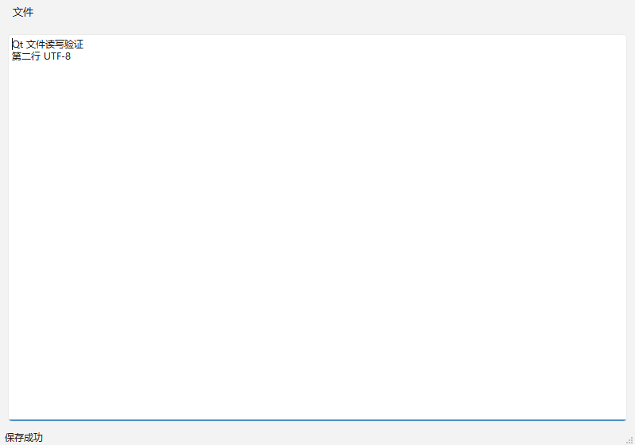
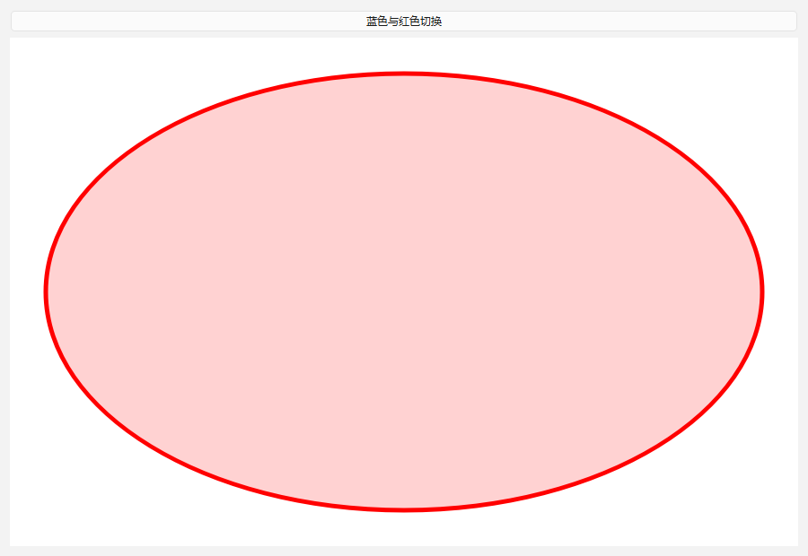

<div align="center">

# Qt Widgets Learning Path

**从第一扇窗口，到能解释、修改和验证的桌面交互。**

一份中文 Qt Widgets 学习教程：统一的 Qt Creator 项目模板、可编辑的 Designer 界面、完整源码、逐步讲解与运行截图。

[](https://github.com/13536309143/qt-widgets-learning-path/actions/workflows/build.yml)


[十一章学习目录](docs/README.md) · [项目模板与 UI 操作](docs/project-format.md) · [离线入口](开始学习.html) · [Word 教程](docs/print/Qt项目知识点详解.docx) · [安装与运行](docs/getting-started.md) · [完整实战](docs/practices.md) · [验证记录](docs/validation.md)

</div>

## 这份教程怎样学

所有项目按 Qt Creator 标准模板拆分：`main.cpp`、`widget/mainwindow.h`、对应 `.cpp` 与 `.ui`。每个项目都保留一个明确的学习目标：先观察效果，再理解对象与数据怎样流动，最后修改一个条件验证自己的判断。前半部分建立窗口、对象生命周期、信号槽与 Lambda 的基础；后半部分继续进入主窗口、对话框、布局、控件、事件和绘图。

- **52 个统一模板项目**：main.cpp 只启动窗口，逻辑拆入 Widget/MainWindow 类，每步有自己的 `.pro`。
- **55 份可编辑表单**：52 个主界面，以及组合控件和自定义对话框；固定控件、菜单和布局在 `.ui` 中，源码目录不提交生成的 `ui_*.h`。
- **11 章系统整理**：按概述、项目、窗口、按钮、信号槽、主窗口、对话框、布局、控件、事件、绘图组织，保留详细解释与练习。
- **4 个操作闭环**：文件读写与保存、对话框调用对比、事件过滤、状态驱动绘图。
- **两种构建入口**：保留 qmake 单步学习，也提供 CMake 批量构建与 CTest 检查。
- **真实运行截图**：截图与对应代码放在一起，可对照操作前后的状态。

教程适合具备基本 C++ 类、指针、引用与函数概念，正在学习 Qt Widgets 的读者。主要内容围绕桌面界面编程；后续可以继续补充线程、网络、数据库、模型视图和工程部署。

## 看看运行结果

<table>
<tr>
<td width="50%"><br>文件读取、编辑与安全保存</td>
<td width="50%"><br>修改状态后请求重绘</td>
</tr>
</table>

## 快速开始

### 在 Qt Creator 中运行一个项目

```sh
git clone https://github.com/13536309143/qt-widgets-learning-path.git
```

打开 `examples/02_01_first_window/02_01_first_window.pro`，选择与已安装 Qt 配套的 Kit，构建并运行。双击项目树中的 `widget.ui` 进入 Designer；按每个项目 README 的控件清单修改界面。想直接看完整应用交互，可以打开 `examples/07_06_text_editor/07_06_text_editor.pro`。

### 用 CMake 构建全部项目

需要 Qt 6 Widgets 开发库、支持 C++17 的编译器和 CMake 3.16+。将路径替换成自己的 Qt 安装目录：

```sh
cmake -S . -B build -DCMAKE_PREFIX_PATH="你的 Qt 安装目录"
cmake --build build --parallel 4
ctest --test-dir build --output-on-failure
```

只构建一个示例：

```sh
cmake -S . -B build-one -DQT_LESSON=07_06_text_editor -DCMAKE_PREFIX_PATH="你的 Qt 安装目录"
cmake --build build-one
```

Windows 上注意 Qt 与编译器的 MinGW/MSVC、32/64 位及运行库匹配。详细配置与常见错误见 [安装与运行](docs/getting-started.md)。

## 章节与项目使用同一套编号

- [第 1 章 Qt概述](docs/chapters/01-overview.md)：概念导读
- [第 2 章 创建Qt项目](docs/chapters/02-create-project.md)：02.1, 02.2
- [第 3 章 设置窗口属性](docs/chapters/03-window-properties.md)：03.1, 03.2
- [第 4 章 按钮的创建和属性设置](docs/chapters/04-buttons.md)：04.1, 04.2, 04.3
- [第 5 章 信号和槽机制（Lambda）](docs/chapters/05-signals-slots-lambda.md)：05.1, 05.2, 05.3, 05.4, 05.5, 05.6, 05.7, 05.8, 05.9, 05.10, 05.11, 05.12, 05.13, 05.14, 05.15, 05.16, 05.17, 05.18, 05.19, 05.20, 05.21, 05.22, 05.23, 05.24, 05.25
- [第 6 章 QMainWindow](docs/chapters/06-mainwindow.md)：06.1, 06.2, 06.3
- [第 7 章 对话框QDialog](docs/chapters/07-dialogs.md)：07.1, 07.2, 07.3, 07.4, 07.5, 07.6
- [第 8 章 布局管理器](docs/chapters/08-layouts.md)：08.1
- [第 9 章 常用控件](docs/chapters/09-widgets.md)：09.1, 09.2, 09.3, 09.4
- [第 10 章 Qt消息机制和事件](docs/chapters/10-events.md)：10.1, 10.2, 10.3, 10.4
- [第 11 章 绘图和绘图设备](docs/chapters/11-painting.md)：11.1, 11.2

每个项目是一节独立知识点，包含从真实源码提取的关键片段、逐段讲解、执行顺序、常见错误与动手验证。[查看全部 52 个知识点](docs/README.md) · [查旧编号](docs/project-renumbering.md)。

## 每章不止一段代码

详细知识点保留：要解决的问题 → 核心概念 → 执行顺序 → 参数和边界 → 完整源码 → 运行结果 → 常见错误 → 动手练习与答案。

例如，文件对话框一章会继续追到文件读取、UTF-8 编解码、写入失败和未保存关闭；绘图一章会解释为什么需要保存状态、调用 `update()`，以及为什么遮挡后仍能正确重绘。

## 仓库结构

```text
.
├── examples/                 # 52 个可独立构建的项目
│   ├── 02_01_first_window/
│   ├── 07_03_file_dialog/       # .pro、完整源码及 samples
│   ├── 07_06_text_editor/       # 文件读写与保存闭环
│   └── 11_02_interactive_paint/
├── docs/
│   ├── chapters/            # 十一章正式教程
│   ├── topics/              # 深入讲解与完整源码
│   ├── practices.md         # 综合练习与章节映射
│   ├── getting-started.md
│   └── validation.md
├── tests/local-results.json # 本机验证摘要
├── scripts/run.cmd          # Windows 已构建项目启动入口
└── CMakeLists.txt           # 全部项目的构建与检查入口
```

构建产物、个人 Qt 路径、Qt SDK 和原始课堂文档不属于仓库内容。每步的 `.ui`、qrc、图片和 GIF 则与代码一起提供。

## 验证情况

本机 Windows / Qt 6.12.0 / MinGW 13.1 / Release 环境下，52 个项目编译成功，52 项运行检查通过。部分早期检查是启动与截图的冒烟检查，后面的实战增加了文件读回、对话框顺序、事件处理和绘制像素等断言。

GitHub Actions 使用 Ubuntu 的 Qt 开发包重新构建和运行。跨平台结果以 Actions 实际执行为准；验证范围、手动练习项和环境差异见 [验证记录](docs/validation.md)。

## 资料与维护

本文以自己的学习顺序组织，并用 [Qt 官方文档](https://doc.qt.io/qt-6/qtwidgets-index.html) 校对 API 行为。具体章节提供对应原始文档链接。Qt 及相关商标属于其权利人。

发现错误欢迎提交 Issue；改进说明见 [CONTRIBUTING](CONTRIBUTING.md)。项目目前公开供阅读，尚未指定统一的代码与文档复用许可，公开可见不等同于已授予开源许可证。
