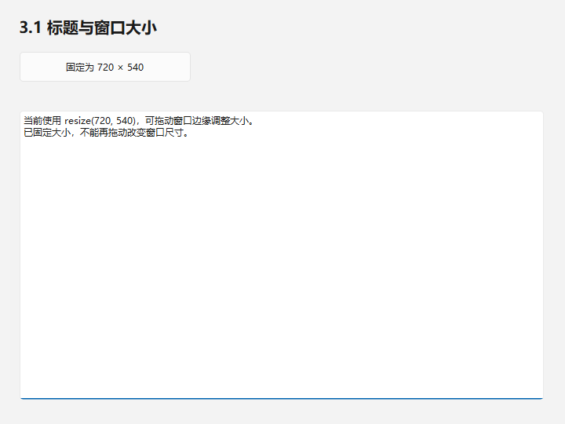
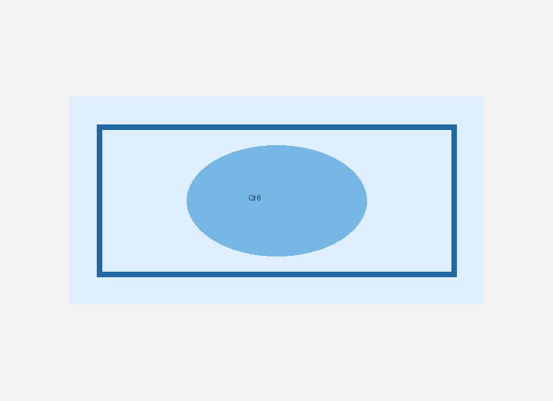

# 第 3 章 设置窗口属性

本章按项目逐个学习，每个项目对应一个知识点。先运行再读关键代码，最后做一次修改验证。[理论补充与复习](../foundations/03-window-properties.md)保留更完整的背景说明。

## 3.1 初始大小与固定大小

[单独阅读本知识点](../knowledge/03_01_window_size.md) · [打开完整项目](../../examples/03_01_window_size/README.md)

### 本项目要掌握什么

初始大小与固定大小。这一节只围绕这个核心问题阅读和修改程序。

### 关键代码在哪里

关键片段 1：[ widget.cpp 第 11 行起](../../examples/03_01_window_size/widget.cpp#L11)。以下代码从本项目源文件提取，完整上下文见源文件。

```cpp
connect(ui->runButton, &QPushButton::clicked, this,
        [this]()
        {
            setFixedSize(720, 540);
            writeLine("已固定大小，不能再拖动改变窗口尺寸。");
        });
writeLine("当前使用 resize(720, 540)，可拖动窗口边缘调整大小。");
```

### 逐段讲解

初始 geometry 在 widget.ui 中；setupUi 读入它。按钮连接建立时没有执行 setFixedSize，只有 clicked 发出后 Lambda 才设置最小和最大尺寸为同一个值。

[this] 让回调访问当前窗口，第三个参数 this 管理连接上下文；writeLine 同时展示结果并输出调试信息。

### 按执行顺序阅读

构造函数先准备界面与连接；交互发生后才进入回调。阅读时按“发送对象 → 信号或调用 → 回调里的数据 → 被修改对象 → 显示结果”追踪，不要把建立连接当成已经执行操作。

### 容易出错的地方与动手验证

先拖动边缘，再点击固定按钮后重试。固定大小会限制布局伸缩，不能把 resize 与 setFixedSize 当成同义词。

先写下预测，再修改一个条件重新构建。记录实际结果，并用本节代码中的变量、对象和调用顺序解释原因；仅仅没有报错不代表已经验证了所有分支。

### 运行结果



### 完整项目与界面文件

- [03_01_window_size.pro](../../examples/03_01_window_size/03_01_window_size.pro)
- [main.cpp](../../examples/03_01_window_size/main.cpp)
- [verify.h](../../examples/03_01_window_size/verify.h)
- [widget.cpp](../../examples/03_01_window_size/widget.cpp)
- [widget.h](../../examples/03_01_window_size/widget.h)
- [widget.ui](../../examples/03_01_window_size/widget.ui)

打开本项目 .pro，选择匹配的 Kit，构建运行；修改界面请打开 .ui，保存后重新构建。verify.h 只在传入 --verify 时执行检查。


## 3.2 资源路径与图像加载

[单独阅读本知识点](../knowledge/03_02_resources.md) · [打开完整项目](../../examples/03_02_resources/README.md)

### 本项目要掌握什么

资源路径与图像加载。这一节只围绕这个核心问题阅读和修改程序。

### 关键代码在哪里

关键片段 1：[ mainwindow.cpp 第 12 行起](../../examples/03_02_resources/mainwindow.cpp#L12)。以下代码从本项目源文件提取，完整上下文见源文件。

```cpp
QPixmap picture(":/images/demo.png");
if (picture.isNull())
    ui->imageLabel->setText("图片加载失败，请检查 qrc 资源路径。");
else
    ui->imageLabel->setPixmap(
        picture.scaled(600, 360, Qt::KeepAspectRatio, Qt::SmoothTransformation));
setWindowIcon(QIcon(":/images/demo.png"));
```

### 逐段讲解

:/images/demo.png 是 qrc 的资源路径，不是磁盘路径；构建系统把资源编入程序。isNull 检查图片是否成功加载。

scaled 返回处理后的图像，KeepAspectRatio 保留比例，SmoothTransformation 控制缩放质量；随后设置标签图像和窗口图标。

### 按执行顺序阅读

构造函数先准备界面与连接；交互发生后才进入回调。阅读时按“发送对象 → 信号或调用 → 回调里的数据 → 被修改对象 → 显示结果”追踪，不要把建立连接当成已经执行操作。

### 容易出错的地方与动手验证

改错别名观察失败提示，再恢复。构造时缩放一次不会自动适应以后所有窗口尺寸。

先写下预测，再修改一个条件重新构建。记录实际结果，并用本节代码中的变量、对象和调用顺序解释原因；仅仅没有报错不代表已经验证了所有分支。

### 运行结果



### 完整项目与界面文件

- [03_02_resources.pro](../../examples/03_02_resources/03_02_resources.pro)
- [assets.qrc](../../examples/03_02_resources/assets.qrc)
- [main.cpp](../../examples/03_02_resources/main.cpp)
- [mainwindow.cpp](../../examples/03_02_resources/mainwindow.cpp)
- [mainwindow.h](../../examples/03_02_resources/mainwindow.h)
- [mainwindow.ui](../../examples/03_02_resources/mainwindow.ui)
- [verify.h](../../examples/03_02_resources/verify.h)

打开本项目 .pro，选择匹配的 Kit，构建运行；修改界面请打开 .ui，保存后重新构建。verify.h 只在传入 --verify 时执行检查。


[返回总目录](../README.md)
