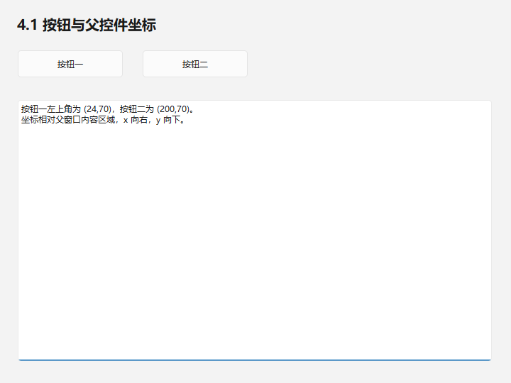
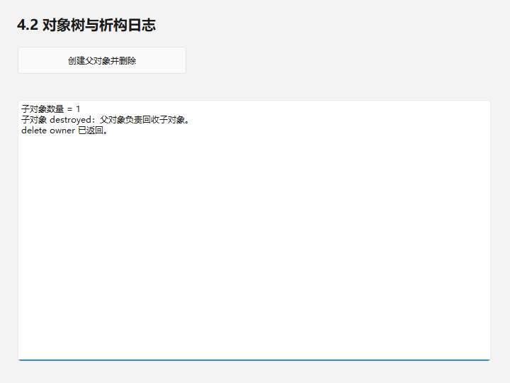
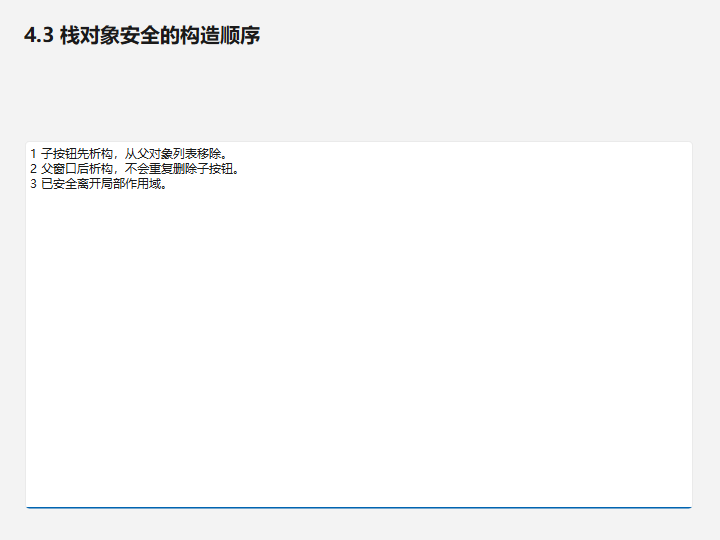

# 第 4 章 按钮的创建和属性设置

本章按项目逐个学习，每个项目对应一个知识点。先运行再读关键代码，最后做一次修改验证。[理论补充与复习](../foundations/04-buttons.md)保留更完整的背景说明。

## 4.1 按钮坐标与父控件

[单独阅读本知识点](../knowledge/04_01_buttons_coordinates.md) · [打开完整项目](../../examples/04_01_buttons_coordinates/README.md)

### 本项目要掌握什么

按钮坐标与父控件。这一节只围绕这个核心问题阅读和修改程序。

### 关键代码在哪里

关键片段 1：[ widget.ui 第 48 行起](../../examples/04_01_buttons_coordinates/widget.ui#L48)。以下是相关界面 XML 节选，完整表单保留在项目中。

```xml
  <widget class="QPushButton" name="firstButton">
   <property name="geometry">
    <rect>
     <x>24</x>
     <y>70</y>
     <width>150</width>
     <height>40</height>
    </rect>
   </property>
   <property name="text">
    <string>按钮一</string>
   </property>
  </widget>
```

### 逐段讲解

firstButton、secondButton 由 .ui 创建，geometry 的 x/y 是相对父控件内容区域的位置，width/height 是按钮尺寸。

代码只输出两组坐标用于对照，按钮并非在 writeLine 时生成。先看 .ui 中的 geometry，再看界面与日志。

### 按执行顺序阅读

先从 main.cpp 创建应用和窗口进入构造函数，再由 setupUi 根据 .ui 建立对象、属性与布局。对照上面的片段定位本节设置；show 后进入事件循环，界面才会持续响应操作。

### 容易出错的地方与动手验证

把一个按钮移入新容器，再比较相同坐标的位置；设置布局后应由布局控制位置。

先写下预测，再修改一个条件重新构建。记录实际结果，并用本节代码中的变量、对象和调用顺序解释原因；仅仅没有报错不代表已经验证了所有分支。

### 运行结果



### 完整项目与界面文件

- [04_01_buttons_coordinates.pro](../../examples/04_01_buttons_coordinates/04_01_buttons_coordinates.pro)
- [main.cpp](../../examples/04_01_buttons_coordinates/main.cpp)
- [verify.h](../../examples/04_01_buttons_coordinates/verify.h)
- [widget.cpp](../../examples/04_01_buttons_coordinates/widget.cpp)
- [widget.h](../../examples/04_01_buttons_coordinates/widget.h)
- [widget.ui](../../examples/04_01_buttons_coordinates/widget.ui)

打开本项目 .pro，选择匹配的 Kit，构建运行；修改界面请打开 .ui，保存后重新构建。verify.h 只在传入 --verify 时执行检查。


## 4.2 对象树的级联销毁

[单独阅读本知识点](../knowledge/04_02_object_tree.md) · [打开完整项目](../../examples/04_02_object_tree/README.md)

### 本项目要掌握什么

对象树的级联销毁。这一节只围绕这个核心问题阅读和修改程序。

### 关键代码在哪里

关键片段 1：[ widget.cpp 第 11 行起](../../examples/04_02_object_tree/widget.cpp#L11)。以下代码从本项目源文件提取，完整上下文见源文件。

```cpp
connect(ui->runButton, &QPushButton::clicked, this,
        [this]()
        {
            auto *owner = new QObject(this);
            auto *child = new QObject(owner);
            connect(child, &QObject::destroyed, this,
                    [this]() { writeLine("子对象 destroyed：父对象负责回收子对象。"); });
            writeLine("子对象数量 = " + QString::number(owner->children().size()));
            delete owner; // 删除父对象，会删除 child；不要再访问 child
            writeLine("delete owner 已返回。");
        });
```

### 逐段讲解

owner 是窗口的子对象，child 又以 owner 为父对象。connect 只登记 destroyed 的处理函数，真正销毁发生在 delete owner。

删除 owner 会清理其仍存活的子对象，child 的 destroyed 信号让日志显示释放过程；局部指针离开作用域不会代替 delete。

### 按执行顺序阅读

构造函数先准备界面与连接；交互发生后才进入回调。阅读时按“发送对象 → 信号或调用 → 回调里的数据 → 被修改对象 → 显示结果”追踪，不要把建立连接当成已经执行操作。

### 容易出错的地方与动手验证

删除 owner 后不能再解引用 child，也不应再手动删除同一 child。观察子对象日志与 delete 返回日志的先后。

先写下预测，再修改一个条件重新构建。记录实际结果，并用本节代码中的变量、对象和调用顺序解释原因；仅仅没有报错不代表已经验证了所有分支。

### 运行结果



### 完整项目与界面文件

- [04_02_object_tree.pro](../../examples/04_02_object_tree/04_02_object_tree.pro)
- [main.cpp](../../examples/04_02_object_tree/main.cpp)
- [verify.h](../../examples/04_02_object_tree/verify.h)
- [widget.cpp](../../examples/04_02_object_tree/widget.cpp)
- [widget.h](../../examples/04_02_object_tree/widget.h)
- [widget.ui](../../examples/04_02_object_tree/widget.ui)

打开本项目 .pro，选择匹配的 Kit，构建运行；修改界面请打开 .ui，保存后重新构建。verify.h 只在传入 --verify 时执行检查。


## 4.3 栈对象的构造与析构顺序

[单独阅读本知识点](../knowledge/04_03_stack_lifetime.md) · [打开完整项目](../../examples/04_03_stack_lifetime/README.md)

### 本项目要掌握什么

栈对象的构造与析构顺序。这一节只围绕这个核心问题阅读和修改程序。

### 关键代码在哪里

关键片段 1：[ widget.cpp 第 12 行起](../../examples/04_03_stack_lifetime/widget.cpp#L12)。以下代码从本项目源文件提取，完整上下文见源文件。

```cpp
{
    QWidget parent;
    QPushButton child("栈按钮", &parent);
    connect(&child, &QObject::destroyed, this,
            [this]() { writeLine("1 子按钮先析构，从父对象列表移除。"); });
    connect(&parent, &QObject::destroyed, this,
            [this]() { writeLine("2 父窗口后析构，不会重复删除子按钮。"); });
}
writeLine("3 已安全离开局部作用域。");
```

### 逐段讲解

先创建 parent，再创建以它为父控件的 child；离开花括号时逆序析构，child 先销毁并从父对象列表移除。

连接上下文是仍存活的主窗口，所以两个析构日志都能输出；Qt 对象树并不改变 C++ 自动对象的存储期。

### 按执行顺序阅读

本项目的主要实验在构造函数里立即执行：变量初始化 → 定义或连接 → 显式调用 → 显示结果。先在代码中圈出实际调用位置，再区分哪些语句只是定义或登记行为。

### 容易出错的地方与动手验证

画出两个对象的构造、析构时间线；不要把先构造的栈对象交给后构造且先析构的父对象管理。

先写下预测，再修改一个条件重新构建。记录实际结果，并用本节代码中的变量、对象和调用顺序解释原因；仅仅没有报错不代表已经验证了所有分支。

### 运行结果



### 完整项目与界面文件

- [04_03_stack_lifetime.pro](../../examples/04_03_stack_lifetime/04_03_stack_lifetime.pro)
- [main.cpp](../../examples/04_03_stack_lifetime/main.cpp)
- [verify.h](../../examples/04_03_stack_lifetime/verify.h)
- [widget.cpp](../../examples/04_03_stack_lifetime/widget.cpp)
- [widget.h](../../examples/04_03_stack_lifetime/widget.h)
- [widget.ui](../../examples/04_03_stack_lifetime/widget.ui)

打开本项目 .pro，选择匹配的 Kit，构建运行；修改界面请打开 .ui，保存后重新构建。verify.h 只在传入 --verify 时执行检查。


[返回总目录](../README.md)
