# 第 5 章 信号和槽机制（Lambda）

本章按项目逐个学习，每个项目对应一个知识点。先运行再读关键代码，最后做一次修改验证。[理论补充与复习](../foundations/05-signals-slots-lambda.md)保留更完整的背景说明。

## 5.1 连接按钮与成员函数

[单独阅读本知识点](../knowledge/05_01_close_connection.md) · [打开完整项目](../../examples/05_01_close_connection/README.md)

### 本项目要掌握什么

连接按钮与成员函数。这一节只围绕这个核心问题阅读和修改程序。

### 关键代码在哪里

关键片段 1：[ widget.cpp 第 11 行起](../../examples/05_01_close_connection/widget.cpp#L11)。以下代码从本项目源文件提取，完整上下文见源文件。

```cpp
connect(ui->runButton, &QPushButton::clicked, this, &QWidget::close);
writeLine("connect 只建立连接；点击按钮后才调用 close()。");
```

### 逐段讲解

connect 四个位置依次表示发送对象、信号、接收对象、处理函数。&QPushButton::clicked 是函数指针，后面不能加调用括号。

clicked 带 bool 参数，close 不需要它，可以忽略末尾参数。connect 时窗口不会关闭，按钮触发后才执行 close。

### 按执行顺序阅读

构造函数先准备界面与连接；交互发生后才进入回调。阅读时按“发送对象 → 信号或调用 → 回调里的数据 → 被修改对象 → 显示结果”追踪，不要把建立连接当成已经执行操作。

### 容易出错的地方与动手验证

在连接前后打印日志，再点击按钮比较时间；close 与对象立即析构也不是同一个概念。

先写下预测，再修改一个条件重新构建。记录实际结果，并用本节代码中的变量、对象和调用顺序解释原因；仅仅没有报错不代表已经验证了所有分支。

### 运行结果

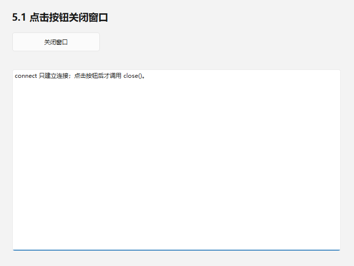

### 完整项目与界面文件

- [05_01_close_connection.pro](../../examples/05_01_close_connection/05_01_close_connection.pro)
- [main.cpp](../../examples/05_01_close_connection/main.cpp)
- [verify.h](../../examples/05_01_close_connection/verify.h)
- [widget.cpp](../../examples/05_01_close_connection/widget.cpp)
- [widget.h](../../examples/05_01_close_connection/widget.h)
- [widget.ui](../../examples/05_01_close_connection/widget.ui)

打开本项目 .pro，选择匹配的 Kit，构建运行；修改界面请打开 .ui，保存后重新构建。verify.h 只在传入 --verify 时执行检查。


## 5.2 自定义信号槽的调用链

[单独阅读本知识点](../knowledge/05_02_custom_signal.md) · [打开完整项目](../../examples/05_02_custom_signal/README.md)

### 本项目要掌握什么

自定义信号槽的调用链。这一节只围绕这个核心问题阅读和修改程序。

### 关键代码在哪里

关键片段 1：[ widget.cpp 第 13 行起](../../examples/05_02_custom_signal/widget.cpp#L13)。以下代码从本项目源文件提取，完整上下文见源文件。

```cpp
auto *teacher = new Teacher(this);
auto *student = new Student(this);
connect(student, &Student::message, this, &Widget::writeLine);
connect(teacher, qOverload<>(&Teacher::hungry), student, qOverload<>(&Student::treat));
connect(ui->runButton, &QPushButton::clicked, teacher, &Teacher::finishClass);
```

### 逐段讲解

Teacher、Student 都有 Q_OBJECT，hungry 只声明信号，treat 是处理函数；窗口把 message 接到 writeLine 显示结果。

点击按钮先调用 finishClass，函数内 emit hungry，再进入 student 的 treat，最后显示 message。qOverload<> 指明无参数重载。

### 按执行顺序阅读

构造函数先准备界面与连接；交互发生后才进入回调。阅读时按“发送对象 → 信号或调用 → 回调里的数据 → 被修改对象 → 显示结果”追踪，不要把建立连接当成已经执行操作。

### 容易出错的地方与动手验证

按调用顺序画箭头，再暂时断开中间连接，确认哪一步停止；信号声明不需要自己写普通函数体。

先写下预测，再修改一个条件重新构建。记录实际结果，并用本节代码中的变量、对象和调用顺序解释原因；仅仅没有报错不代表已经验证了所有分支。

### 运行结果

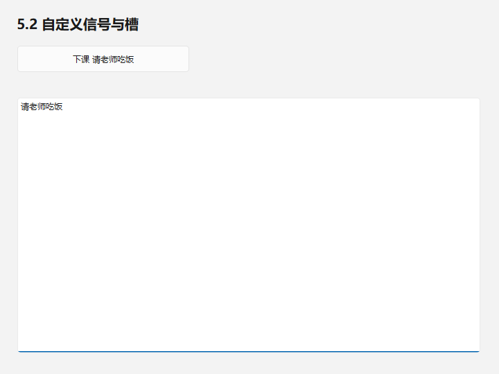

### 完整项目与界面文件

- [05_02_custom_signal.pro](../../examples/05_02_custom_signal/05_02_custom_signal.pro)
- [main.cpp](../../examples/05_02_custom_signal/main.cpp)
- [student.h](../../examples/05_02_custom_signal/student.h)
- [teacher.h](../../examples/05_02_custom_signal/teacher.h)
- [verify.h](../../examples/05_02_custom_signal/verify.h)
- [widget.cpp](../../examples/05_02_custom_signal/widget.cpp)
- [widget.h](../../examples/05_02_custom_signal/widget.h)
- [widget.ui](../../examples/05_02_custom_signal/widget.ui)

打开本项目 .pro，选择匹配的 Kit，构建运行；修改界面请打开 .ui，保存后重新构建。verify.h 只在传入 --verify 时执行检查。


## 5.3 信号转发

[单独阅读本知识点](../knowledge/05_03_signal_to_signal.md) · [打开完整项目](../../examples/05_03_signal_to_signal/README.md)

### 本项目要掌握什么

信号转发。这一节只围绕这个核心问题阅读和修改程序。

### 关键代码在哪里

关键片段 1：[ widget.cpp 第 13 行起](../../examples/05_03_signal_to_signal/widget.cpp#L13)。以下代码从本项目源文件提取，完整上下文见源文件。

```cpp
auto *teacher = new Teacher(this);
auto *student = new Student(this);
connect(student, &Student::message, this, &Widget::writeLine);
connect(teacher, qOverload<>(&Teacher::hungry), student, qOverload<>(&Student::treat));
connect(ui->runButton, &QPushButton::clicked, teacher, qOverload<>(&Teacher::hungry));
```

### 逐段讲解

按钮的 clicked 直接连接 Teacher 的 hungry 信号，而 hungry 仍连接 Student::treat。目标是另一个信号，也可以成为通知链的一环。

它省去了 finishClass 这个中转函数，但 Teacher 与 Student 的角色没有交换；真正的输出仍由 message 到窗口的连接完成。

### 按执行顺序阅读

构造函数先准备界面与连接；交互发生后才进入回调。阅读时按“发送对象 → 信号或调用 → 回调里的数据 → 被修改对象 → 显示结果”追踪，不要把建立连接当成已经执行操作。

### 容易出错的地方与动手验证

与上一个项目逐行对比，指出唯一变化的按钮连接；不要为了转发再重复连接同一条链。

先写下预测，再修改一个条件重新构建。记录实际结果，并用本节代码中的变量、对象和调用顺序解释原因；仅仅没有报错不代表已经验证了所有分支。

### 运行结果

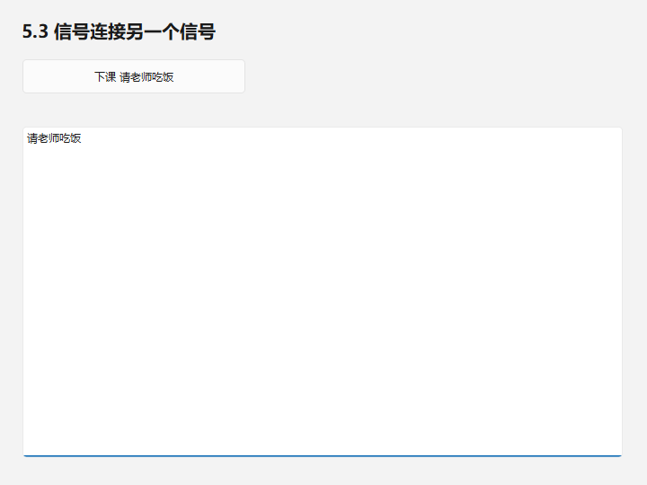

### 完整项目与界面文件

- [05_03_signal_to_signal.pro](../../examples/05_03_signal_to_signal/05_03_signal_to_signal.pro)
- [main.cpp](../../examples/05_03_signal_to_signal/main.cpp)
- [student.h](../../examples/05_03_signal_to_signal/student.h)
- [teacher.h](../../examples/05_03_signal_to_signal/teacher.h)
- [verify.h](../../examples/05_03_signal_to_signal/verify.h)
- [widget.cpp](../../examples/05_03_signal_to_signal/widget.cpp)
- [widget.h](../../examples/05_03_signal_to_signal/widget.h)
- [widget.ui](../../examples/05_03_signal_to_signal/widget.ui)

打开本项目 .pro，选择匹配的 Kit，构建运行；修改界面请打开 .ui，保存后重新构建。verify.h 只在传入 --verify 时执行检查。


## 5.4 选择带参数的重载

[单独阅读本知识点](../knowledge/05_04_overloaded_signal.md) · [打开完整项目](../../examples/05_04_overloaded_signal/README.md)

### 本项目要掌握什么

选择带参数的重载。这一节只围绕这个核心问题阅读和修改程序。

### 关键代码在哪里

关键片段 1：[ widget.cpp 第 13 行起](../../examples/05_04_overloaded_signal/widget.cpp#L13)。以下代码从本项目源文件提取，完整上下文见源文件。

```cpp
auto *teacher = new Teacher(this);
auto *student = new Student(this);
connect(student, &Student::message, this, &Widget::writeLine);
connect(teacher, qOverload<const QString &>(&Teacher::hungry), student,
        qOverload<const QString &>(&Student::treat));
connect(ui->runButton, &QPushButton::clicked, this,
        [teacher]() { teacher->requestFood(QStringLiteral("红烧排骨")); });
```

### 逐段讲解

hungry 和 treat 同名但签名不同，qOverload<const QString &> 明确选中接收菜名的版本，模板参数是类型而不是实参。

按钮给出的是 bool，Lambda 忽略它，调用 requestFood 并传入 QStringLiteral 菜名；随后 hungry(food) 把数据交给 treat(food)。

### 按执行顺序阅读

构造函数先准备界面与连接；交互发生后才进入回调。阅读时按“发送对象 → 信号或调用 → 回调里的数据 → 被修改对象 → 显示结果”追踪，不要把建立连接当成已经执行操作。

### 容易出错的地方与动手验证

改变菜名并追踪输出；不要把 bool 当作 QString 参数硬接，也不要省略有歧义的重载选择。

先写下预测，再修改一个条件重新构建。记录实际结果，并用本节代码中的变量、对象和调用顺序解释原因；仅仅没有报错不代表已经验证了所有分支。

### 运行结果

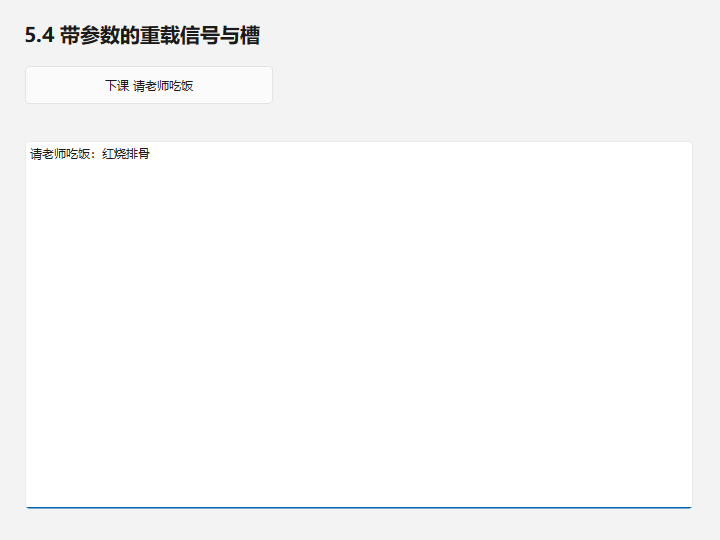

### 完整项目与界面文件

- [05_04_overloaded_signal.pro](../../examples/05_04_overloaded_signal/05_04_overloaded_signal.pro)
- [main.cpp](../../examples/05_04_overloaded_signal/main.cpp)
- [student.h](../../examples/05_04_overloaded_signal/student.h)
- [teacher.h](../../examples/05_04_overloaded_signal/teacher.h)
- [verify.h](../../examples/05_04_overloaded_signal/verify.h)
- [widget.cpp](../../examples/05_04_overloaded_signal/widget.cpp)
- [widget.h](../../examples/05_04_overloaded_signal/widget.h)
- [widget.ui](../../examples/05_04_overloaded_signal/widget.ui)

打开本项目 .pro，选择匹配的 Kit，构建运行；修改界面请打开 .ui，保存后重新构建。verify.h 只在传入 --verify 时执行检查。


## 5.5 保存连接句柄并断开

[单独阅读本知识点](../knowledge/05_05_disconnect.md) · [打开完整项目](../../examples/05_05_disconnect/README.md)

### 本项目要掌握什么

保存连接句柄并断开。这一节只围绕这个核心问题阅读和修改程序。

### 关键代码在哪里

关键片段 1：[ widget.cpp 第 11 行起](../../examples/05_05_disconnect/widget.cpp#L11)。以下代码从本项目源文件提取，完整上下文见源文件。

```cpp
auto connection = connect(ui->sourceButton, &QPushButton::clicked, this,
                          [this]() { writeLine("收到 clicked"); });
writeLine("第一次调用 click()");
ui->sourceButton->click();
QObject::disconnect(connection);
writeLine("已断开；第二次调用 click()");
ui->sourceButton->click();
writeLine("第二次不会再输出 收到 clicked。");
```

### 逐段讲解

connect 返回 QMetaObject::Connection，保存的 connection 标识这一条连接。第一次 click 主动发出按钮通知，所以能打印接收日志。

disconnect(connection) 移除指定连接，再次 click 不再调用这条回调；函数返回并不会因为局部句柄消失就自动断开连接。

### 按执行顺序阅读

本项目的主要实验在构造函数里立即执行：变量初始化 → 定义或连接 → 显式调用 → 显示结果。先在代码中圈出实际调用位置，再区分哪些语句只是定义或登记行为。

### 容易出错的地方与动手验证

增加第二条连接，只断开第一条，观察另一条仍有效；disconnect 是函数，不是 C++ 关键字。

先写下预测，再修改一个条件重新构建。记录实际结果，并用本节代码中的变量、对象和调用顺序解释原因；仅仅没有报错不代表已经验证了所有分支。

### 运行结果

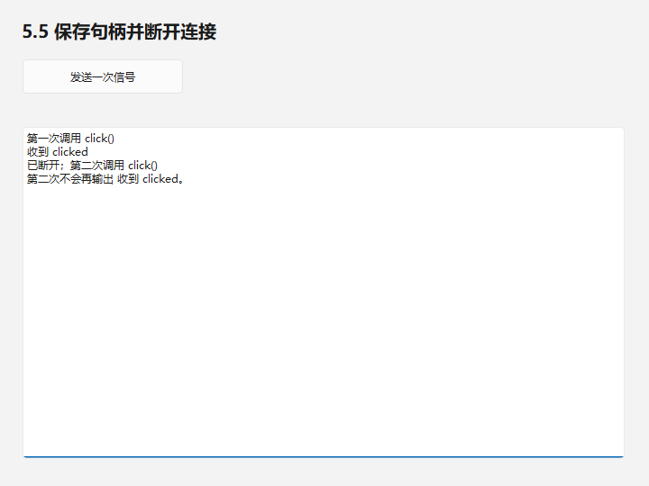

### 完整项目与界面文件

- [05_05_disconnect.pro](../../examples/05_05_disconnect/05_05_disconnect.pro)
- [main.cpp](../../examples/05_05_disconnect/main.cpp)
- [verify.h](../../examples/05_05_disconnect/verify.h)
- [widget.cpp](../../examples/05_05_disconnect/widget.cpp)
- [widget.h](../../examples/05_05_disconnect/widget.h)
- [widget.ui](../../examples/05_05_disconnect/widget.ui)

打开本项目 .pro，选择匹配的 Kit，构建运行；修改界面请打开 .ui，保存后重新构建。verify.h 只在传入 --verify 时执行检查。


## 5.6 一个信号连接多个处理函数

[单独阅读本知识点](../knowledge/05_06_multiple_slots.md) · [打开完整项目](../../examples/05_06_multiple_slots/README.md)

### 本项目要掌握什么

一个信号连接多个处理函数。这一节只围绕这个核心问题阅读和修改程序。

### 关键代码在哪里

关键片段 1：[ widget.cpp 第 11 行起](../../examples/05_06_multiple_slots/widget.cpp#L11)。以下代码从本项目源文件提取，完整上下文见源文件。

```cpp
connect(ui->runButton, &QPushButton::clicked, this, [this]() { writeLine("1 第一个连接"); });
connect(ui->runButton, &QPushButton::clicked, this, [this]() { writeLine("2 第二个连接"); });
```

### 逐段讲解

两个 connect 都监听同一个按钮，每次 clicked 会依次进入两段处理代码。在本例同线程直接连接中，执行顺序与连接建立顺序一致。

这里是一次通知的两个订阅者，不是按钮被按了两次；若无意中重复执行初始化连接，也会出现一次点击重复输出。

### 按执行顺序阅读

构造函数先准备界面与连接；交互发生后才进入回调。阅读时按“发送对象 → 信号或调用 → 回调里的数据 → 被修改对象 → 显示结果”追踪，不要把建立连接当成已经执行操作。

### 容易出错的地方与动手验证

调换两条连接的位置观察输出；不要把这一顺序推导成跨线程任务完成顺序。

先写下预测，再修改一个条件重新构建。记录实际结果，并用本节代码中的变量、对象和调用顺序解释原因；仅仅没有报错不代表已经验证了所有分支。

### 运行结果

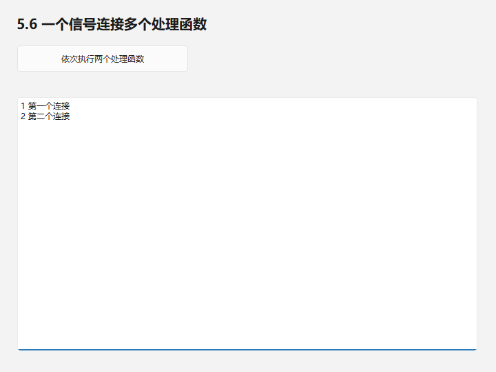

### 完整项目与界面文件

- [05_06_multiple_slots.pro](../../examples/05_06_multiple_slots/05_06_multiple_slots.pro)
- [main.cpp](../../examples/05_06_multiple_slots/main.cpp)
- [verify.h](../../examples/05_06_multiple_slots/verify.h)
- [widget.cpp](../../examples/05_06_multiple_slots/widget.cpp)
- [widget.h](../../examples/05_06_multiple_slots/widget.h)
- [widget.ui](../../examples/05_06_multiple_slots/widget.ui)

打开本项目 .pro，选择匹配的 Kit，构建运行；修改界面请打开 .ui，保存后重新构建。verify.h 只在传入 --verify 时执行检查。


## 5.7 Lambda的定义与调用

[单独阅读本知识点](../knowledge/05_07_function_to_lambda.md) · [打开完整项目](../../examples/05_07_function_to_lambda/README.md)

### 本项目要掌握什么

Lambda的定义与调用。这一节只围绕这个核心问题阅读和修改程序。

### 关键代码在哪里

关键片段 1：[ widget.cpp 第 11 行起](../../examples/05_07_function_to_lambda/widget.cpp#L11)。以下代码从本项目源文件提取，完整上下文见源文件。

```cpp
auto add = [](int a, int b) -> int { return a + b; };
int result = add(3, 4);
writeLine("add(3,4) = " + QString::number(result));
writeLine("auto 保存可调用对象；add(3,4) 才真正执行函数体。");
```

### 逐段讲解

[] 是捕获列表，(int a, int b) 是调用参数，-> int 明确返回类型，花括号是函数体；auto add 保存可调用对象。

定义 add 不会计算 3+4，add(3,4) 才传入参数并执行 return。result 接收返回值，随后 writeLine 显示 7。

### 按执行顺序阅读

本项目的主要实验在构造函数里立即执行：变量初始化 → 定义或连接 → 显式调用 → 显示结果。先在代码中圈出实际调用位置，再区分哪些语句只是定义或登记行为。

### 容易出错的地方与动手验证

把参数换为负数预测结果，再用普通函数实现同一计算；auto 不是把函数体提前执行的指令。

先写下预测，再修改一个条件重新构建。记录实际结果，并用本节代码中的变量、对象和调用顺序解释原因；仅仅没有报错不代表已经验证了所有分支。

### 运行结果

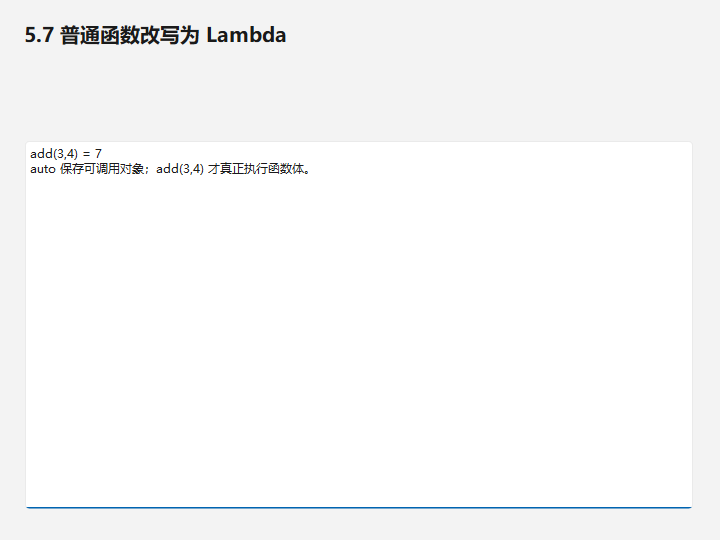

### 完整项目与界面文件

- [05_07_function_to_lambda.pro](../../examples/05_07_function_to_lambda/05_07_function_to_lambda.pro)
- [main.cpp](../../examples/05_07_function_to_lambda/main.cpp)
- [verify.h](../../examples/05_07_function_to_lambda/verify.h)
- [widget.cpp](../../examples/05_07_function_to_lambda/widget.cpp)
- [widget.h](../../examples/05_07_function_to_lambda/widget.h)
- [widget.ui](../../examples/05_07_function_to_lambda/widget.ui)

打开本项目 .pro，选择匹配的 Kit，构建运行；修改界面请打开 .ui，保存后重新构建。verify.h 只在传入 --verify 时执行检查。


## 5.8 定义阶段与执行阶段

[单独阅读本知识点](../knowledge/05_08_define_and_call.md) · [打开完整项目](../../examples/05_08_define_and_call/README.md)

### 本项目要掌握什么

定义阶段与执行阶段。这一节只围绕这个核心问题阅读和修改程序。

### 关键代码在哪里

关键片段 1：[ widget.cpp 第 11 行起](../../examples/05_08_define_and_call/widget.cpp#L11)。以下代码从本项目源文件提取，完整上下文见源文件。

```cpp
writeLine("1 开始定义 Lambda");
auto say = [this]() { writeLine("3 函数体此时执行"); };
writeLine("2 定义完成，函数体还没有执行");
say();
writeLine("4 调用完成");
```

### 逐段讲解

say 的函数体包含编号 3 的输出，创建 Lambda 时只是保存这段行为，因此编号 2 会先显示。

调用 say() 后进入函数体，返回后再打印编号 4。[this] 允许内部调用窗口的 writeLine。

### 按执行顺序阅读

本项目的主要实验在构造函数里立即执行：变量初始化 → 定义或连接 → 显式调用 → 显示结果。先在代码中圈出实际调用位置，再区分哪些语句只是定义或登记行为。

### 容易出错的地方与动手验证

注释掉 say() 预测哪些输出消失，再恢复；把函数体交给 connect 时也要区分保存回调和真正触发。

先写下预测，再修改一个条件重新构建。记录实际结果，并用本节代码中的变量、对象和调用顺序解释原因；仅仅没有报错不代表已经验证了所有分支。

### 运行结果

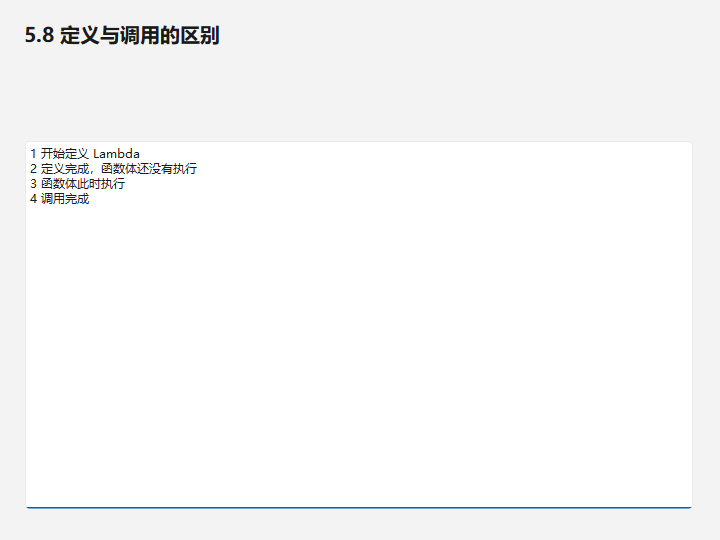

### 完整项目与界面文件

- [05_08_define_and_call.pro](../../examples/05_08_define_and_call/05_08_define_and_call.pro)
- [main.cpp](../../examples/05_08_define_and_call/main.cpp)
- [verify.h](../../examples/05_08_define_and_call/verify.h)
- [widget.cpp](../../examples/05_08_define_and_call/widget.cpp)
- [widget.h](../../examples/05_08_define_and_call/widget.h)
- [widget.ui](../../examples/05_08_define_and_call/widget.ui)

打开本项目 .pro，选择匹配的 Kit，构建运行；修改界面请打开 .ui，保存后重新构建。verify.h 只在传入 --verify 时执行检查。


## 5.9 捕获值与函数参数的来源

[单独阅读本知识点](../knowledge/05_09_capture_and_parameter.md) · [打开完整项目](../../examples/05_09_capture_and_parameter/README.md)

### 本项目要掌握什么

捕获值与函数参数的来源。这一节只围绕这个核心问题阅读和修改程序。

### 关键代码在哪里

关键片段 1：[ widget.cpp 第 11 行起](../../examples/05_09_capture_and_parameter/widget.cpp#L11)。以下代码从本项目源文件提取，完整上下文见源文件。

```cpp
int base = 10;
auto addBase = [base](int x) { return base + x; };
writeLine("base 的副本 = 10");
writeLine("addBase(3) = " + QString::number(addBase(3)));
writeLine("addBase(8) = " + QString::number(addBase(8)));
```

### 逐段讲解

base 在 Lambda 创建时按值捕获，为这个可调用对象保存一份 10；x 则来自每次调用 addBase 时提供的实参。

addBase(3) 与 addBase(8) 使用相同的 base 副本和不同的 x，因此得到 13 与 18。捕获列表不是函数的参数列表。

### 按执行顺序阅读

本项目的主要实验在构造函数里立即执行：变量初始化 → 定义或连接 → 显式调用 → 显示结果。先在代码中圈出实际调用位置，再区分哪些语句只是定义或登记行为。

### 容易出错的地方与动手验证

在定义后把外部 base 改为 100，预测两次结果；不要把每次传入的参数写进捕获列表代替它。

先写下预测，再修改一个条件重新构建。记录实际结果，并用本节代码中的变量、对象和调用顺序解释原因；仅仅没有报错不代表已经验证了所有分支。

### 运行结果

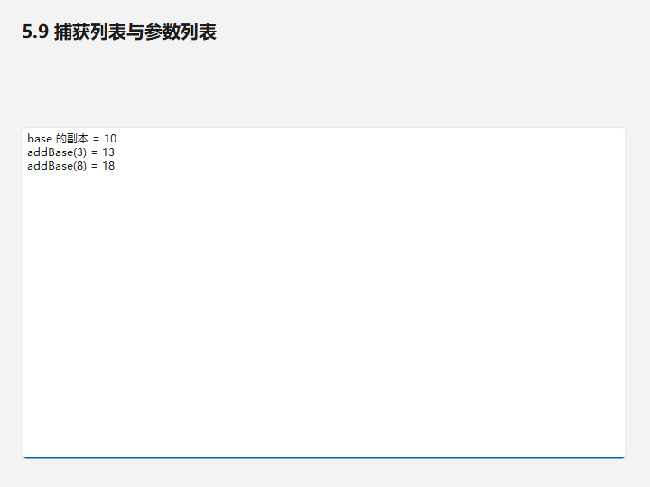

### 完整项目与界面文件

- [05_09_capture_and_parameter.pro](../../examples/05_09_capture_and_parameter/05_09_capture_and_parameter.pro)
- [main.cpp](../../examples/05_09_capture_and_parameter/main.cpp)
- [verify.h](../../examples/05_09_capture_and_parameter/verify.h)
- [widget.cpp](../../examples/05_09_capture_and_parameter/widget.cpp)
- [widget.h](../../examples/05_09_capture_and_parameter/widget.h)
- [widget.ui](../../examples/05_09_capture_and_parameter/widget.ui)

打开本项目 .pro，选择匹配的 Kit，构建运行；修改界面请打开 .ui，保存后重新构建。verify.h 只在传入 --verify 时执行检查。


## 5.10 值捕获保存创建时的副本

[单独阅读本知识点](../knowledge/05_10_value_capture.md) · [打开完整项目](../../examples/05_10_value_capture/README.md)

### 本项目要掌握什么

值捕获保存创建时的副本。这一节只围绕这个核心问题阅读和修改程序。

### 关键代码在哪里

关键片段 1：[ widget.cpp 第 11 行起](../../examples/05_10_value_capture/widget.cpp#L11)。以下代码从本项目源文件提取，完整上下文见源文件。

```cpp
int n = 10;
auto read = [n]() { return n; };
n = 20;
writeLine("read() = " + QString::number(read()));
writeLine("外部 n = " + QString::number(n));
```

### 逐段讲解

[n] 在 read 建立时复制 n 的值 10，随后 n=20 改的是构造函数中的局部变量。

read() 读取闭包里保存的副本，外部变量与内部副本是两份状态，因此分别输出 10、20。

### 按执行顺序阅读

本项目的主要实验在构造函数里立即执行：变量初始化 → 定义或连接 → 显式调用 → 显示结果。先在代码中圈出实际调用位置，再区分哪些语句只是定义或登记行为。

### 容易出错的地方与动手验证

把赋值放到定义 Lambda 之前，解释结果为何变化；不要把值捕获理解为自动同步外部变量。

先写下预测，再修改一个条件重新构建。记录实际结果，并用本节代码中的变量、对象和调用顺序解释原因；仅仅没有报错不代表已经验证了所有分支。

### 运行结果

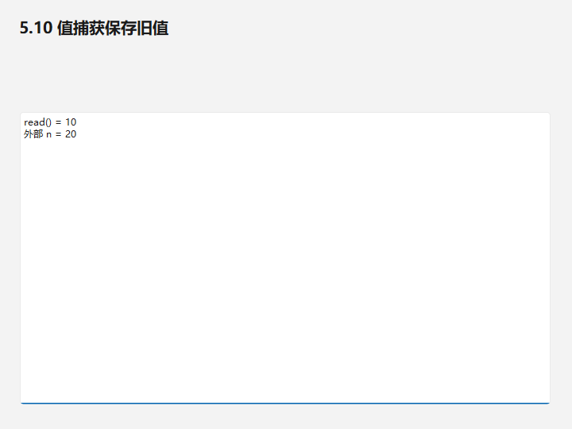

### 完整项目与界面文件

- [05_10_value_capture.pro](../../examples/05_10_value_capture/05_10_value_capture.pro)
- [main.cpp](../../examples/05_10_value_capture/main.cpp)
- [verify.h](../../examples/05_10_value_capture/verify.h)
- [widget.cpp](../../examples/05_10_value_capture/widget.cpp)
- [widget.h](../../examples/05_10_value_capture/widget.h)
- [widget.ui](../../examples/05_10_value_capture/widget.ui)

打开本项目 .pro，选择匹配的 Kit，构建运行；修改界面请打开 .ui，保存后重新构建。verify.h 只在传入 --verify 时执行检查。


## 5.11 引用捕获访问原变量

[单独阅读本知识点](../knowledge/05_11_reference_capture.md) · [打开完整项目](../../examples/05_11_reference_capture/README.md)

### 本项目要掌握什么

引用捕获访问原变量。这一节只围绕这个核心问题阅读和修改程序。

### 关键代码在哪里

关键片段 1：[ widget.cpp 第 11 行起](../../examples/05_11_reference_capture/widget.cpp#L11)。以下代码从本项目源文件提取，完整上下文见源文件。

```cpp
int n = 10;
auto increase = [&n]() { ++n; };
increase();
writeLine("第一次调用后 n = " + QString::number(n));
n = 40;
increase();
writeLine("第二次调用后 n = " + QString::number(n));
```

### 逐段讲解

[&n] 不保存独立数值副本，而是引用外部 n。第一次 increase 将 10 改为 11，外部再设为 40，第二次调用得到 41。

两次调用都在 n 的作用域内完成，所以引用仍然有效；同一写法保存到构造结束后的按钮回调里就可能失效。

### 按执行顺序阅读

本项目的主要实验在构造函数里立即执行：变量初始化 → 定义或连接 → 显式调用 → 显示结果。先在代码中圈出实际调用位置，再区分哪些语句只是定义或登记行为。

### 容易出错的地方与动手验证

把本例的立即调用与长期回调画在时间线上比较；不能只看到 & 就认为任何时刻都安全。

先写下预测，再修改一个条件重新构建。记录实际结果，并用本节代码中的变量、对象和调用顺序解释原因；仅仅没有报错不代表已经验证了所有分支。

### 运行结果

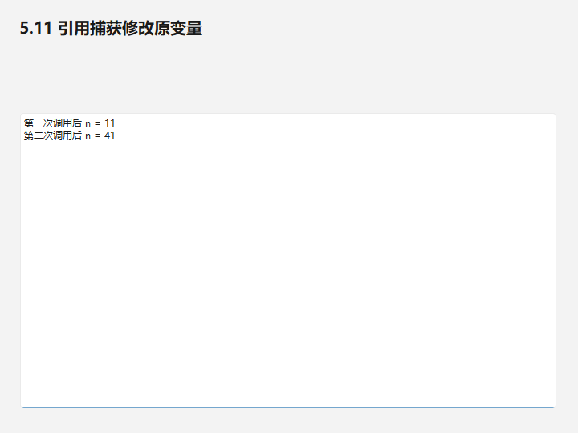

### 完整项目与界面文件

- [05_11_reference_capture.pro](../../examples/05_11_reference_capture/05_11_reference_capture.pro)
- [main.cpp](../../examples/05_11_reference_capture/main.cpp)
- [verify.h](../../examples/05_11_reference_capture/verify.h)
- [widget.cpp](../../examples/05_11_reference_capture/widget.cpp)
- [widget.h](../../examples/05_11_reference_capture/widget.h)
- [widget.ui](../../examples/05_11_reference_capture/widget.ui)

打开本项目 .pro，选择匹配的 Kit，构建运行；修改界面请打开 .ui，保存后重新构建。verify.h 只在传入 --verify 时执行检查。


## 5.12 显式混合捕获

[单独阅读本知识点](../knowledge/05_12_mixed_capture.md) · [打开完整项目](../../examples/05_12_mixed_capture/README.md)

### 本项目要掌握什么

显式混合捕获。这一节只围绕这个核心问题阅读和修改程序。

### 关键代码在哪里

关键片段 1：[ widget.cpp 第 11 行起](../../examples/05_12_mixed_capture/widget.cpp#L11)。以下代码从本项目源文件提取，完整上下文见源文件。

```cpp
int base = 10;
int total = 0;
auto accumulate = [base, &total](int x) { total += base + x; };
base = 100;
accumulate(3);
writeLine("第一次 total = " + QString::number(total));
accumulate(8);
writeLine("第二次 total = " + QString::number(total));
writeLine("外部 base = " + QString::number(base));
```

### 逐段讲解

[base, &total] 明确表示 base 用副本、total 用引用。外部 base=100 不改变副本，累加仍以 10 为基础。

accumulate(3) 把 total 改为 13，第二次加上 18，结果为 31；两次操作都发生在局部 total 仍存活时。

### 按执行顺序阅读

本项目的主要实验在构造函数里立即执行：变量初始化 → 定义或连接 → 显式调用 → 显示结果。先在代码中圈出实际调用位置，再区分哪些语句只是定义或登记行为。

### 容易出错的地方与动手验证

改用 [&base, &total] 重新预测结果；不同捕获依赖必须分别判断，不能笼统地说 Lambda 都是复制。

先写下预测，再修改一个条件重新构建。记录实际结果，并用本节代码中的变量、对象和调用顺序解释原因；仅仅没有报错不代表已经验证了所有分支。

### 运行结果

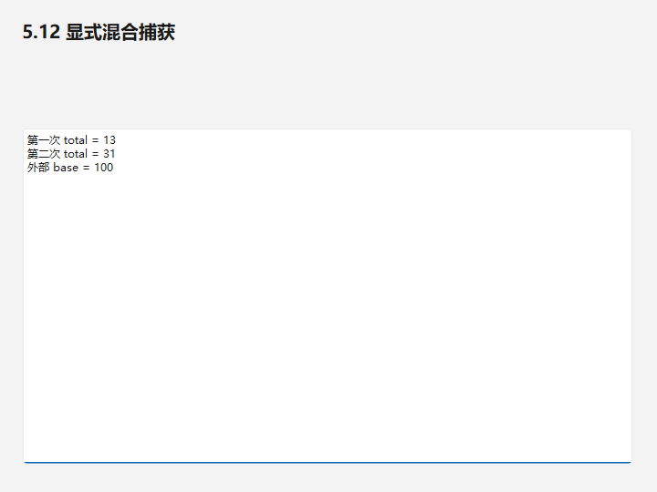

### 完整项目与界面文件

- [05_12_mixed_capture.pro](../../examples/05_12_mixed_capture/05_12_mixed_capture.pro)
- [main.cpp](../../examples/05_12_mixed_capture/main.cpp)
- [verify.h](../../examples/05_12_mixed_capture/verify.h)
- [widget.cpp](../../examples/05_12_mixed_capture/widget.cpp)
- [widget.h](../../examples/05_12_mixed_capture/widget.h)
- [widget.ui](../../examples/05_12_mixed_capture/widget.ui)

打开本项目 .pro，选择匹配的 Kit，构建运行；修改界面请打开 .ui，保存后重新构建。verify.h 只在传入 --verify 时执行检查。


## 5.13 指针捕获复制地址

[单独阅读本知识点](../knowledge/05_13_pointer_capture.md) · [打开完整项目](../../examples/05_13_pointer_capture/README.md)

### 本项目要掌握什么

指针捕获复制地址。这一节只围绕这个核心问题阅读和修改程序。

### 关键代码在哪里

关键片段 1：[ widget.cpp 第 11 行起](../../examples/05_13_pointer_capture/widget.cpp#L11)。以下代码从本项目源文件提取，完整上下文见源文件。

```cpp
int number = 10;
int *ptr = &number;
auto change = [ptr]() { *ptr = 30; };
change();
writeLine("number = " + QString::number(number));
writeLine("[ptr] 没有复制 number，只复制了地址。");
```

### 逐段讲解

ptr 指向 number，[ptr] 复制的是指针值。副本仍指向同一个 number，所以 *ptr=30 会改变外部整数。

这没有复制整个目标对象，也不延长目标对象的生命周期；本例立即调用，number 尚未离开作用域。

### 按执行顺序阅读

本项目的主要实验在构造函数里立即执行：变量初始化 → 定义或连接 → 显式调用 → 显示结果。先在代码中圈出实际调用位置，再区分哪些语句只是定义或登记行为。

### 容易出错的地方与动手验证

比较 ptr=nullptr 与 *ptr=30 的含义；指针不空也不能证明目标仍然存活。

先写下预测，再修改一个条件重新构建。记录实际结果，并用本节代码中的变量、对象和调用顺序解释原因；仅仅没有报错不代表已经验证了所有分支。

### 运行结果

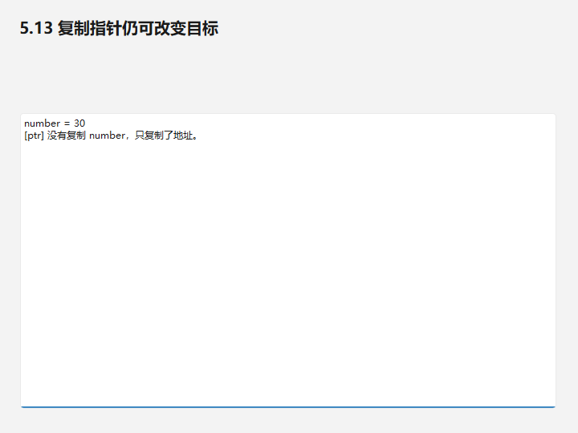

### 完整项目与界面文件

- [05_13_pointer_capture.pro](../../examples/05_13_pointer_capture/05_13_pointer_capture.pro)
- [main.cpp](../../examples/05_13_pointer_capture/main.cpp)
- [verify.h](../../examples/05_13_pointer_capture/verify.h)
- [widget.cpp](../../examples/05_13_pointer_capture/widget.cpp)
- [widget.h](../../examples/05_13_pointer_capture/widget.h)
- [widget.ui](../../examples/05_13_pointer_capture/widget.ui)

打开本项目 .pro，选择匹配的 Kit，构建运行；修改界面请打开 .ui，保存后重新构建。verify.h 只在传入 --verify 时执行检查。


## 5.14 mutable修改捕获副本

[单独阅读本知识点](../knowledge/05_14_mutable_original.md) · [打开完整项目](../../examples/05_14_mutable_original/README.md)

### 本项目要掌握什么

mutable修改捕获副本。这一节只围绕这个核心问题阅读和修改程序。

### 关键代码在哪里

关键片段 1：[ widget.cpp 第 11 行起](../../examples/05_14_mutable_original/widget.cpp#L11)。以下代码从本项目源文件提取，完整上下文见源文件。

```cpp
int m = 10;
auto fun = [m, this](int a, int b) mutable
{
    writeLine("lambda is running!");
    m = 300;
    writeLine("内部副本 m = " + QString::number(m));
    return a + b;
};
int sum = fun(100, 200);
writeLine("返回值 sum = " + QString::number(sum));
writeLine("外部 m = " + QString::number(m));
```

### 逐段讲解

[m,this] 复制 m 并保存 this 指针。mutable 允许函数体给自己的 m 副本赋值 300；它没有让外部 m 变成引用。

fun(100,200) 执行日志和副本赋值，再返回 a+b=300。内部副本 300、返回值 300 与外部 m=10 是三件不同的事。

### 按执行顺序阅读

本项目的主要实验在构造函数里立即执行：变量初始化 → 定义或连接 → 显式调用 → 显示结果。先在代码中圈出实际调用位置，再区分哪些语句只是定义或登记行为。

### 容易出错的地方与动手验证

把返回表达式改为 m，再区分返回值与外部状态；不要把 mutable 记成允许修改所有外部变量。

先写下预测，再修改一个条件重新构建。记录实际结果，并用本节代码中的变量、对象和调用顺序解释原因；仅仅没有报错不代表已经验证了所有分支。

### 运行结果

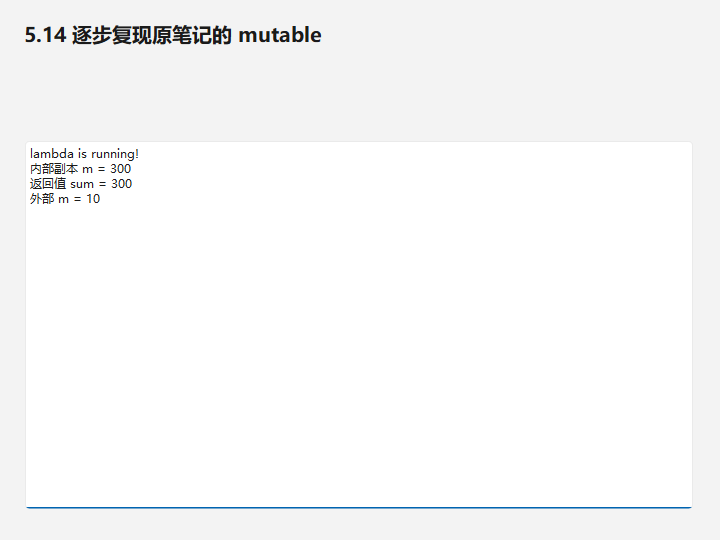

### 完整项目与界面文件

- [05_14_mutable_original.pro](../../examples/05_14_mutable_original/05_14_mutable_original.pro)
- [main.cpp](../../examples/05_14_mutable_original/main.cpp)
- [verify.h](../../examples/05_14_mutable_original/verify.h)
- [widget.cpp](../../examples/05_14_mutable_original/widget.cpp)
- [widget.h](../../examples/05_14_mutable_original/widget.h)
- [widget.ui](../../examples/05_14_mutable_original/widget.ui)

打开本项目 .pro，选择匹配的 Kit，构建运行；修改界面请打开 .ui，保存后重新构建。verify.h 只在传入 --verify 时执行检查。


## 5.15 闭包副本的状态保留

[单独阅读本知识点](../knowledge/05_15_mutable_state.md) · [打开完整项目](../../examples/05_15_mutable_state/README.md)

### 本项目要掌握什么

闭包副本的状态保留。这一节只围绕这个核心问题阅读和修改程序。

### 关键代码在哪里

关键片段 1：[ widget.cpp 第 11 行起](../../examples/05_15_mutable_state/widget.cpp#L11)。以下代码从本项目源文件提取，完整上下文见源文件。

```cpp
int m = 10;
auto next = [m]() mutable { return ++m; };
writeLine("next 第一次 = " + QString::number(next()));
writeLine("next 第二次 = " + QString::number(next()));
writeLine("外部 m = " + QString::number(m));
```

### 逐段讲解

next 是同一个 Lambda 对象，内部保存 m=10 的副本；mutable 使 ++m 能更新这份副本。

连续调用 next 得到 11、12，而不是每次重新从 10 开始。外部 m 没有被引用，所以仍为 10。

### 按执行顺序阅读

本项目的主要实验在构造函数里立即执行：变量初始化 → 定义或连接 → 显式调用 → 显示结果。先在代码中圈出实际调用位置，再区分哪些语句只是定义或登记行为。

### 容易出错的地方与动手验证

复制 next 到 another 后分别调用，观察两个闭包副本各自的状态；先分清是同一个对象还是重新创建。

先写下预测，再修改一个条件重新构建。记录实际结果，并用本节代码中的变量、对象和调用顺序解释原因；仅仅没有报错不代表已经验证了所有分支。

### 运行结果

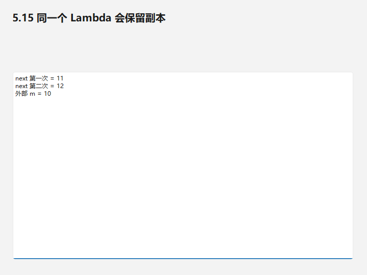

### 完整项目与界面文件

- [05_15_mutable_state.pro](../../examples/05_15_mutable_state/05_15_mutable_state.pro)
- [main.cpp](../../examples/05_15_mutable_state/main.cpp)
- [verify.h](../../examples/05_15_mutable_state/verify.h)
- [widget.cpp](../../examples/05_15_mutable_state/widget.cpp)
- [widget.h](../../examples/05_15_mutable_state/widget.h)
- [widget.ui](../../examples/05_15_mutable_state/widget.ui)

打开本项目 .pro，选择匹配的 Kit，构建运行；修改界面请打开 .ui，保存后重新构建。verify.h 只在传入 --verify 时执行检查。


## 5.16 通过this访问窗口成员

[单独阅读本知识点](../knowledge/05_16_this_member.md) · [打开完整项目](../../examples/05_16_this_member/README.md)

### 本项目要掌握什么

通过this访问窗口成员。这一节只围绕这个核心问题阅读和修改程序。

### 关键代码在哪里

关键片段 1：[ widget.cpp 第 11 行起](../../examples/05_16_this_member/widget.cpp#L11)。以下代码从本项目源文件提取，完整上下文见源文件。

```cpp
connect(ui->runButton, &QPushButton::clicked, this,
        [this]()
        {
            ++count_;
            setWindowTitle(QString("5.16 已点击 %1 次").arg(count_));
            writeLine("count_ = " + QString::number(count_));
        });
```

### 逐段讲解

[this] 保存当前窗口地址，count_ 是窗口成员，所以回调在构造函数结束后仍能访问它，并更新标题与输出。

它不需要 mutable，因为修改的是 this 指向对象的成员，不是给保存的 this 指针副本重新赋值。

### 按执行顺序阅读

构造函数先准备界面与连接；交互发生后才进入回调。阅读时按“发送对象 → 信号或调用 → 回调里的数据 → 被修改对象 → 显示结果”追踪，不要把建立连接当成已经执行操作。

### 容易出错的地方与动手验证

比较 this->count_ 与局部 count 的生命周期；窗口作为 context 断开连接，并不保护其他随意捕获的对象。

先写下预测，再修改一个条件重新构建。记录实际结果，并用本节代码中的变量、对象和调用顺序解释原因；仅仅没有报错不代表已经验证了所有分支。

### 运行结果

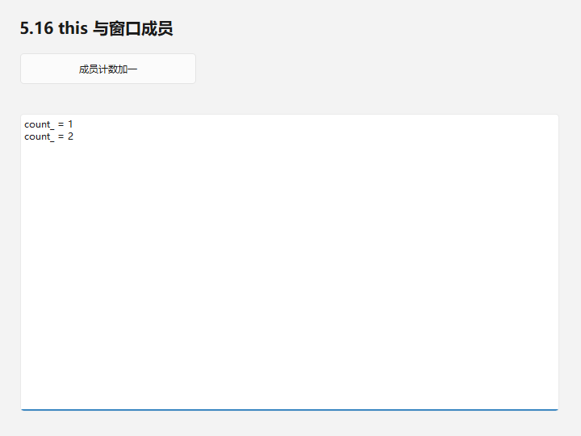

### 完整项目与界面文件

- [05_16_this_member.pro](../../examples/05_16_this_member/05_16_this_member.pro)
- [main.cpp](../../examples/05_16_this_member/main.cpp)
- [verify.h](../../examples/05_16_this_member/verify.h)
- [widget.cpp](../../examples/05_16_this_member/widget.cpp)
- [widget.h](../../examples/05_16_this_member/widget.h)
- [widget.ui](../../examples/05_16_this_member/widget.ui)

打开本项目 .pro，选择匹配的 Kit，构建运行；修改界面请打开 .ui，保存后重新构建。verify.h 只在传入 --verify 时执行检查。


## 5.17 空捕获回调

[单独阅读本知识点](../knowledge/05_17_empty_capture_button.md) · [打开完整项目](../../examples/05_17_empty_capture_button/README.md)

### 本项目要掌握什么

空捕获回调。这一节只围绕这个核心问题阅读和修改程序。

### 关键代码在哪里

关键片段 1：[ widget.cpp 第 11 行起](../../examples/05_17_empty_capture_button/widget.cpp#L11)。以下代码从本项目源文件提取，完整上下文见源文件。

```cpp
connect(ui->runButton, &QPushButton::clicked, this,
        []() { qDebug() << "按钮被按下，当前 Lambda 没有捕获外部变量"; });
// 第二条连接只负责把结果显示到窗口中，不影响上面的空捕获示例。
connect(ui->runButton, &QPushButton::clicked, this,
        [this]() { writeLine("按钮被按下；空捕获示例也已向调试输出打印信息。"); });
```

### 逐段讲解

第一条连接使用 []，函数体只向 qDebug 输出固定文字，没有依赖外部局部变量或窗口成员。

第二条 [this] 连接负责窗口显示，是额外观察手段；它没有改变第一条回调的捕获方式，两条连接都会收到 clicked。

### 按执行顺序阅读

构造函数先准备界面与连接；交互发生后才进入回调。阅读时按“发送对象 → 信号或调用 → 回调里的数据 → 被修改对象 → 显示结果”追踪，不要把建立连接当成已经执行操作。

### 容易出错的地方与动手验证

暂时移除第二条连接，到应用程序输出查看第一条日志；不能在 [] 里直接访问 ui。

先写下预测，再修改一个条件重新构建。记录实际结果，并用本节代码中的变量、对象和调用顺序解释原因；仅仅没有报错不代表已经验证了所有分支。

### 运行结果

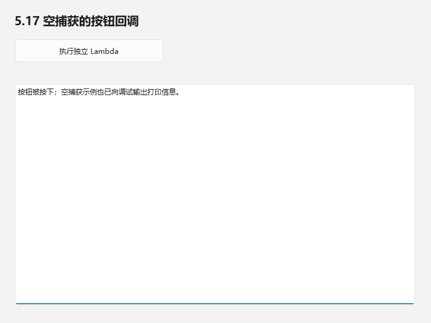

### 完整项目与界面文件

- [05_17_empty_capture_button.pro](../../examples/05_17_empty_capture_button/05_17_empty_capture_button.pro)
- [main.cpp](../../examples/05_17_empty_capture_button/main.cpp)
- [verify.h](../../examples/05_17_empty_capture_button/verify.h)
- [widget.cpp](../../examples/05_17_empty_capture_button/widget.cpp)
- [widget.h](../../examples/05_17_empty_capture_button/widget.h)
- [widget.ui](../../examples/05_17_empty_capture_button/widget.ui)

打开本项目 .pro，选择匹配的 Kit，构建运行；修改界面请打开 .ui，保存后重新构建。verify.h 只在传入 --verify 时执行检查。


## 5.18 信号实参与捕获数据同时使用

[单独阅读本知识点](../knowledge/05_18_signal_parameter.md) · [打开完整项目](../../examples/05_18_signal_parameter/README.md)

### 本项目要掌握什么

信号实参与捕获数据同时使用。这一节只围绕这个核心问题阅读和修改程序。

### 关键代码在哪里

关键片段 1：[ widget.cpp 第 11 行起](../../examples/05_18_signal_parameter/widget.cpp#L11)。以下代码从本项目源文件提取，完整上下文见源文件。

```cpp
QString tag = "保存按钮";
connect(ui->runButton, &QPushButton::clicked, this, [this, tag](bool checked)
        { writeLine(tag + " checked = " + (checked ? "true" : "false")); });
```

### 逐段讲解

tag 由 [this,tag] 在连接建立时保存副本；bool checked 由按钮每次 clicked 通知传入。两类数据的来源和进入时机不同。

按钮在 .ui 中启用 checkable，连续点击改变状态，因此 checked 显示 true、false；this 让回调调用 writeLine。

### 按执行顺序阅读

构造函数先准备界面与连接；交互发生后才进入回调。阅读时按“发送对象 → 信号或调用 → 回调里的数据 → 被修改对象 → 显示结果”追踪，不要把建立连接当成已经执行操作。

### 容易出错的地方与动手验证

取消 checkable 后观察 checked，再把 tag 的外部值改掉比较；不要把 checked 当作某个被捕获的局部变量。

先写下预测，再修改一个条件重新构建。记录实际结果，并用本节代码中的变量、对象和调用顺序解释原因；仅仅没有报错不代表已经验证了所有分支。

### 运行结果

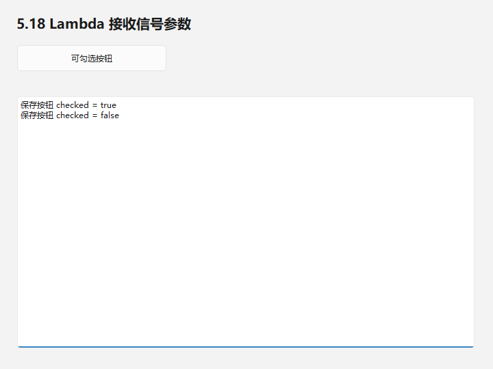

### 完整项目与界面文件

- [05_18_signal_parameter.pro](../../examples/05_18_signal_parameter/05_18_signal_parameter.pro)
- [main.cpp](../../examples/05_18_signal_parameter/main.cpp)
- [verify.h](../../examples/05_18_signal_parameter/verify.h)
- [widget.cpp](../../examples/05_18_signal_parameter/widget.cpp)
- [widget.h](../../examples/05_18_signal_parameter/widget.h)
- [widget.ui](../../examples/05_18_signal_parameter/widget.ui)

打开本项目 .pro，选择匹配的 Kit，构建运行；修改界面请打开 .ui，保存后重新构建。verify.h 只在传入 --verify 时执行检查。


## 5.19 Lambda适配业务参数

[单独阅读本知识点](../knowledge/05_19_lambda_adapter.md) · [打开完整项目](../../examples/05_19_lambda_adapter/README.md)

### 本项目要掌握什么

Lambda适配业务参数。这一节只围绕这个核心问题阅读和修改程序。

### 关键代码在哪里

关键片段 1：[ widget.cpp 第 13 行起](../../examples/05_19_lambda_adapter/widget.cpp#L13)。以下代码从本项目源文件提取，完整上下文见源文件。

```cpp
auto *teacher = new Teacher(this);
auto *student = new Student(this);
connect(student, &Student::message, this, &Widget::writeLine);
connect(teacher, qOverload<const QString &>(&Teacher::hungry), student,
        qOverload<const QString &>(&Student::treat));
connect(ui->runButton, &QPushButton::clicked, this,
        [teacher]() { teacher->requestFood(QStringLiteral("面条")); });
```

### 逐段讲解

clicked 的 bool 不是老师想要的菜名。Lambda 不声明 bool 参数，因此忽略它，改为显式调用 requestFood("面条")。

teacher 按值捕获仅复制地址，Student 的处理仍由 hungry(food) 触发。窗口 context 管理本连接，teacher 也作为窗口子对象管理。

### 按执行顺序阅读

构造函数先准备界面与连接；交互发生后才进入回调。阅读时按“发送对象 → 信号或调用 → 回调里的数据 → 被修改对象 → 显示结果”追踪，不要把建立连接当成已经执行操作。

### 容易出错的地方与动手验证

让按钮选择两种菜名再调用同一接口；若允许提前删除 teacher，需要另外检查其存活状态。

先写下预测，再修改一个条件重新构建。记录实际结果，并用本节代码中的变量、对象和调用顺序解释原因；仅仅没有报错不代表已经验证了所有分支。

### 运行结果

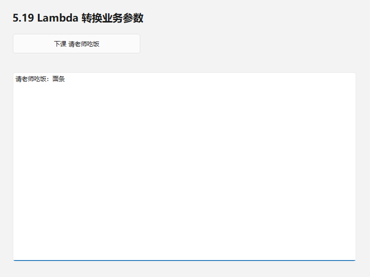

### 完整项目与界面文件

- [05_19_lambda_adapter.pro](../../examples/05_19_lambda_adapter/05_19_lambda_adapter.pro)
- [main.cpp](../../examples/05_19_lambda_adapter/main.cpp)
- [student.h](../../examples/05_19_lambda_adapter/student.h)
- [teacher.h](../../examples/05_19_lambda_adapter/teacher.h)
- [verify.h](../../examples/05_19_lambda_adapter/verify.h)
- [widget.cpp](../../examples/05_19_lambda_adapter/widget.cpp)
- [widget.h](../../examples/05_19_lambda_adapter/widget.h)
- [widget.ui](../../examples/05_19_lambda_adapter/widget.ui)

打开本项目 .pro，选择匹配的 Kit，构建运行；修改界面请打开 .ui，保存后重新构建。verify.h 只在传入 --verify 时执行检查。


## 5.20 循环回调保存各自编号

[单独阅读本知识点](../knowledge/05_20_loop_capture.md) · [打开完整项目](../../examples/05_20_loop_capture/README.md)

### 本项目要掌握什么

循环回调保存各自编号。这一节只围绕这个核心问题阅读和修改程序。

### 关键代码在哪里

关键片段 1：[ widget.cpp 第 12 行起](../../examples/05_20_loop_capture/widget.cpp#L12)。以下代码从本项目源文件提取，完整上下文见源文件。

```cpp
const QList<QPushButton *> buttons = {ui->number0, ui->number1, ui->number2};
for (int i = 0; i < buttons.size(); ++i)
{
    auto *button = buttons.at(i);
    connect(button, &QPushButton::clicked, this,
            [this, i]() { writeLine("点击的编号 = " + QString::number(i)); });
}
```

### 逐段讲解

buttons 是三个 .ui 按钮的指针集合，循环每次取出一个按钮。[this,i] 在每次建立连接时保存当次 i 的数值。

循环结束后用户才点击，但每个回调都有自己的 0、1、2 副本，因此不会读取构造函数里已经消失的循环变量。

### 按执行顺序阅读

构造函数先准备界面与连接；交互发生后才进入回调。阅读时按“发送对象 → 信号或调用 → 回调里的数据 → 被修改对象 → 显示结果”追踪，不要把建立连接当成已经执行操作。

### 容易出错的地方与动手验证

把循环改为更大的按钮集合；不要用 [&i] 试图让每个按钮保留编号，循环结束后这个引用会失效。

先写下预测，再修改一个条件重新构建。记录实际结果，并用本节代码中的变量、对象和调用顺序解释原因；仅仅没有报错不代表已经验证了所有分支。

### 运行结果

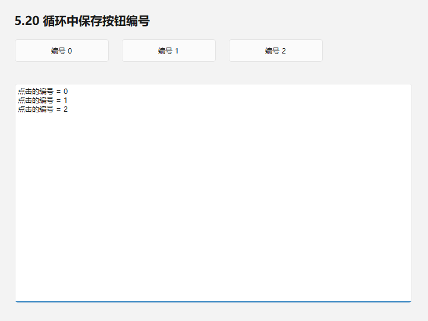

### 完整项目与界面文件

- [05_20_loop_capture.pro](../../examples/05_20_loop_capture/05_20_loop_capture.pro)
- [main.cpp](../../examples/05_20_loop_capture/main.cpp)
- [verify.h](../../examples/05_20_loop_capture/verify.h)
- [widget.cpp](../../examples/05_20_loop_capture/widget.cpp)
- [widget.h](../../examples/05_20_loop_capture/widget.h)
- [widget.ui](../../examples/05_20_loop_capture/widget.ui)

打开本项目 .pro，选择匹配的 Kit，构建运行；修改界面请打开 .ui，保存后重新构建。verify.h 只在传入 --verify 时执行检查。


## 5.21 长期回调使用窗口状态

[单独阅读本知识点](../knowledge/05_21_safe_delayed_state.md) · [打开完整项目](../../examples/05_21_safe_delayed_state/README.md)

### 本项目要掌握什么

长期回调使用窗口状态。这一节只围绕这个核心问题阅读和修改程序。

### 关键代码在哪里

关键片段 1：[ widget.cpp 第 11 行起](../../examples/05_21_safe_delayed_state/widget.cpp#L11)。以下代码从本项目源文件提取，完整上下文见源文件。

```cpp
// 错误思路（仅说明，不执行）：
// int localCount = 0;
// 把 [&localCount] 保存到按钮回调，构造结束后引用就会失效。
connect(ui->runButton, &QPushButton::clicked, this,
        [this]()
        {
            ++count_;
            writeLine("窗口成员仍然存活，count_ = " + QString::number(count_));
        });
```

### 逐段讲解

注释中的 localCount 是错误思路：构造结束后局部变量消失，保存它的引用不能安全等到点击。

实际代码把 count_ 保存在窗口成员中，用 [this] 更新，并以窗口为 context。只要该窗口回调仍在正常工作，成员状态就有明确归属。

### 按执行顺序阅读

构造函数先准备界面与连接；交互发生后才进入回调。阅读时按“发送对象 → 信号或调用 → 回调里的数据 → 被修改对象 → 显示结果”追踪，不要把建立连接当成已经执行操作。

### 容易出错的地方与动手验证

多次点击观察连续计数，再解释为什么复制裸指针也不等于延长目标生命周期。

先写下预测，再修改一个条件重新构建。记录实际结果，并用本节代码中的变量、对象和调用顺序解释原因；仅仅没有报错不代表已经验证了所有分支。

### 运行结果

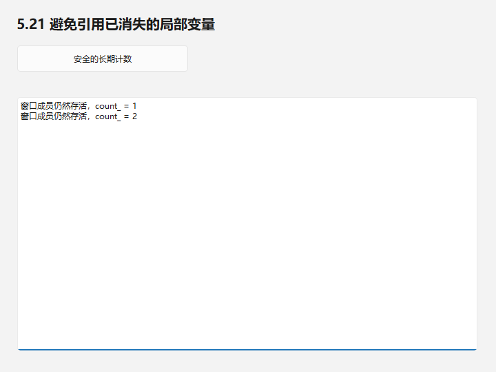

### 完整项目与界面文件

- [05_21_safe_delayed_state.pro](../../examples/05_21_safe_delayed_state/05_21_safe_delayed_state.pro)
- [main.cpp](../../examples/05_21_safe_delayed_state/main.cpp)
- [verify.h](../../examples/05_21_safe_delayed_state/verify.h)
- [widget.cpp](../../examples/05_21_safe_delayed_state/widget.cpp)
- [widget.h](../../examples/05_21_safe_delayed_state/widget.h)
- [widget.ui](../../examples/05_21_safe_delayed_state/widget.ui)

打开本项目 .pro，选择匹配的 Kit，构建运行；修改界面请打开 .ui，保存后重新构建。verify.h 只在传入 --verify 时执行检查。


## 5.22 回调内部保存独立计数

[单独阅读本知识点](../knowledge/05_22_lambda_keeps_copy.md) · [打开完整项目](../../examples/05_22_lambda_keeps_copy/README.md)

### 本项目要掌握什么

回调内部保存独立计数。这一节只围绕这个核心问题阅读和修改程序。

### 关键代码在哪里

关键片段 1：[ widget.cpp 第 11 行起](../../examples/05_22_lambda_keeps_copy/widget.cpp#L11)。以下代码从本项目源文件提取，完整上下文见源文件。

```cpp
int count = 0;
connect(ui->runButton, &QPushButton::clicked, this,
        [this, count]() mutable
        {
            ++count;
            writeLine("Lambda 内部 count = " + QString::number(count));
        });
writeLine("外部局部 count = " + QString::number(count));
writeLine("连接保存的是副本，不引用这个局部 count。");
```

### 逐段讲解

count 在 connect 时按值捕获，mutable 允许每次 clicked 修改回调自己的副本。外部 count 输出为 0，构造结束后它也不再需要。

Qt 保存的那个回调对象会持续保留内部状态，因此连续点击得到 1、2。这个计数不是 Widget 的成员。

### 按执行顺序阅读

构造函数先准备界面与连接；交互发生后才进入回调。阅读时按“发送对象 → 信号或调用 → 回调里的数据 → 被修改对象 → 显示结果”追踪，不要把建立连接当成已经执行操作。

### 容易出错的地方与动手验证

比较本例与上例的状态归属，考虑多个按钮是否需要共享同一计数；相互独立的闭包不能自动同步。

先写下预测，再修改一个条件重新构建。记录实际结果，并用本节代码中的变量、对象和调用顺序解释原因；仅仅没有报错不代表已经验证了所有分支。

### 运行结果

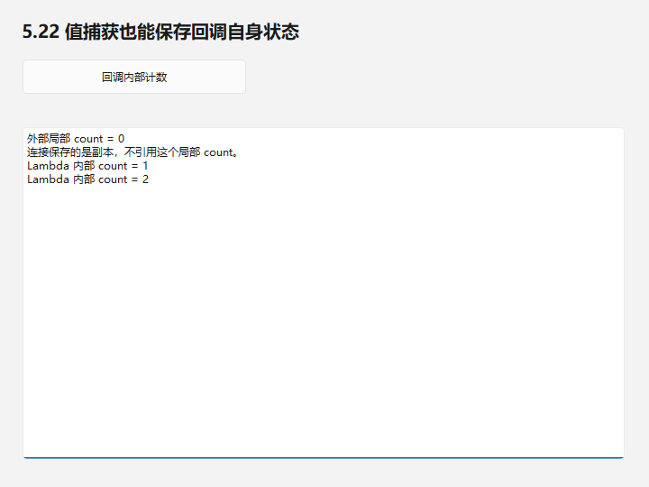

### 完整项目与界面文件

- [05_22_lambda_keeps_copy.pro](../../examples/05_22_lambda_keeps_copy/05_22_lambda_keeps_copy.pro)
- [main.cpp](../../examples/05_22_lambda_keeps_copy/main.cpp)
- [verify.h](../../examples/05_22_lambda_keeps_copy/verify.h)
- [widget.cpp](../../examples/05_22_lambda_keeps_copy/widget.cpp)
- [widget.h](../../examples/05_22_lambda_keeps_copy/widget.h)
- [widget.ui](../../examples/05_22_lambda_keeps_copy/widget.ui)

打开本项目 .pro，选择匹配的 Kit，构建运行；修改界面请打开 .ui，保存后重新构建。verify.h 只在传入 --verify 时执行检查。


## 5.23 成员状态与界面统一刷新

[单独阅读本知识点](../knowledge/05_23_complete_counter.md) · [打开完整项目](../../examples/05_23_complete_counter/README.md)

### 本项目要掌握什么

成员状态与界面统一刷新。这一节只围绕这个核心问题阅读和修改程序。

### 关键代码在哪里

关键片段 1：[ widget.cpp 第 11 行起](../../examples/05_23_complete_counter/widget.cpp#L11)。以下代码从本项目源文件提取，完整上下文见源文件。

```cpp
connect(ui->runButton, &QPushButton::clicked, this,
        [this]()
        {
            ++count_;
            refreshTitle();
            writeLine("加一后 count_ = " + QString::number(count_));
        });
connect(ui->resetButton, &QPushButton::clicked, this,
        [this]()
        {
            count_ = 0;
            refreshTitle();
            writeLine("清零后 count_ = 0");
        });
refreshTitle();
```

关键片段 2：[ widget.cpp 第 42 行起](../../examples/05_23_complete_counter/widget.cpp#L42)。以下代码从本项目源文件提取，完整上下文见源文件。

```cpp
void Widget::refreshTitle()
{
    setWindowTitle(QString("已点击 %1 次").arg(count_));
}
```

### 逐段讲解

count_ 属于窗口，加一和清零都先修改同一份状态，再调用 refreshTitle，避免两个分支各自拼出不同格式。

setupUi 创建按钮，connect 登记行为，初始 refreshTitle 显示 0；用户操作时才更新成员。writeLine 用于观察过程。

### 按执行顺序阅读

构造函数先准备界面与连接；交互发生后才进入回调。阅读时按“发送对象 → 信号或调用 → 回调里的数据 → 被修改对象 → 显示结果”追踪，不要把建立连接当成已经执行操作。

### 容易出错的地方与动手验证

按加一两次、清零、再加一的顺序预测标题；不要另建一个同名局部 count_ 遮蔽成员。

先写下预测，再修改一个条件重新构建。记录实际结果，并用本节代码中的变量、对象和调用顺序解释原因；仅仅没有报错不代表已经验证了所有分支。

### 运行结果


### 完整项目与界面文件

- [05_23_complete_counter.pro](../../examples/05_23_complete_counter/05_23_complete_counter.pro)
- [main.cpp](../../examples/05_23_complete_counter/main.cpp)
- [verify.h](../../examples/05_23_complete_counter/verify.h)
- [widget.cpp](../../examples/05_23_complete_counter/widget.cpp)
- [widget.h](../../examples/05_23_complete_counter/widget.h)
- [widget.ui](../../examples/05_23_complete_counter/widget.ui)

打开本项目 .pro，选择匹配的 Kit，构建运行；修改界面请打开 .ui，保存后重新构建。verify.h 只在传入 --verify 时执行检查。


## 5.24 连接普通成员函数

[单独阅读本知识点](../knowledge/05_24_member_slot.md) · [打开完整项目](../../examples/05_24_member_slot/README.md)

### 本项目要掌握什么

连接普通成员函数。这一节只围绕这个核心问题阅读和修改程序。

### 关键代码在哪里

关键片段 1：[ widget.cpp 第 11 行起](../../examples/05_24_member_slot/widget.cpp#L11)。以下代码从本项目源文件提取，完整上下文见源文件。

```cpp
connect(ui->runButton, &QPushButton::clicked, this, &Widget::increase);
connect(ui->resetButton, &QPushButton::clicked, this,
        [this]()
        {
            count_ = 0;
            refreshTitle();
            writeLine("清零后 count_ = 0");
        });
refreshTitle();
```

关键片段 2：[ widget.cpp 第 41 行起](../../examples/05_24_member_slot/widget.cpp#L41)。以下代码从本项目源文件提取，完整上下文见源文件。

```cpp
void Widget::increase()
{
    ++count_;
    refreshTitle();
    writeLine("加一后 count_ = " + QString::number(count_));
}
```

### 逐段讲解

加一按钮直接连接 &Widget::increase，窗口 this 是实际执行该成员函数的对象；这里不需要把同样的逻辑再包进 Lambda。

increase 更新 count_ 并调用 refreshTitle，与清零回调使用同一成员状态。新式 connect 可以连接匹配的普通成员函数。

### 按执行顺序阅读

构造函数先准备界面与连接；交互发生后才进入回调。阅读时按“发送对象 → 信号或调用 → 回调里的数据 → 被修改对象 → 显示结果”追踪，不要把建立连接当成已经执行操作。

### 容易出错的地方与动手验证

把加一逻辑同时接到另一个按钮，验证两入口共享状态；不要同时保留旧 Lambda 和新连接导致一次点击加两次。

先写下预测，再修改一个条件重新构建。记录实际结果，并用本节代码中的变量、对象和调用顺序解释原因；仅仅没有报错不代表已经验证了所有分支。

### 运行结果

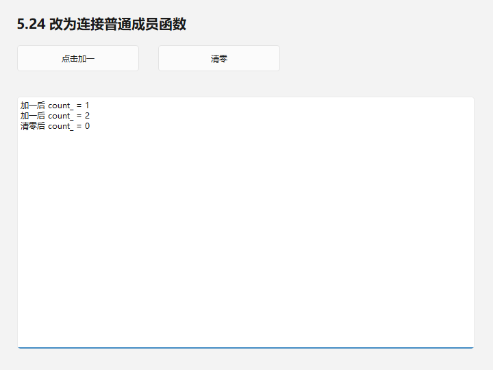

### 完整项目与界面文件

- [05_24_member_slot.pro](../../examples/05_24_member_slot/05_24_member_slot.pro)
- [main.cpp](../../examples/05_24_member_slot/main.cpp)
- [verify.h](../../examples/05_24_member_slot/verify.h)
- [widget.cpp](../../examples/05_24_member_slot/widget.cpp)
- [widget.h](../../examples/05_24_member_slot/widget.h)
- [widget.ui](../../examples/05_24_member_slot/widget.ui)

打开本项目 .pro，选择匹配的 Kit，构建运行；修改界面请打开 .ui，保存后重新构建。verify.h 只在传入 --verify 时执行检查。


## 5.25 用输出验证捕获规则

[单独阅读本知识点](../knowledge/05_25_self_test.md) · [打开完整项目](../../examples/05_25_self_test/README.md)

### 本项目要掌握什么

用输出验证捕获规则。这一节只围绕这个核心问题阅读和修改程序。

### 关键代码在哪里

关键片段 1：[ widget.cpp 第 11 行起](../../examples/05_25_self_test/widget.cpp#L11)。以下代码从本项目源文件提取，完整上下文见源文件。

```cpp
int x = 5;
auto value = [x]() { return x + 1; };
x = 100;
writeLine("题一 f() = " + QString::number(value()) + ", 外部 x = " + QString::number(x));
int y = 5;
auto reference = [&y]() { ++y; };
reference();
writeLine("题二外部 y = " + QString::number(y));
int z = 5;
auto state = [z]() mutable { return ++z; };
int first = state();
int second = state();
writeLine(QString("题三两次返回 %1、%2，外部 z = %3").arg(first).arg(second).arg(z));
```

### 逐段讲解

第一组按值保存 x=5，外部改到 100 后仍返回 6；第二组按引用修改 y，结果 6；第三组 mutable 连续更新 z 副本，返回 6、7，外部仍为 5。

这些都是立即执行的纯 C++ 捕获实验，先逐组判断访问哪个对象，再把相同判断方法用于按钮回调。

### 按执行顺序阅读

本项目的主要实验在构造函数里立即执行：变量初始化 → 定义或连接 → 显式调用 → 显示结果。先在代码中圈出实际调用位置，再区分哪些语句只是定义或登记行为。

### 容易出错的地方与动手验证

先遮住结果写出预测和理由，再运行；输出相同的数字也可能来自不同状态，不能只背结果。

先写下预测，再修改一个条件重新构建。记录实际结果，并用本节代码中的变量、对象和调用顺序解释原因；仅仅没有报错不代表已经验证了所有分支。

### 运行结果

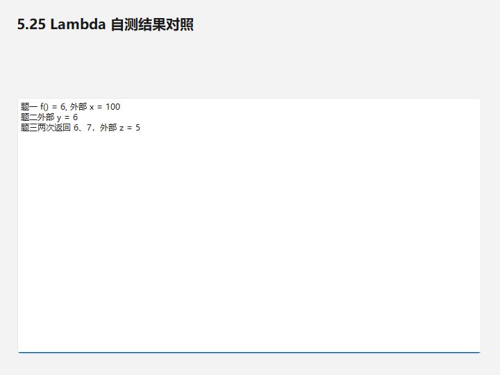

### 完整项目与界面文件

- [05_25_self_test.pro](../../examples/05_25_self_test/05_25_self_test.pro)
- [main.cpp](../../examples/05_25_self_test/main.cpp)
- [verify.h](../../examples/05_25_self_test/verify.h)
- [widget.cpp](../../examples/05_25_self_test/widget.cpp)
- [widget.h](../../examples/05_25_self_test/widget.h)
- [widget.ui](../../examples/05_25_self_test/widget.ui)

打开本项目 .pro，选择匹配的 Kit，构建运行；修改界面请打开 .ui，保存后重新构建。verify.h 只在传入 --verify 时执行检查。


[返回总目录](../README.md)
