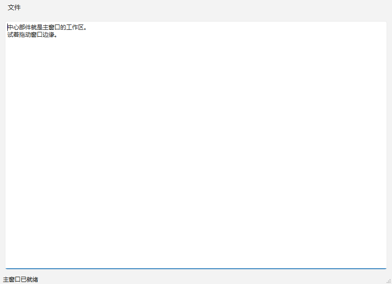
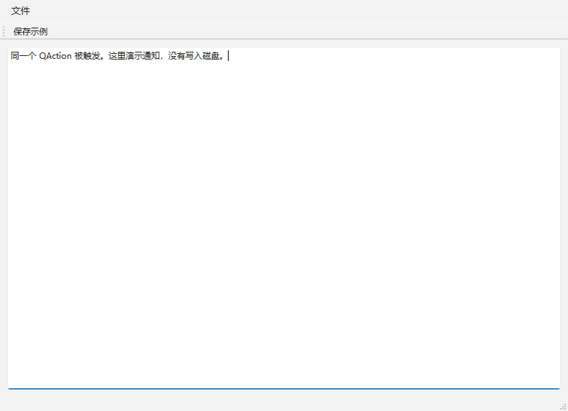
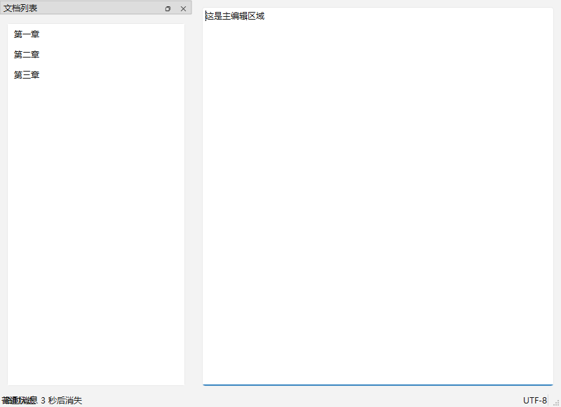

# 第 6 章 QMainWindow

本章按项目逐个学习，每个项目对应一个知识点。先运行再读关键代码，最后做一次修改验证。[理论补充与复习](../foundations/06-mainwindow.md)保留更完整的背景说明。

## 6.1 QMainWindow中心工作区

[单独阅读本知识点](../knowledge/06_01_mainwindow.md) · [打开完整项目](../../examples/06_01_mainwindow/README.md)

### 本项目要掌握什么

QMainWindow中心工作区。这一节只围绕这个核心问题阅读和修改程序。

### 关键代码在哪里

关键片段 1：[ mainwindow.ui 第 16 行起](../../examples/06_01_mainwindow/mainwindow.ui#L16)。以下是相关界面 XML 节选，完整表单保留在项目中。

```xml
  <widget class="QWidget" name="centralwidget">
   <layout class="QVBoxLayout" name="verticalLayout">
    <item>
     <widget class="QTextEdit" name="textEdit">
      <property name="plainText">
       <string>中心部件就是主窗口的工作区。
试着拖动窗口边缘。</string>
      </property>
     </widget>
    </item>
   </layout>
  </widget>
  <widget class="QMenuBar" name="menubar">
   <widget class="QMenu" name="menuFile">
    <property name="title">
     <string>文件</string>
    </property>
   </widget>
   <addaction name="menuFile" />
  </widget>
  <widget class="QStatusBar" name="statusbar" />
 </widget>
 <resources />
 <connections />
</ui>
```

### 逐段讲解

mainwindow.ui 建立 centralwidget、布局和 textEdit，setupUi 内部把工作区交给主窗口管理。构造函数只需设置状态提示。

主窗口自带菜单、工具栏、停靠和状态栏区域，不能把普通 QWidget 的任意布局直接装到 QMainWindow 顶层。

### 按执行顺序阅读

先从 main.cpp 创建应用和窗口进入构造函数，再由 setupUi 根据 .ui 建立对象、属性与布局。对照上面的片段定位本节设置；show 后进入事件循环，界面才会持续响应操作。

### 容易出错的地方与动手验证

在 centralwidget 布局里增加标签，缩放观察工作区；到 .ui 查看对象层级，区分被创建与被正确放置。

先写下预测，再修改一个条件重新构建。记录实际结果，并用本节代码中的变量、对象和调用顺序解释原因；仅仅没有报错不代表已经验证了所有分支。

### 运行结果



### 完整项目与界面文件

- [06_01_mainwindow.pro](../../examples/06_01_mainwindow/06_01_mainwindow.pro)
- [main.cpp](../../examples/06_01_mainwindow/main.cpp)
- [mainwindow.cpp](../../examples/06_01_mainwindow/mainwindow.cpp)
- [mainwindow.h](../../examples/06_01_mainwindow/mainwindow.h)
- [mainwindow.ui](../../examples/06_01_mainwindow/mainwindow.ui)
- [verify.h](../../examples/06_01_mainwindow/verify.h)

打开本项目 .pro，选择匹配的 Kit，构建运行；修改界面请打开 .ui，保存后重新构建。verify.h 只在传入 --verify 时执行检查。


## 6.2 QAction共享命令入口

[单独阅读本知识点](../knowledge/06_02_menu_toolbar.md) · [打开完整项目](../../examples/06_02_menu_toolbar/README.md)

### 本项目要掌握什么

QAction共享命令入口。这一节只围绕这个核心问题阅读和修改程序。

### 关键代码在哪里

关键片段 1：[ mainwindow.cpp 第 11 行起](../../examples/06_02_menu_toolbar/mainwindow.cpp#L11)。以下代码从本项目源文件提取，完整上下文见源文件。

```cpp
connect(ui->action, &QAction::triggered, this, [this]()
        { ui->textEdit->append("同一个 QAction 被触发。这里演示通知，没有写入磁盘。"); });
```

### 逐段讲解

菜单与工具栏在 .ui 中引用同一个 action；只有一次 triggered 连接，因此任一入口触发同一段追加文字的行为。

动作保存快捷键、启用和勾选等命令状态，菜单项与工具按钮是入口。本例演示通知，没有真正保存文件。

### 按执行顺序阅读

构造函数先准备界面与连接；交互发生后才进入回调。阅读时按“发送对象 → 信号或调用 → 回调里的数据 → 被修改对象 → 显示结果”追踪，不要把建立连接当成已经执行操作。

### 容易出错的地方与动手验证

禁用 ui->action 后比较两个入口；两个同名 QAction 是两个对象，不会自动共享状态。

先写下预测，再修改一个条件重新构建。记录实际结果，并用本节代码中的变量、对象和调用顺序解释原因；仅仅没有报错不代表已经验证了所有分支。

### 运行结果



### 完整项目与界面文件

- [06_02_menu_toolbar.pro](../../examples/06_02_menu_toolbar/06_02_menu_toolbar.pro)
- [main.cpp](../../examples/06_02_menu_toolbar/main.cpp)
- [mainwindow.cpp](../../examples/06_02_menu_toolbar/mainwindow.cpp)
- [mainwindow.h](../../examples/06_02_menu_toolbar/mainwindow.h)
- [mainwindow.ui](../../examples/06_02_menu_toolbar/mainwindow.ui)
- [verify.h](../../examples/06_02_menu_toolbar/verify.h)

打开本项目 .pro，选择匹配的 Kit，构建运行；修改界面请打开 .ui，保存后重新构建。verify.h 只在传入 --verify 时执行检查。


## 6.3 临时状态与停靠区域

[单独阅读本知识点](../knowledge/06_03_status_dock.md) · [打开完整项目](../../examples/06_03_status_dock/README.md)

### 本项目要掌握什么

临时状态与停靠区域。这一节只围绕这个核心问题阅读和修改程序。

### 关键代码在哪里

关键片段 1：[ mainwindow.cpp 第 11 行起](../../examples/06_03_status_dock/mainwindow.cpp#L11)。以下代码从本项目源文件提取，完整上下文见源文件。

```cpp
ui->statusbar->addWidget(new QLabel("普通状态", this));
ui->statusbar->addPermanentWidget(new QLabel("UTF-8", this));
ui->statusbar->showMessage("临时消息 3 秒后消失", 3000);
```

### 逐段讲解

dockWidget 和文档列表在 .ui 配置，状态栏通过 addWidget 与 addPermanentWidget 加入两种状态控件。

showMessage 的 3000 单位为毫秒，临时消息会覆盖普通状态区域；永久区域用来保留编码等信息。DockWidget 管理工作区旁的可停靠内容。

### 按执行顺序阅读

构造函数先准备界面与连接；交互发生后才进入回调。阅读时按“发送对象 → 信号或调用 → 回调里的数据 → 被修改对象 → 显示结果”追踪，不要把建立连接当成已经执行操作。

### 容易出错的地方与动手验证

等待临时消息消失并拖动停靠面板；隐藏面板后应重新显示已有实例，不要反复 new 相同面板。

先写下预测，再修改一个条件重新构建。记录实际结果，并用本节代码中的变量、对象和调用顺序解释原因；仅仅没有报错不代表已经验证了所有分支。

### 运行结果



### 完整项目与界面文件

- [06_03_status_dock.pro](../../examples/06_03_status_dock/06_03_status_dock.pro)
- [main.cpp](../../examples/06_03_status_dock/main.cpp)
- [mainwindow.cpp](../../examples/06_03_status_dock/mainwindow.cpp)
- [mainwindow.h](../../examples/06_03_status_dock/mainwindow.h)
- [mainwindow.ui](../../examples/06_03_status_dock/mainwindow.ui)
- [verify.h](../../examples/06_03_status_dock/verify.h)

打开本项目 .pro，选择匹配的 Kit，构建运行；修改界面请打开 .ui，保存后重新构建。verify.h 只在传入 --verify 时执行检查。


[返回总目录](../README.md)
