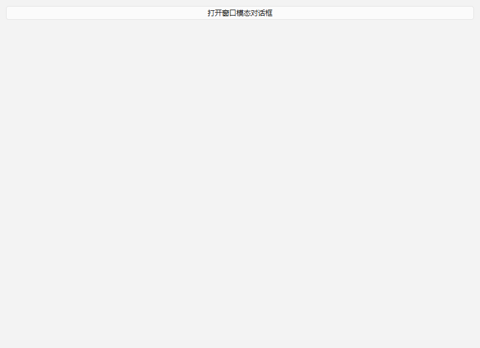
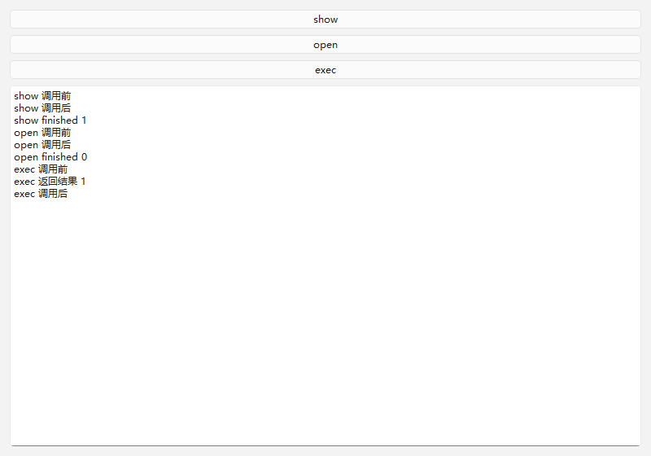
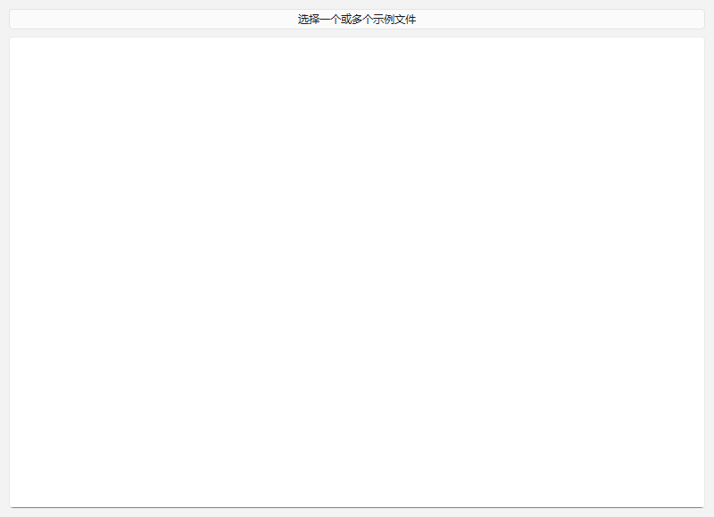
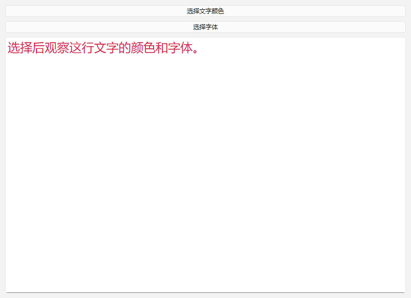
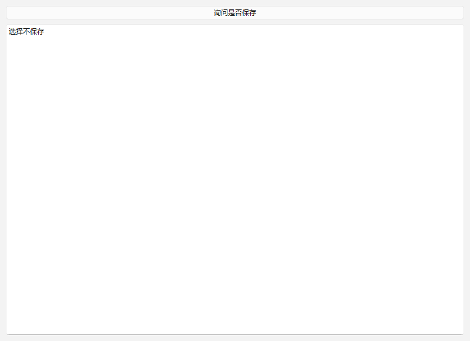
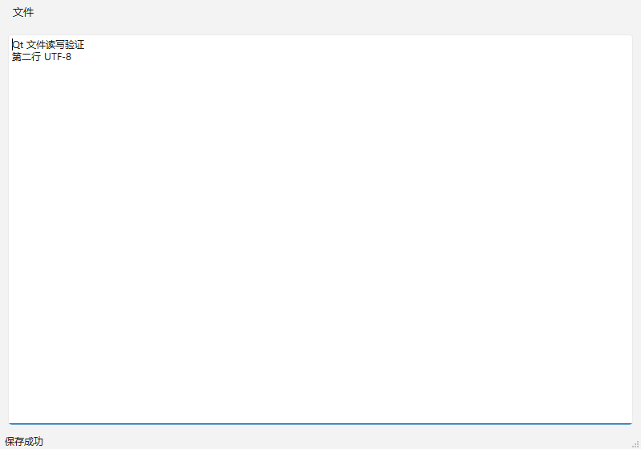

# 第 7 章 对话框QDialog

本章按项目逐个学习，每个项目对应一个知识点。先运行再读关键代码，最后做一次修改验证。[理论补充与复习](../foundations/07-dialogs.md)保留更完整的背景说明。

## 7.1 异步对话框的生命周期

[单独阅读本知识点](../knowledge/07_01_dialog.md) · [打开完整项目](../../examples/07_01_dialog/README.md)

### 本项目要掌握什么

异步对话框的生命周期。这一节只围绕这个核心问题阅读和修改程序。

### 关键代码在哪里

关键片段 1：[ mainwindow.cpp 第 11 行起](../../examples/07_01_dialog/mainwindow.cpp#L11)。以下代码从本项目源文件提取，完整上下文见源文件。

```cpp
connect(ui->run, &QPushButton::clicked, this,
        [this]()
        {
            auto *dialog = new Dialog(this);
            dialog->setAttribute(Qt::WA_DeleteOnClose);
            dialog->setWindowTitle("open 立即返回");
            dialog->open();
        });
```

### 逐段讲解

new Dialog(this) 建立有父对象的对话框，Dialog 自己加载 dialog.ui。WA_DeleteOnClose 使它关闭后回收，open 显示窗口模态对话框并立即返回。

父窗口暂时不能输入，不等于代码停在 open 等待；标准按钮在 .ui 中连接 accept/reject，结束后再处理结果。

### 按执行顺序阅读

构造函数先准备界面与连接；交互发生后才进入回调。阅读时按“发送对象 → 信号或调用 → 回调里的数据 → 被修改对象 → 显示结果”追踪，不要把建立连接当成已经执行操作。

### 容易出错的地方与动手验证

打开后比较父窗口输入状态；不要用构造函数中的局部栈对象 show/open 后立刻离开作用域。

先写下预测，再修改一个条件重新构建。记录实际结果，并用本节代码中的变量、对象和调用顺序解释原因；仅仅没有报错不代表已经验证了所有分支。

### 运行结果



### 完整项目与界面文件

- [07_01_dialog.pro](../../examples/07_01_dialog/07_01_dialog.pro)
- [dialog.cpp](../../examples/07_01_dialog/dialog.cpp)
- [dialog.h](../../examples/07_01_dialog/dialog.h)
- [dialog.ui](../../examples/07_01_dialog/dialog.ui)
- [main.cpp](../../examples/07_01_dialog/main.cpp)
- [mainwindow.cpp](../../examples/07_01_dialog/mainwindow.cpp)
- [mainwindow.h](../../examples/07_01_dialog/mainwindow.h)
- [mainwindow.ui](../../examples/07_01_dialog/mainwindow.ui)
- [verify.h](../../examples/07_01_dialog/verify.h)

打开本项目 .pro，选择匹配的 Kit，构建运行；修改界面请打开 .ui，保存后重新构建。verify.h 只在传入 --verify 时执行检查。


## 7.2 show open exec的返回时机

[单独阅读本知识点](../knowledge/07_02_dialog_modes.md) · [打开完整项目](../../examples/07_02_dialog_modes/README.md)

### 本项目要掌握什么

show open exec的返回时机。这一节只围绕这个核心问题阅读和修改程序。

### 关键代码在哪里

关键片段 1：[ widget.cpp 第 29 行起](../../examples/07_02_dialog_modes/widget.cpp#L29)。以下代码从本项目源文件提取，完整上下文见源文件。

```cpp
void Widget::openMode(const QString &mode)
{
    ui->logEdit->appendPlainText(mode + " 调用前");
    if (mode == "exec")
    {
        Dialog dialog(this); // exec 返回之前，局部对象一直存在。
        dialog.setObjectName("demoDialog");
        dialog.setWindowTitle(mode + " 对话框");
        const int result = dialog.exec();
        ui->logEdit->appendPlainText("exec 返回结果 " + QString::number(result));
    }
    else
    {
        auto *dialog = new Dialog(this);
        dialog->setObjectName("demoDialog");
        dialog->setWindowTitle(mode + " 对话框");
        dialog->setAttribute(Qt::WA_DeleteOnClose);
        connect(dialog, &QDialog::finished, this, [this, mode](int result)
                { ui->logEdit->appendPlainText(mode + " finished " + QString::number(result)); });
        if (mode == "open")
            dialog->open();
        else
            dialog->show();
    }
    ui->logEdit->appendPlainText(mode + " 调用后");
}
```

### 逐段讲解

三个按钮调用同一 openMode，以 mode 区分行为。show/open 使用堆对话框和结束通知；exec 示例用栈对象并取得返回结果。

show/open 的调用后日志先出现，exec 的调用后日志要等关闭；exec 内仍处理事件，不能把它理解为整个 GUI 停止。

### 关键分支再拆一步

exec 分支的局部 Dialog 在 exec 返回前一直存在，关闭后才读 result。异步分支的对象在函数返回后仍要存在，所以用 new 和 parent，并在 finished 中记录结果，WA_DeleteOnClose 负责关闭后回收。日志中的“调用后”位置是判断是否等待的证据，窗口模态则要另看父窗口能否输入。

### 按执行顺序阅读

构造函数先准备界面与连接；交互发生后才进入回调。阅读时按“发送对象 → 信号或调用 → 回调里的数据 → 被修改对象 → 显示结果”追踪，不要把建立连接当成已经执行操作。

### 容易出错的地方与动手验证

逐个确认与取消，并比较父窗口能否操作；不要让异步栈对象先析构，也不要给栈对话框设置自动删除。

先写下预测，再修改一个条件重新构建。记录实际结果，并用本节代码中的变量、对象和调用顺序解释原因；仅仅没有报错不代表已经验证了所有分支。

### 运行结果



### 完整项目与界面文件

- [07_02_dialog_modes.pro](../../examples/07_02_dialog_modes/07_02_dialog_modes.pro)
- [dialog.cpp](../../examples/07_02_dialog_modes/dialog.cpp)
- [dialog.h](../../examples/07_02_dialog_modes/dialog.h)
- [dialog.ui](../../examples/07_02_dialog_modes/dialog.ui)
- [main.cpp](../../examples/07_02_dialog_modes/main.cpp)
- [verify.h](../../examples/07_02_dialog_modes/verify.h)
- [widget.cpp](../../examples/07_02_dialog_modes/widget.cpp)
- [widget.h](../../examples/07_02_dialog_modes/widget.h)
- [widget.ui](../../examples/07_02_dialog_modes/widget.ui)

打开本项目 .pro，选择匹配的 Kit，构建运行；修改界面请打开 .ui，保存后重新构建。verify.h 只在传入 --verify 时执行检查。


## 7.3 文件选择与取消处理

[单独阅读本知识点](../knowledge/07_03_file_dialog.md) · [打开完整项目](../../examples/07_03_file_dialog/README.md)

### 本项目要掌握什么

文件选择与取消处理。这一节只围绕这个核心问题阅读和修改程序。

### 关键代码在哪里

关键片段 1：[ mainwindow.cpp 第 11 行起](../../examples/07_03_file_dialog/mainwindow.cpp#L11)。以下代码从本项目源文件提取，完整上下文见源文件。

```cpp
connect(ui->run, &QPushButton::clicked, this,
        [this]()
        {
            auto *dialog = new QFileDialog(this, "选择文件",
                                           QStringLiteral(QT_LESSON_SOURCE_DIR "/samples"));
            dialog->setOption(QFileDialog::DontUseNativeDialog);
            dialog->setFileMode(QFileDialog::ExistingFiles);
            dialog->setNameFilter("Text (*.txt);;Images (*.png *.jpg)");
            dialog->setAttribute(Qt::WA_DeleteOnClose);
            connect(dialog, &QFileDialog::filesSelected, ui->resultEdit,
                    [this](const QStringList &files)
                    { ui->resultEdit->setPlainText(files.join('\n')); });
            dialog->open();
        });
```

### 逐段讲解

QFileDialog 先设置 ExistingFiles 和过滤器，再连接 filesSelected，最后 open；只有完成文件选择时才把路径列表写入结果框。

过滤器只是帮助筛选文件，取消不执行选择逻辑。当前示例选择路径，不读取文件内容；读取与安全保存由后面的文本编辑器承担。

### 关键分支再拆一步

构造 QFileDialog 只准备选择过程，ExistingFiles 允许多个现有文件，nameFilter 只设置筛选规则。filesSelected 的 QStringList 是确认选择后的结果；join 将多条路径逐行显示。取消不会发出成功选择的这段处理，文件内容仍需另外用 QFile 打开。

### 按执行顺序阅读

构造函数先准备界面与连接；交互发生后才进入回调。阅读时按“发送对象 → 信号或调用 → 回调里的数据 → 被修改对象 → 显示结果”追踪，不要把建立连接当成已经执行操作。

### 容易出错的地方与动手验证

先取消再选一个或多个文件，比较结果；不要把相对路径的基准误认为源码目录。

先写下预测，再修改一个条件重新构建。记录实际结果，并用本节代码中的变量、对象和调用顺序解释原因；仅仅没有报错不代表已经验证了所有分支。

### 运行结果



### 完整项目与界面文件

- [07_03_file_dialog.pro](../../examples/07_03_file_dialog/07_03_file_dialog.pro)
- [main.cpp](../../examples/07_03_file_dialog/main.cpp)
- [mainwindow.cpp](../../examples/07_03_file_dialog/mainwindow.cpp)
- [mainwindow.h](../../examples/07_03_file_dialog/mainwindow.h)
- [mainwindow.ui](../../examples/07_03_file_dialog/mainwindow.ui)
- [verify.h](../../examples/07_03_file_dialog/verify.h)

打开本项目 .pro，选择匹配的 Kit，构建运行；修改界面请打开 .ui，保存后重新构建。verify.h 只在传入 --verify 时执行检查。


## 7.4 确认颜色或字体后再应用

[单独阅读本知识点](../knowledge/07_04_color_font.md) · [打开完整项目](../../examples/07_04_color_font/README.md)

### 本项目要掌握什么

确认颜色或字体后再应用。这一节只围绕这个核心问题阅读和修改程序。

### 关键代码在哪里

关键片段 1：[ mainwindow.cpp 第 12 行起](../../examples/07_04_color_font/mainwindow.cpp#L12)。以下代码从本项目源文件提取，完整上下文见源文件。

```cpp
connect(ui->run, &QPushButton::clicked, this,
        [this]()
        {
            auto *dialog =
                new QColorDialog(ui->plainTextEdit->palette().color(QPalette::Text), this);
            dialog->setOption(QColorDialog::DontUseNativeDialog);
            dialog->setAttribute(Qt::WA_DeleteOnClose);
            connect(dialog, &QColorDialog::colorSelected, ui->plainTextEdit,
                    [this](const QColor &value)
                    {
                        auto pal = ui->plainTextEdit->palette();
                        pal.setColor(QPalette::Text, value);
                        ui->plainTextEdit->setPalette(pal);
                    });
            dialog->open();
        });
connect(ui->fontButton, &QPushButton::clicked, this,
        [this]()
        {
            auto *dialog = new QFontDialog(ui->plainTextEdit->font(), this);
            dialog->setOption(QFontDialog::DontUseNativeDialog);
            dialog->setAttribute(Qt::WA_DeleteOnClose);
            connect(dialog, &QFontDialog::fontSelected, ui->plainTextEdit, &QWidget::setFont);
            dialog->open();
        });
```

### 逐段讲解

颜色框从编辑器当前 palette 的 Text 角色取得初始值，colorSelected 发生后修改该角色并重新设置 palette。

字体框使用当前 font，并把 fontSelected 连接 setFont。选择过程与最终确认要区分，取消应保留原设置。

### 按执行顺序阅读

构造函数先准备界面与连接；交互发生后才进入回调。阅读时按“发送对象 → 信号或调用 → 回调里的数据 → 被修改对象 → 显示结果”追踪，不要把建立连接当成已经执行操作。

### 容易出错的地方与动手验证

分别取消和确认两个对话框；不能把静态 getFont 返回的某个字体当作用户一定确认，要检查确认标记。

先写下预测，再修改一个条件重新构建。记录实际结果，并用本节代码中的变量、对象和调用顺序解释原因；仅仅没有报错不代表已经验证了所有分支。

### 运行结果



### 完整项目与界面文件

- [07_04_color_font.pro](../../examples/07_04_color_font/07_04_color_font.pro)
- [main.cpp](../../examples/07_04_color_font/main.cpp)
- [mainwindow.cpp](../../examples/07_04_color_font/mainwindow.cpp)
- [mainwindow.h](../../examples/07_04_color_font/mainwindow.h)
- [mainwindow.ui](../../examples/07_04_color_font/mainwindow.ui)
- [verify.h](../../examples/07_04_color_font/verify.h)

打开本项目 .pro，选择匹配的 Kit，构建运行；修改界面请打开 .ui，保存后重新构建。verify.h 只在传入 --verify 时执行检查。


## 7.5 消息框返回值与控制分支

[单独阅读本知识点](../knowledge/07_05_messagebox.md) · [打开完整项目](../../examples/07_05_messagebox/README.md)

### 本项目要掌握什么

消息框返回值与控制分支。这一节只围绕这个核心问题阅读和修改程序。

### 关键代码在哪里

关键片段 1：[ mainwindow.cpp 第 11 行起](../../examples/07_05_messagebox/mainwindow.cpp#L11)。以下代码从本项目源文件提取，完整上下文见源文件。

```cpp
connect(ui->run, &QPushButton::clicked, this,
        [this]()
        {
            auto *box =
                new QMessageBox(QMessageBox::Question, "保存选择", "文件已修改，是否保存？",
                                QMessageBox::Yes | QMessageBox::No | QMessageBox::Cancel, this);
            box->setDefaultButton(QMessageBox::Cancel);
            box->setAttribute(Qt::WA_DeleteOnClose);
            connect(box, &QDialog::finished, ui->resultEdit,
                    [this](int result)
                    {
                        if (result == QMessageBox::Yes)
                            ui->resultEdit->append("选择保存（仅演示）");
                        else if (result == QMessageBox::No)
                            ui->resultEdit->append("选择不保存");
                        else
                            ui->resultEdit->append("取消当前操作");
                    });
            box->open();
        });
```

### 逐段讲解

消息框提供 Yes、No、Cancel，并把默认按钮设为 Cancel；finished 给出的结果必须与具体 StandardButton 值比较。

三个枚举值并不等同于 true/false 的业务含义。本例显示选择结果，真实保存应在成功写入后才允许继续关闭或切换。

### 按执行顺序阅读

构造函数先准备界面与连接；交互发生后才进入回调。阅读时按“发送对象 → 信号或调用 → 回调里的数据 → 被修改对象 → 显示结果”追踪，不要把建立连接当成已经执行操作。

### 容易出错的地方与动手验证

测试按钮、Enter 与取消路径；不能只写 if(result) 就把全部非零返回值解释成保存。

先写下预测，再修改一个条件重新构建。记录实际结果，并用本节代码中的变量、对象和调用顺序解释原因；仅仅没有报错不代表已经验证了所有分支。

### 运行结果



### 完整项目与界面文件

- [07_05_messagebox.pro](../../examples/07_05_messagebox/07_05_messagebox.pro)
- [main.cpp](../../examples/07_05_messagebox/main.cpp)
- [mainwindow.cpp](../../examples/07_05_messagebox/mainwindow.cpp)
- [mainwindow.h](../../examples/07_05_messagebox/mainwindow.h)
- [mainwindow.ui](../../examples/07_05_messagebox/mainwindow.ui)
- [verify.h](../../examples/07_05_messagebox/verify.h)

打开本项目 .pro，选择匹配的 Kit，构建运行；修改界面请打开 .ui，保存后重新构建。verify.h 只在传入 --verify 时执行检查。


## 7.6 打开编辑保存的完整流程

[单独阅读本知识点](../knowledge/07_06_text_editor.md) · [打开完整项目](../../examples/07_06_text_editor/README.md)

### 本项目要掌握什么

打开编辑保存的完整流程。这一节只围绕这个核心问题阅读和修改程序。

### 关键代码在哪里

关键片段 1：[ mainwindow.cpp 第 38 行起](../../examples/07_06_text_editor/mainwindow.cpp#L38)。以下代码从本项目源文件提取，完整上下文见源文件。

```cpp
bool MainWindow::loadPath(const QString &path)
{
    QFile file(path);
    if (!file.open(QIODevice::ReadOnly))
    {
        statusBar()->showMessage("打开失败：" + file.errorString());
        return false;
    }
    const QByteArray bytes = file.readAll();
    if (file.error() != QFileDevice::NoError)
    {
        statusBar()->showMessage("读取失败：" + file.errorString());
        return false;
    }
    // 这个练习约定 UTF-8。其他编码应先识别或明确指定后再解码。
    ui->plainTextEdit->setPlainText(QString::fromUtf8(bytes));
    path_ = path;
    ui->plainTextEdit->document()->setModified(false);
    updateTitle();
    return true;
}
```

关键片段 2：[ mainwindow.cpp 第 60 行起](../../examples/07_06_text_editor/mainwindow.cpp#L60)。以下代码从本项目源文件提取，完整上下文见源文件。

```cpp
bool MainWindow::savePath(const QString &path)
{
    QSaveFile file(path);
    if (!file.open(QIODevice::WriteOnly))
    {
        statusBar()->showMessage("无法保存：" + file.errorString());
        return false;
    }
    const auto bytes = ui->plainTextEdit->toPlainText().toUtf8();
    const bool written = file.write(bytes) == bytes.size();
    if (!written || !file.commit())
    {
        statusBar()->showMessage("保存失败：" + file.errorString());
        return false;
    }
    path_ = path;
    ui->plainTextEdit->document()->setModified(false);
    updateTitle();
    statusBar()->showMessage("保存成功", 2000);
    return true;
}
```

关键片段 3：[ mainwindow.cpp 第 103 行起](../../examples/07_06_text_editor/mainwindow.cpp#L103)。以下代码从本项目源文件提取，完整上下文见源文件。

```cpp
bool MainWindow::confirmDiscard()
{
    if (!ui->plainTextEdit->document()->isModified())
        return true;
    const auto choice = QMessageBox::question(
        this, "未保存的修改", "是否保存后继续？",
        QMessageBox::Yes | QMessageBox::No | QMessageBox::Cancel, QMessageBox::Cancel);
    if (choice == QMessageBox::Cancel)
        return false;
    if (choice == QMessageBox::No)
        return true;
    return saveCurrent(); // 保存取消或失败时，继续保留当前窗口与文档。
}
```

### 逐段讲解

loadPath 先检查打开和读取错误，成功后再替换文本；savePath 用 QSaveFile 写 UTF-8 字节，检查写入长度及 commit。

确认保存成功才清除 modified；confirmDiscard 将保存、不保存、取消接入打开和 closeEvent。取消路径或写入失败应保留当前修改。

### 关键分支再拆一步

保存函数要逐个检查四个关口：open(WriteOnly) 失败立即返回；write 的返回长度要等于完整 UTF-8 字节数；commit 成功才真正确认写入；完成后再更新 path_ 和 modified。confirmDiscard 中 Cancel 返回 false，No 返回 true，Yes 则把决定交给 saveCurrent 的实际结果。这样保存对话框取消或磁盘错误都不会继续丢弃修改。

### 按执行顺序阅读

构造函数先准备界面与连接；交互发生后才进入回调。阅读时按“发送对象 → 信号或调用 → 回调里的数据 → 被修改对象 → 显示结果”追踪，不要把建立连接当成已经执行操作。

### 容易出错的地方与动手验证

输入中文与换行，保存后读回，再测试未保存关闭与取消；文件选择框选出路径不代表已写入。

先写下预测，再修改一个条件重新构建。记录实际结果，并用本节代码中的变量、对象和调用顺序解释原因；仅仅没有报错不代表已经验证了所有分支。

### 运行结果



### 完整项目与界面文件

- [07_06_text_editor.pro](../../examples/07_06_text_editor/07_06_text_editor.pro)
- [main.cpp](../../examples/07_06_text_editor/main.cpp)
- [mainwindow.cpp](../../examples/07_06_text_editor/mainwindow.cpp)
- [mainwindow.h](../../examples/07_06_text_editor/mainwindow.h)
- [mainwindow.ui](../../examples/07_06_text_editor/mainwindow.ui)
- [verify.h](../../examples/07_06_text_editor/verify.h)

打开本项目 .pro，选择匹配的 Kit，构建运行；修改界面请打开 .ui，保存后重新构建。verify.h 只在传入 --verify 时执行检查。


[返回总目录](../README.md)
