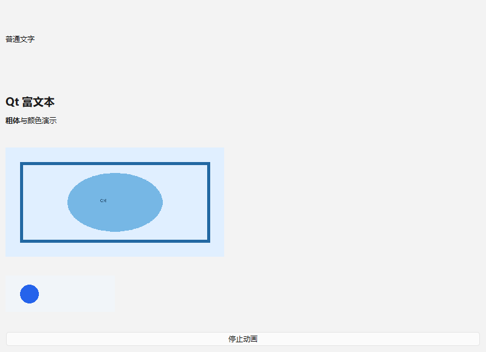
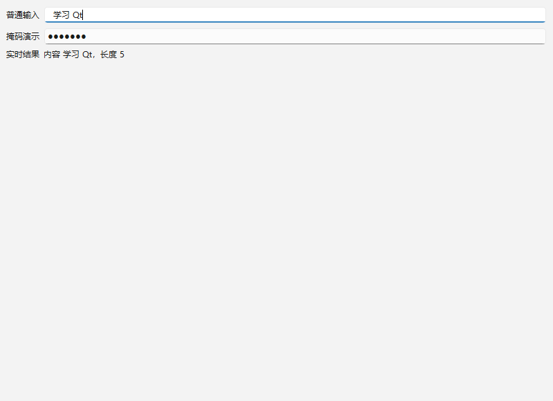
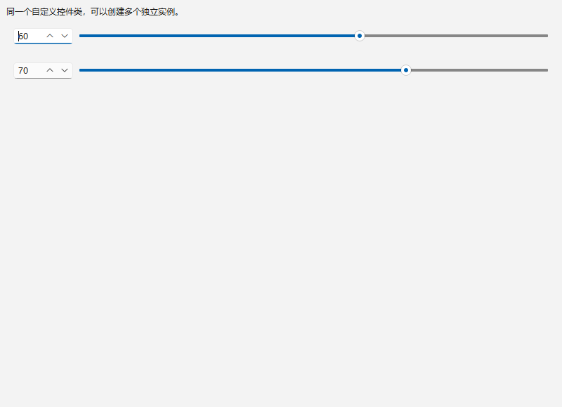
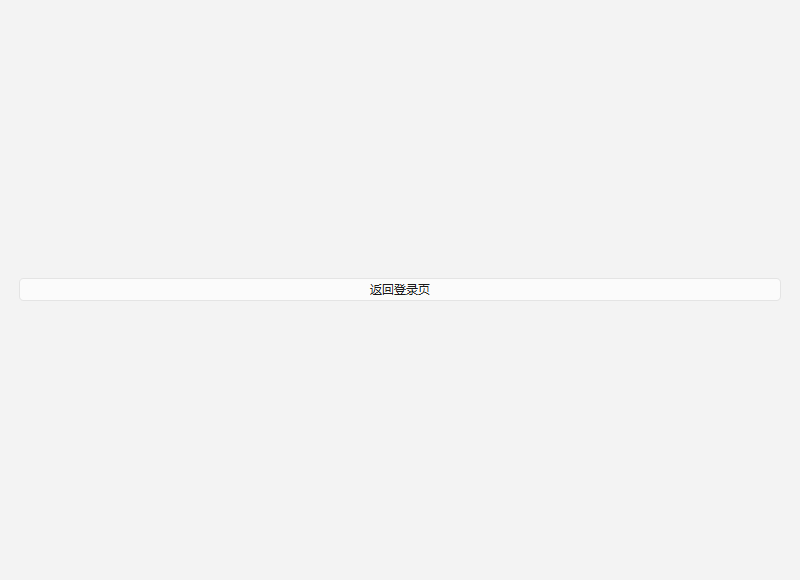

# 第 9 章 常用控件

本章按项目逐个学习，每个项目对应一个知识点。先运行再读关键代码，最后做一次修改验证。[理论补充与复习](../foundations/09-widgets.md)保留更完整的背景说明。

## 9.1 标签的文本图像与动画接口

[单独阅读本知识点](../knowledge/09_01_label_movie.md) · [打开完整项目](../../examples/09_01_label_movie/README.md)

### 本项目要掌握什么

标签的文本图像与动画接口。这一节只围绕这个核心问题阅读和修改程序。

### 关键代码在哪里

关键片段 1：[ mainwindow.cpp 第 11 行起](../../examples/09_01_label_movie/mainwindow.cpp#L11)。以下代码从本项目源文件提取，完整上下文见源文件。

```cpp
ui->imageLabel->setPixmap(QPixmap(":/images/demo.png").scaledToWidth(360));
auto *movie = new QMovie(":/images/demo.gif", QByteArray(), this);
ui->animationLabel->setMovie(movie);
movie->start();
connect(ui->run, &QPushButton::clicked, movie, &QMovie::stop);
```

### 逐段讲解

setPixmap 显示静态图片，setMovie 绑定动画对象，movie->start 才开始播放；停止按钮连接 QMovie::stop。

QMovie 的 parent 是窗口，QLabel 不接管动画所有权。富文本内容属于 Qt 支持的子集，不是完整浏览器。

### 按执行顺序阅读

构造函数先准备界面与连接；交互发生后才进入回调。阅读时按“发送对象 → 信号或调用 → 回调里的数据 → 被修改对象 → 显示结果”追踪，不要把建立连接当成已经执行操作。

### 容易出错的地方与动手验证

比较 stop 与 setPaused，检查 qrc 和 GIF 插件；setText(":/images/demo.png") 只会显示路径文字。

先写下预测，再修改一个条件重新构建。记录实际结果，并用本节代码中的变量、对象和调用顺序解释原因；仅仅没有报错不代表已经验证了所有分支。

### 运行结果



### 完整项目与界面文件

- [09_01_label_movie.pro](../../examples/09_01_label_movie/09_01_label_movie.pro)
- [assets.qrc](../../examples/09_01_label_movie/assets.qrc)
- [main.cpp](../../examples/09_01_label_movie/main.cpp)
- [mainwindow.cpp](../../examples/09_01_label_movie/mainwindow.cpp)
- [mainwindow.h](../../examples/09_01_label_movie/mainwindow.h)
- [mainwindow.ui](../../examples/09_01_label_movie/mainwindow.ui)
- [verify.h](../../examples/09_01_label_movie/verify.h)

打开本项目 .pro，选择匹配的 Kit，构建运行；修改界面请打开 .ui，保存后重新构建。verify.h 只在传入 --verify 时执行检查。


## 9.2 输入内容与显示模式

[单独阅读本知识点](../knowledge/09_02_lineedit.md) · [打开完整项目](../../examples/09_02_lineedit/README.md)

### 本项目要掌握什么

输入内容与显示模式。这一节只围绕这个核心问题阅读和修改程序。

### 关键代码在哪里

关键片段 1：[ mainwindow.cpp 第 11 行起](../../examples/09_02_lineedit/mainwindow.cpp#L11)。以下代码从本项目源文件提取，完整上下文见源文件。

```cpp
ui->name->setTextMargins(8, 0, 8, 0);
connect(ui->name, &QLineEdit::textChanged, this, [this](const QString &text)
        { ui->resultLabel->setText(QString("内容 %1，长度 %2").arg(text).arg(text.size())); });
```

### 逐段讲解

name 的 textChanged 提供真实文本，Lambda 同时更新内容和长度；placeholderText 在空输入时作提示，不是 text 的一部分。

Password 改变显示方式，不负责加密。textChanged 也可能由代码 setText 触发，与只关注用户编辑的信号要区分。

### 按执行顺序阅读

构造函数先准备界面与连接；交互发生后才进入回调。阅读时按“发送对象 → 信号或调用 → 回调里的数据 → 被修改对象 → 显示结果”追踪，不要把建立连接当成已经执行操作。

### 容易出错的地方与动手验证

清空再输入，比较 text 与 displayText；给密码框设置掩码不等于可以安全记录或存储密码。

先写下预测，再修改一个条件重新构建。记录实际结果，并用本节代码中的变量、对象和调用顺序解释原因；仅仅没有报错不代表已经验证了所有分支。

### 运行结果



### 完整项目与界面文件

- [09_02_lineedit.pro](../../examples/09_02_lineedit/09_02_lineedit.pro)
- [main.cpp](../../examples/09_02_lineedit/main.cpp)
- [mainwindow.cpp](../../examples/09_02_lineedit/mainwindow.cpp)
- [mainwindow.h](../../examples/09_02_lineedit/mainwindow.h)
- [mainwindow.ui](../../examples/09_02_lineedit/mainwindow.ui)
- [verify.h](../../examples/09_02_lineedit/verify.h)

打开本项目 .pro，选择匹配的 Kit，构建运行；修改界面请打开 .ui，保存后重新构建。verify.h 只在传入 --verify 时执行检查。


## 9.3 可复用组合控件与提升

[单独阅读本知识点](../knowledge/09_03_custom_widget.md) · [打开完整项目](../../examples/09_03_custom_widget/README.md)

### 本项目要掌握什么

可复用组合控件与提升。这一节只围绕这个核心问题阅读和修改程序。

### 关键代码在哪里

关键片段 1：[ smallwidget.cpp 第 4 行起](../../examples/09_03_custom_widget/smallwidget.cpp#L4)。以下代码从本项目源文件提取，完整上下文见源文件。

```cpp
SmallWidget::SmallWidget(QWidget *parent)
    : QWidget(parent)
    , ui(new Ui::SmallWidget)
{
    ui->setupUi(this);
    connect(ui->spinBox, &QSpinBox::valueChanged, ui->horizontalSlider, &QSlider::setValue);
    connect(ui->horizontalSlider, &QSlider::valueChanged, ui->spinBox, &QSpinBox::setValue);
}
```

关键片段 2：[ smallwidget.cpp 第 18 行起](../../examples/09_03_custom_widget/smallwidget.cpp#L18)。以下代码从本项目源文件提取，完整上下文见源文件。

```cpp
void SmallWidget::setValue(int value)
{
    ui->spinBox->setValue(value);
}
```

关键片段 3：[ smallwidget.cpp 第 23 行起](../../examples/09_03_custom_widget/smallwidget.cpp#L23)。以下代码从本项目源文件提取，完整上下文见源文件。

```cpp
int SmallWidget::value() const
{
    return ui->spinBox->value();
}
```

### 逐段讲解

mainwindow.ui 的 first、second 提升为 SmallWidget；每个实例的 smallwidget.ui 分别创建 SpinBox 和 Slider。

双向连接把两个值同步起来，setValue/value 提供对外接口；相同值不再重复触发变化，使本例同步能稳定结束。

### 关键分支再拆一步

外层 first 与 second 的 Ui 指针、SpinBox 和 Slider 都分别创建。SmallWidget::setValue 只调用内部 SpinBox 的 setter，后者通过 valueChanged 推动 Slider；Slider 再通知 SpinBox 时值已相同，标准控件不会无限重复发送相同变化。自己的组件也应建立这种值变化约束。

### 按执行顺序阅读

构造函数先准备界面与连接；交互发生后才进入回调。阅读时按“发送对象 → 信号或调用 → 回调里的数据 → 被修改对象 → 显示结果”追踪，不要把建立连接当成已经执行操作。

### 容易出错的地方与动手验证

改变第一个实例确认第二个不变；自己的 setter 若每次都无条件发信号，可能需要先比较值或用 QSignalBlocker。

先写下预测，再修改一个条件重新构建。记录实际结果，并用本节代码中的变量、对象和调用顺序解释原因；仅仅没有报错不代表已经验证了所有分支。

### 运行结果



### 完整项目与界面文件

- [09_03_custom_widget.pro](../../examples/09_03_custom_widget/09_03_custom_widget.pro)
- [main.cpp](../../examples/09_03_custom_widget/main.cpp)
- [mainwindow.cpp](../../examples/09_03_custom_widget/mainwindow.cpp)
- [mainwindow.h](../../examples/09_03_custom_widget/mainwindow.h)
- [mainwindow.ui](../../examples/09_03_custom_widget/mainwindow.ui)
- [smallwidget.cpp](../../examples/09_03_custom_widget/smallwidget.cpp)
- [smallwidget.h](../../examples/09_03_custom_widget/smallwidget.h)
- [smallwidget.ui](../../examples/09_03_custom_widget/smallwidget.ui)
- [verify.h](../../examples/09_03_custom_widget/verify.h)

打开本项目 .pro，选择匹配的 Kit，构建运行；修改界面请打开 .ui，保存后重新构建。verify.h 只在传入 --verify 时执行检查。


## 9.4 堆叠页面与状态保留

[单独阅读本知识点](../knowledge/09_04_stacked_pages.md) · [打开完整项目](../../examples/09_04_stacked_pages/README.md)

### 本项目要掌握什么

堆叠页面与状态保留。这一节只围绕这个核心问题阅读和修改程序。

### 关键代码在哪里

关键片段 1：[ mainwindow.cpp 第 11 行起](../../examples/09_04_stacked_pages/mainwindow.cpp#L11)。以下代码从本项目源文件提取，完整上下文见源文件。

```cpp
connect(ui->run, &QPushButton::clicked, this, [this]() { ui->pages->setCurrentIndex(1); });
connect(ui->back, &QPushButton::clicked, this, [this]() { ui->pages->setCurrentIndex(0); });
```

### 逐段讲解

pages 包含 loginPage、homePage，按钮回调只调用 setCurrentIndex，索引从 0 开始。

切换显示不会重新创建另一页，也不会自动清空输入或完成身份校验；所有页面仍由同一窗口管理。

### 按执行顺序阅读

构造函数先准备界面与连接；交互发生后才进入回调。阅读时按“发送对象 → 信号或调用 → 回调里的数据 → 被修改对象 → 显示结果”追踪，不要把建立连接当成已经执行操作。

### 容易出错的地方与动手验证

在页面加输入框，往返后观察状态保留；removeWidget 不等于 delete，要另行决定对象释放。

先写下预测，再修改一个条件重新构建。记录实际结果，并用本节代码中的变量、对象和调用顺序解释原因；仅仅没有报错不代表已经验证了所有分支。

### 运行结果



### 完整项目与界面文件

- [09_04_stacked_pages.pro](../../examples/09_04_stacked_pages/09_04_stacked_pages.pro)
- [main.cpp](../../examples/09_04_stacked_pages/main.cpp)
- [mainwindow.cpp](../../examples/09_04_stacked_pages/mainwindow.cpp)
- [mainwindow.h](../../examples/09_04_stacked_pages/mainwindow.h)
- [mainwindow.ui](../../examples/09_04_stacked_pages/mainwindow.ui)
- [verify.h](../../examples/09_04_stacked_pages/verify.h)

打开本项目 .pro，选择匹配的 Kit，构建运行；修改界面请打开 .ui，保存后重新构建。verify.h 只在传入 --verify 时执行检查。


[返回总目录](../README.md)
