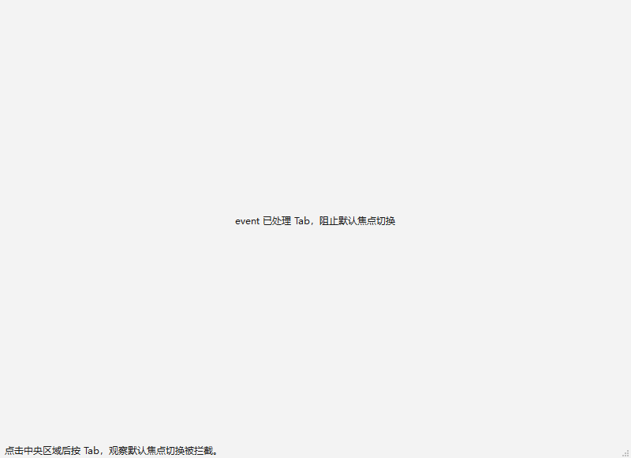
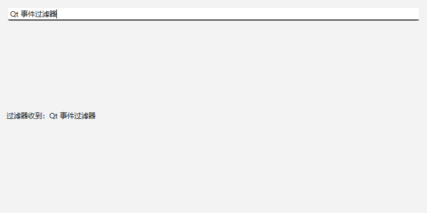

# 第十章 Qt消息机制和事件

先从事件循环理解输入与消息的处理，再学习特定事件函数、event 分发和事件过滤器，区分它们与信号槽的关系。

本章对应的完整项目：

- [示例 45 close_resize](../../examples/45_close_resize/README.md)
- [示例 46 mouse_events](../../examples/46_mouse_events/README.md)
- [示例 47 event_tab](../../examples/47_event_tab/README.md)
- [示例 51 event_filter](../../examples/51_event_filter/README.md)

## 10.1 事件循环与对象通知

QApplication::exec() 进入事件循环后，程序持续处理鼠标、键盘、尺寸变化和重绘等事件。QEvent 对象描述某次事件，事件系统把它交给目标 QObject；QWidget 的 event 会按类型分派到相应的处理函数。

信号槽用于对象之间通知和调用处理逻辑，事件机制处理输入和窗口等事件。一个用户动作可能先由控件处理事件，再由控件发出信号，但两者不是同一个接口。下面从具体事件进入，不需要自己建立轮询按钮的 while 循环。

## 10.2 关闭事件与尺寸变化

对应示例：[完整源码](../../examples/45_close_resize)。先运行项目观察行为，再按以下顺序阅读。

### 10.2.1 本章要解决的问题

事件是 QEvent 的对象，由事件系统送到目标 QObject。QWidget 的 event() 会根据类型分派到 closeEvent、resizeEvent 等专用处理函数；按钮 clicked 则是较高层的信号通知。二者经常配合，但不是同一个概念。

在头文件 protected 区声明 void closeEvent(QCloseEvent *event) override，源文件实现。accept 允许关闭，ignore 拒绝关闭；不要调用 close() 重新触发自己。resizeEvent 的 size 是新尺寸，oldSize 是旧尺寸，首次事件的旧尺寸可能无效。resizeEvent 中尽量避免无条件再次 resize，以免递归。

### 10.2.2 关闭请求和尺寸通知是不同事件

closeEvent 收到的是关闭请求，ignore 可以让窗口继续存在；resizeEvent 通知的是尺寸已经变化，不是拿来询问是否允许缩放。不要在 closeEvent 里再次调用 close 引发递归，也不要在 resizeEvent 中无条件再次 resize 制造事件循环。

### 10.2.3 按执行顺序拆解

mainwindow.ui 的中央标签提升为 EventArea，eventarea.cpp 的 resizeEvent 显示区域尺寸。mainwindow.h 声明主窗口 closeEvent，mainwindow.cpp 根据 Yes/No 决定 accept/ignore。关闭逻辑在主窗口，尺寸显示逻辑在中央区域，职责分开。

### 10.2.4 参数与行为边界

事件参数只在当前调用中有效，不要把 QCloseEvent* 或 QResizeEvent* 保存到异步回调后再使用。若要异步询问关闭，可以先 ignore，本次事件结束后显示异步对话框，确认后设置状态并重新发起关闭请求。

### 10.2.5 易错点与排查

override 用于检查是否真正覆盖了基类虚函数。保留原有处理通常要调用基类对应函数，但关闭拦截中拒绝后不要再调用会重新接受关闭的默认处理。本例自动验证会分别选择 No 与 Yes。

遇到问题时先区分三个层次：编译错误检查声明、头文件与构建配置；界面无反应检查连接、接收对象与生存期；运行结果不对检查输入、返回值和分支是否真正执行。可以先在连接入口记录一条日志，再在结果处理处记录一条，定位中间哪一步没有到达。

### 完整代码与界面操作

[本节完整源码与深入讲解](../topics/close-resize.md) · [独立项目与 Designer 步骤](../../examples/45_close_resize/README.md)

### 动手练习

第一次关闭选 No，确认窗口仍显示；第二次选 Yes，确认窗口退出。改变窗口大小后记录旧新尺寸。再思考怎样让编辑器修改未保存时才询问，而不是每次关闭都询问。

先写下预期行为，再修改代码、重新构建，最后对照实际结果。程序没有报错不等于逻辑已经正确，尤其要测试取消、空输入、重复操作和失败分支。

### 自测与答案

**在拒绝关闭后还调用默认 closeEvent 有何问题？**

默认实现可能接受这次关闭请求，覆盖你的拒绝决策。需要保留的基类行为必须结合事件种类判断，不能机械地在每个函数末尾调用。

## 10.3 鼠标按键 坐标和跟踪

对应示例：[完整源码](../../examples/46_mouse_events)。先运行项目观察行为，再按以下顺序阅读。

### 10.3.1 本章要解决的问题

mousePressEvent 处理按下，mouseReleaseEvent 处理释放，mouseMoveEvent 处理移动。button() 描述本次发生变化的按键；buttons() 是当前仍按下的按键集合，例如移动时判断是否正在拖动要查看 buttons()。

默认不按键移动时不一定收到移动事件，setMouseTracking(true) 允许无按键移动跟踪。Qt 6 推荐 position() 获取相对接收控件的浮点坐标，用 globalPosition() 获取屏幕坐标。坐标属于接收事件的控件，不是任意父窗口。

### 10.3.2 本次变化的按键和当前按下集合

鼠标 button() 表示触发本次按下或释放的按键，buttons() 表示当前仍保持按下的集合。mouseMoveEvent 的 button 常是 NoButton，因此拖拽判断应使用 buttons() & Qt::LeftButton。position 是相对接收控件的坐标，globalPosition 是屏幕坐标，二者不能混用。

### 10.3.3 按执行顺序拆解

mainwindow.ui 将中央 QLabel 提升为 EventArea。eventarea.cpp 中启用 mouseTracking，重写 mouseMoveEvent 和 mousePressEvent，读取 position/button 并设置焦点。只保留本步鼠标处理，键盘事件的实现留到下一步。

### 10.3.4 参数与行为边界

默认把某些事件交给基类处理，有助于保留原控件行为。事件传播不是任意祖先都会收到一份副本；是否处理、是否接受、控件默认行为都会影响链路。需要观察已有子控件而不改继承时，下一节的事件过滤器更合适。

### 10.3.5 易错点与排查

鼠标位于某个子控件上时，事件通常发给那个子控件。若想观察 QLabel 上的事件，应继承 QLabel 重写，而不是只在主窗口上重写后期待捕获所有子控件事件。

遇到问题时先区分三个层次：编译错误检查声明、头文件与构建配置；界面无反应检查连接、接收对象与生存期；运行结果不对检查输入、返回值和分支是否真正执行。可以先在连接入口记录一条日志，再在结果处理处记录一条，定位中间哪一步没有到达。

### 完整代码与界面操作

[本节完整源码与深入讲解](../topics/mouse-events.md) · [独立项目与 Designer 步骤](../../examples/46_mouse_events/README.md)

### 动手练习

在 mouseMoveEvent 中只有左键拖动时显示“拖动”，无按键时显示“悬停”。用 position 记录相对位置，再把标签放进带边距的布局中，确认坐标原点跟随标签而非主窗口。

先写下预期行为，再修改代码、重新构建，最后对照实际结果。程序没有报错不等于逻辑已经正确，尤其要测试取消、空输入、重复操作和失败分支。

### 自测与答案

**Qt 5 示例中的 x/y 可以照搬吗？**

部分旧接口仍可能存在但不适合新代码。Qt 6 使用 position 的浮点位置更准确，必要时再有意识转换成整数 QPoint。

## 10.4 重写 event 拦截 Tab

对应示例：[完整源码](../../examples/47_event_tab)。先运行项目观察行为，再按以下顺序阅读。

### 10.4.1 本章要解决的问题

event(QEvent *) 返回 bool，表示是否处理这个事件。先检查 type 再把通用指针转换到对应事件类型；未经类型判断的强制转换可能访问错误的数据。处理感兴趣的事件后返回 true；其余事件必须 return 基类::event(event)，避免破坏默认行为。

Tab 常被控件系统用来切换焦点，因此只在 keyPressEvent 中写代码可能不够。要改变这个行为，可以在目标控件的 event 中拦截 KeyPress，识别 Qt::Key_Tab。键盘事件发给有焦点的对象，先确保目标控件有适当 focusPolicy 并获得焦点。

### 10.4.2 事件分发 事件处理和事件过滤

特定处理函数适合某一类事件；重写 event 适合介入目标对象的分发；eventFilter 适合在不改被观察对象继承关系时提前观察或消费事件。示例 51在 QLineEdit 上安装过滤器，识别回车并更新标签，不需要创建 QLineEdit 子类。

### 10.4.3 按执行顺序拆解

在 mainwindow.ui 查看 EventArea 提升信息，在 eventarea.h 中找到 event 声明。eventarea.cpp 先判断 KeyPress，再读取 Tab 键并返回 true；其他情况调用 QLabel::event。示例 51则把过滤器安装在普通 QLineEdit 上，便于对比两种方式。

### 10.4.4 参数与行为边界

键盘事件以焦点为中心。focusPolicy 决定能否通过 Tab 或点击等方式获得焦点，setFocus 才是当前请求。QEvent::accept 与 event 返回值并不是所有事件中都可机械等同的通用开关。sendEvent 同步送达，postEvent 排队稍后送达且由 Qt 接管事件对象。

### 10.4.5 易错点与排查

返回 true 不是“所有事件继续向下传递”。不要在末尾无条件 return true。QEvent::accept() 与 event() 返回值有关但不能在所有事件种类下简单当成同一开关。原例中 Ctrl、Tab 等专用按键应使用 Qt 枚举。

遇到问题时先区分三个层次：编译错误检查声明、头文件与构建配置；界面无反应检查连接、接收对象与生存期；运行结果不对检查输入、返回值和分支是否真正执行。可以先在连接入口记录一条日志，再在结果处理处记录一条，定位中间哪一步没有到达。

### 完整代码与界面操作

[本节完整源码与深入讲解](../topics/event-dispatch.md) · [独立项目与 Designer 步骤](../../examples/47_event_tab/README.md)

### 动手练习

给输入框安装示例 51过滤器，输入中文后回车观察结果。再把 true 改为基类返回，观察输入框自己的 returnPressed 是否仍可触发。不要同时把所有事件无条件吞掉。

先写下预期行为，再修改代码、重新构建，最后对照实际结果。程序没有报错不等于逻辑已经正确，尤其要测试取消、空输入、重复操作和失败分支。

### 自测与答案

**过滤器能保存传入的 event 指针以后再用吗？**

不能假定它仍存活。需要延后处理时先复制所需数据，例如 key、文本或坐标，再通过信号或排队调用传递这些值。

## 10.5 事件过滤器

[完整项目与 UI 步骤](../../examples/51_event_filter/README.md) · [窗口逻辑](../../examples/51_event_filter/widget.cpp) · [界面表单](../../examples/51_event_filter/widget.ui)

输入框和结果标签在 widget.ui。returnfilter.h/.cpp 中的 ReturnFilter 继承 QObject，安装在普通 QLineEdit 上。收到事件时先判断 KeyPress，再读取键值；识别 Return 或小键盘 Enter 后更新结果标签并返回 true，消费事件。其余情况交给 QObject::eventFilter。

过滤器与目标控件放在同一窗口管理下。这里的 QLabel 指针在过滤器工作期间持续有效；如果将过滤器移到另一个更长寿的对象上，需要重新检查结果标签的生命期。

练习：同时给输入框连接 returnPressed，然后比较过滤器返回 true 与返回基类结果时，原信号是否还能触发。这样可以实际观察“消费事件”的含义。

---

[总目录](../README.md) · [上一章](09-widgets.md) · [下一章](11-painting.md)
