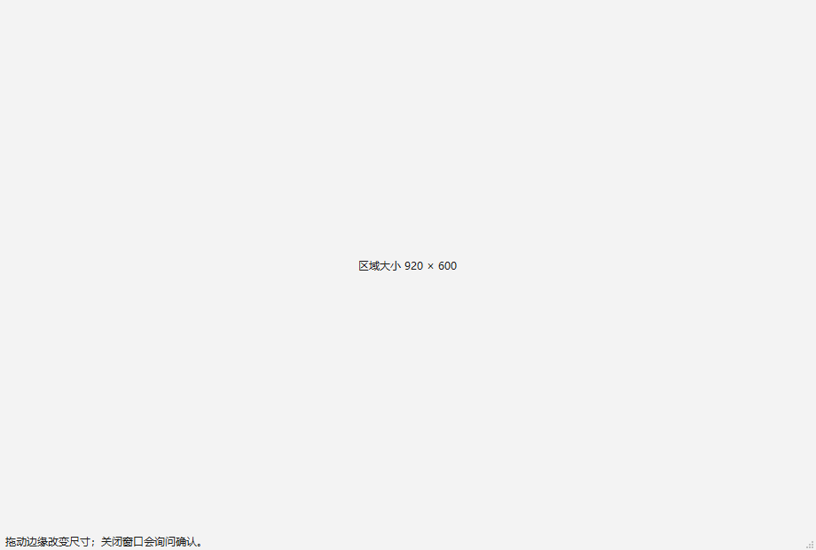
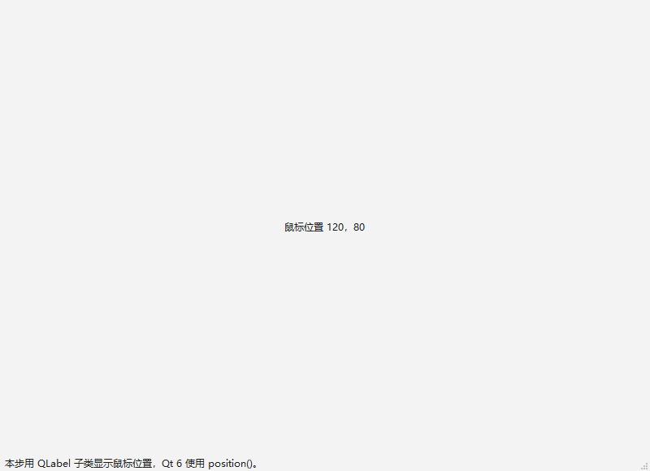
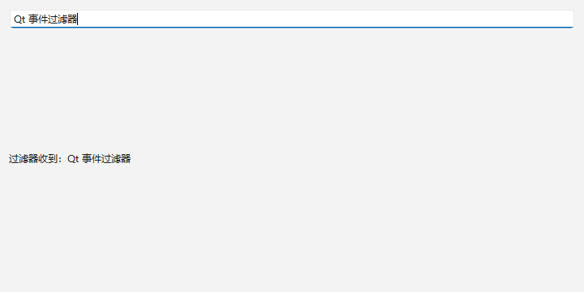

# 项目 5.5 章 Qt消息机制和事件

本章按项目逐个学习，每个项目对应一个知识点。先运行再读关键代码，最后做一次修改验证。[理论补充与复习](../foundations/10-events.md)保留更完整的背景说明。

## 10.1 关闭请求与尺寸通知

[单独阅读本知识点](../knowledge/10_01_close_resize.md) · [打开完整项目](../../examples/10_01_close_resize/README.md)

### 本项目要掌握什么

关闭请求与尺寸通知。这一节只围绕这个核心问题阅读和修改程序。

### 关键代码在哪里

关键片段 1：[ mainwindow.cpp 第 23 行起](../../examples/10_01_close_resize/mainwindow.cpp#L23)。以下代码从本项目源文件提取，完整上下文见源文件。

```cpp
void MainWindow::closeEvent(QCloseEvent *event)
{
    auto choice = QMessageBox::question(this, "关闭确认", "确定关闭窗口吗？",
                                        QMessageBox::Yes | QMessageBox::No, QMessageBox::No);
    if (choice == QMessageBox::Yes)
        event->accept();
    else
        event->ignore();
}
```

关键片段 2：[ eventarea.cpp 第 15 行起](../../examples/10_01_close_resize/eventarea.cpp#L15)。以下代码从本项目源文件提取，完整上下文见源文件。

```cpp
void EventArea::resizeEvent(QResizeEvent *event)
{
    setText(QString("区域大小 %1 × %2").arg(event->size().width()).arg(event->size().height()));
    QLabel::resizeEvent(event);
}
```

### 逐段讲解

MainWindow::closeEvent 通过消息框决定 accept 或 ignore，ignore 允许窗口继续存在；EventArea::resizeEvent 接收区域已改变的尺寸。

两个处理函数属于不同对象：关闭决策在主窗口，尺寸显示在中央区域。事件指针仅在本次处理时使用。

### 按执行顺序阅读

窗口初始化先准备对象和连接；用户输入、尺寸变化或重绘请求到达后，才进入上述处理函数。依次追踪事件或信号的目标、类型判断、状态变化和结果更新，再观察是否把剩余处理交回基类。

### 容易出错的地方与动手验证

先拒绝关闭再确认关闭；不要在 closeEvent 内再调用 close，也不要在 resizeEvent 无条件调用 resize 造成递归。

先写下预测，再修改一个条件重新构建。记录实际结果，并用本节代码中的变量、对象和调用顺序解释原因；仅仅没有报错不代表已经验证了所有分支。

### 运行结果



### 完整项目与界面文件

- [10_01_close_resize.pro](../../examples/10_01_close_resize/10_01_close_resize.pro)
- [eventarea.cpp](../../examples/10_01_close_resize/eventarea.cpp)
- [eventarea.h](../../examples/10_01_close_resize/eventarea.h)
- [main.cpp](../../examples/10_01_close_resize/main.cpp)
- [mainwindow.cpp](../../examples/10_01_close_resize/mainwindow.cpp)
- [mainwindow.h](../../examples/10_01_close_resize/mainwindow.h)
- [mainwindow.ui](../../examples/10_01_close_resize/mainwindow.ui)
- [verify.h](../../examples/10_01_close_resize/verify.h)

打开本项目 .pro，选择匹配的 Kit，构建运行；修改界面请打开 .ui，保存后重新构建。verify.h 只在传入 --verify 时执行检查。


## 10.2 鼠标事件的坐标与按键

[单独阅读本知识点](../knowledge/10_02_mouse_events.md) · [打开完整项目](../../examples/10_02_mouse_events/README.md)

### 本项目要掌握什么

鼠标事件的坐标与按键。这一节只围绕这个核心问题阅读和修改程序。

### 关键代码在哪里

关键片段 1：[ eventarea.cpp 第 15 行起](../../examples/10_02_mouse_events/eventarea.cpp#L15)。以下代码从本项目源文件提取，完整上下文见源文件。

```cpp
void EventArea::mouseMoveEvent(QMouseEvent *event)
{
    setText(QString("鼠标位置 %1，%2").arg(event->position().x()).arg(event->position().y()));
    QLabel::mouseMoveEvent(event);
}
```

关键片段 2：[ eventarea.cpp 第 21 行起](../../examples/10_02_mouse_events/eventarea.cpp#L21)。以下代码从本项目源文件提取，完整上下文见源文件。

```cpp
void EventArea::mousePressEvent(QMouseEvent *event)
{
    setFocus();
    setText(event->button() == Qt::LeftButton ? "左键按下" : "其他鼠标键按下");
    QLabel::mousePressEvent(event);
}
```

### 逐段讲解

mouseMoveEvent 的 position 是相对当前 EventArea 的位置；mousePressEvent 的 button 表示本次发生变化的按键。

mouseTracking 使没有按键时也能收到移动事件；buttons 表示当前按下集合，与 button 不同。调用基类函数保留默认处理。

### 按执行顺序阅读

窗口初始化先准备对象和连接；用户输入、尺寸变化或重绘请求到达后，才进入上述处理函数。依次追踪事件或信号的目标、类型判断、状态变化和结果更新，再观察是否把剩余处理交回基类。

### 容易出错的地方与动手验证

比较悬停与按键拖动，并把区域移进布局；不要把控件坐标当作全屏坐标。

先写下预测，再修改一个条件重新构建。记录实际结果，并用本节代码中的变量、对象和调用顺序解释原因；仅仅没有报错不代表已经验证了所有分支。

### 运行结果



### 完整项目与界面文件

- [10_02_mouse_events.pro](../../examples/10_02_mouse_events/10_02_mouse_events.pro)
- [eventarea.cpp](../../examples/10_02_mouse_events/eventarea.cpp)
- [eventarea.h](../../examples/10_02_mouse_events/eventarea.h)
- [main.cpp](../../examples/10_02_mouse_events/main.cpp)
- [mainwindow.cpp](../../examples/10_02_mouse_events/mainwindow.cpp)
- [mainwindow.h](../../examples/10_02_mouse_events/mainwindow.h)
- [mainwindow.ui](../../examples/10_02_mouse_events/mainwindow.ui)
- [verify.h](../../examples/10_02_mouse_events/verify.h)

打开本项目 .pro，选择匹配的 Kit，构建运行；修改界面请打开 .ui，保存后重新构建。verify.h 只在传入 --verify 时执行检查。


## 10.3 event中拦截Tab

[单独阅读本知识点](../knowledge/10_03_event_tab.md) · [打开完整项目](../../examples/10_03_event_tab/README.md)

### 本项目要掌握什么

event中拦截Tab。这一节只围绕这个核心问题阅读和修改程序。

### 关键代码在哪里

关键片段 1：[ eventarea.cpp 第 15 行起](../../examples/10_03_event_tab/eventarea.cpp#L15)。以下代码从本项目源文件提取，完整上下文见源文件。

```cpp
bool EventArea::event(QEvent *event)
{
    if (event->type() == QEvent::KeyPress)
    {
        auto *key = static_cast<QKeyEvent *>(event);
        if (key->key() == Qt::Key_Tab)
        {
            setText("event 已处理 Tab，阻止默认焦点切换");
            return true;
        }
    }
    return QLabel::event(event);
}
```

### 逐段讲解

event 先判断 QEvent::KeyPress，再将指针转换为 QKeyEvent 并检查 Tab；识别后返回 true 表示本次已处理。

其余情况调用 QLabel::event，保留默认事件分发。Tab 常参与焦点切换，需要在这里理解分发与特定处理函数的关系。

### 按执行顺序阅读

窗口初始化先准备对象和连接；用户输入、尺寸变化或重绘请求到达后，才进入上述处理函数。依次追踪事件或信号的目标、类型判断、状态变化和结果更新，再观察是否把剩余处理交回基类。

### 容易出错的地方与动手验证

比较返回 true 与调用基类后的焦点行为；不要不判断类型就 static_cast，也不要无条件吞掉所有事件。

先写下预测，再修改一个条件重新构建。记录实际结果，并用本节代码中的变量、对象和调用顺序解释原因；仅仅没有报错不代表已经验证了所有分支。

### 运行结果


### 完整项目与界面文件

- [10_03_event_tab.pro](../../examples/10_03_event_tab/10_03_event_tab.pro)
- [eventarea.cpp](../../examples/10_03_event_tab/eventarea.cpp)
- [eventarea.h](../../examples/10_03_event_tab/eventarea.h)
- [main.cpp](../../examples/10_03_event_tab/main.cpp)
- [mainwindow.cpp](../../examples/10_03_event_tab/mainwindow.cpp)
- [mainwindow.h](../../examples/10_03_event_tab/mainwindow.h)
- [mainwindow.ui](../../examples/10_03_event_tab/mainwindow.ui)
- [verify.h](../../examples/10_03_event_tab/verify.h)

打开本项目 .pro，选择匹配的 Kit，构建运行；修改界面请打开 .ui，保存后重新构建。verify.h 只在传入 --verify 时执行检查。


## 10.4 为现有控件安装事件过滤器

[单独阅读本知识点](../knowledge/10_04_event_filter.md) · [打开完整项目](../../examples/10_04_event_filter/README.md)

### 本项目要掌握什么

为现有控件安装事件过滤器。这一节只围绕这个核心问题阅读和修改程序。

### 关键代码在哪里

关键片段 1：[ widget.cpp 第 6 行起](../../examples/10_04_event_filter/widget.cpp#L6)。以下代码从本项目源文件提取，完整上下文见源文件。

```cpp
Widget::Widget(QWidget *parent)
    : QWidget(parent)
    , ui(new Ui::Widget)
{
    ui->setupUi(this);
    auto *filter = new ReturnFilter(ui->resultLabel, this);
    ui->lineEdit->installEventFilter(filter);
}
```

关键片段 2：[ returnfilter.cpp 第 12 行起](../../examples/10_04_event_filter/returnfilter.cpp#L12)。以下代码从本项目源文件提取，完整上下文见源文件。

```cpp
bool ReturnFilter::eventFilter(QObject *watched, QEvent *event)
{
    if (event->type() == QEvent::KeyPress)
    {
        auto *key = static_cast<QKeyEvent *>(event);
        if (key->key() == Qt::Key_Return || key->key() == Qt::Key_Enter)
        {
            auto *line = qobject_cast<QLineEdit *>(watched);
            if (line)
            {
                result_->setText("过滤器收到：" + line->text());
                return true; // 消费回车，不再交给输入框默认处理。
            }
        }
    }
    return QObject::eventFilter(watched, event);
}
```

### 逐段讲解

ReturnFilter 作为 QObject 安装在普通 QLineEdit 上；先判断 KeyPress，再检查 Return/Enter，取出输入更新标签。

返回 true 消费该事件，原输入框不会继续按默认流程处理这次回车。其他事件交给 QObject::eventFilter。

### 关键分支再拆一步

eventFilter 的 watched 是被观察的输入框，不是过滤器自己。先检查事件类型再转换，随后用 qobject_cast 检查 watched 是否为 QLineEdit；识别回车时读取 line->text。返回 true 后，这次按键不会继续进入输入框自己的默认回车处理，其他事件必须继续交回基类。

### 按执行顺序阅读

窗口初始化先准备对象和连接；用户输入、尺寸变化或重绘请求到达后，才进入上述处理函数。依次追踪事件或信号的目标、类型判断、状态变化和结果更新，再观察是否把剩余处理交回基类。

### 容易出错的地方与动手验证

同时连接 returnPressed，比较过滤器返回 true 与基类结果；过滤器、输入框和标签的生命周期都要匹配。

先写下预测，再修改一个条件重新构建。记录实际结果，并用本节代码中的变量、对象和调用顺序解释原因；仅仅没有报错不代表已经验证了所有分支。

### 运行结果



### 完整项目与界面文件

- [10_04_event_filter.pro](../../examples/10_04_event_filter/10_04_event_filter.pro)
- [main.cpp](../../examples/10_04_event_filter/main.cpp)
- [returnfilter.cpp](../../examples/10_04_event_filter/returnfilter.cpp)
- [returnfilter.h](../../examples/10_04_event_filter/returnfilter.h)
- [verify.h](../../examples/10_04_event_filter/verify.h)
- [widget.cpp](../../examples/10_04_event_filter/widget.cpp)
- [widget.h](../../examples/10_04_event_filter/widget.h)
- [widget.ui](../../examples/10_04_event_filter/widget.ui)

打开本项目 .pro，选择匹配的 Kit，构建运行；修改界面请打开 .ui，保存后重新构建。verify.h 只在传入 --verify 时执行检查。


[返回总目录](../README.md)
