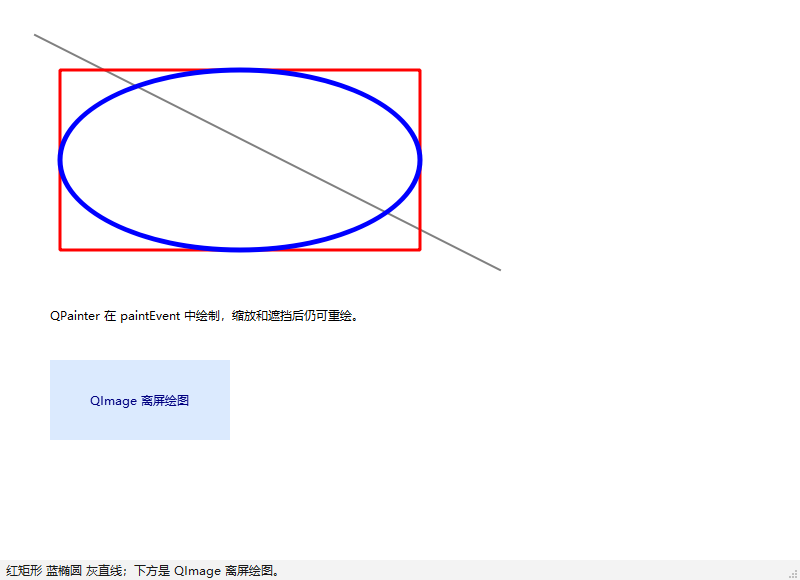
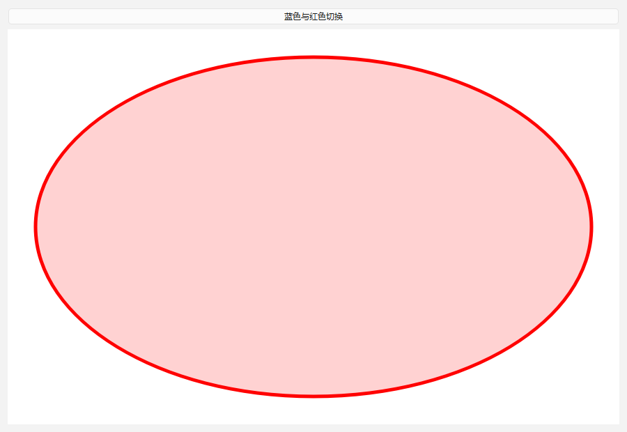

# 第十一章 绘图和绘图设备

理解 QPainter 与绘图设备的关系，在 paintEvent 中完成绘制，并通过成员状态与 update 实现可持续重绘的交互。

本章对应的完整项目：

- [示例 48 painter](../../examples/48_painter/README.md)
- [示例 52 interactive_paint](../../examples/52_interactive_paint/README.md)

## 11.1 QPainter 与绘图设备

对应示例：[完整源码](../../examples/48_painter)。先运行项目观察行为，再按以下顺序阅读。

### 11.1.1 本章要解决的问题

QPainter 执行画线、矩形、椭圆、图片和文本等操作；QPaintDevice 是可被绘制的设备基类；QPaintEngine 提供设备对应的绘制实现，入门通常不用直接操作。原笔记中的 QPainterDevice 应改为 QPaintDevice。

对 QWidget 绘制应在 paintEvent 或其调用链中完成。先创建 QPainter(this)，设置 QPen 控制边线颜色宽度，设置 QBrush 控制填充，再调用 drawLine、drawRect、drawEllipse。要改变图形，更新成员状态后调用 update() 请求重新绘制，而不是把绘图只放进按钮槽临时画一次。

QPixmap 常用于界面显示，QImage 便于像素访问，QBitmap 是一位深度位图，QPicture 记录与重放绘图命令。它们不是全部绘图设备，QWidget 也是 QPaintDevice 的子类。

### 11.1.2 图形应该从持久状态重建

绘制结果是窗口某一时刻的像素，不是可靠的应用状态。遮挡、缩放、主题变化等都可能触发重绘。把“画一个红椭圆”只写在按钮槽里而不保留颜色状态，下一次重绘可能消失。示例 52将 color_ 放在 DrawingArea 成员中，按钮只更新颜色并 update，paintEvent 每次根据状态重建图形。

### 11.1.3 按执行顺序拆解

mainwindow.ui 中 QWidget 已提升为 Canvas；mainwindow.cpp 只负责装载界面和状态提示。绘制逻辑独立在 canvas.cpp 的 paintEvent：创建局部 QPainter、设置画笔和画刷、绘制形状与文字，再绘制离屏 QImage。示例 52继续让绘制由成员状态驱动。

### 11.1.4 参数与行为边界

QWidget 是屏幕控件，QImage 便于像素操作，QPixmap 为界面显示优化，QBitmap 是一位位图，QPicture 记录绘制命令。逻辑坐标、像素坐标与设备像素比需要区分。painter.save/restore 可隔离画笔与坐标变换状态，复杂绘制中比反复手动恢复属性更可靠。

### 11.1.5 易错点与排查

QPicture 不是普通像素图片。QImage、QPixmap 上的离屏绘制可以在适当代码位置进行，不要求它们自己的 paintEvent。一个设备同时只应有一个活动画家；使用局部 QPainter 作用域可自动结束绘制。

遇到问题时先区分三个层次：编译错误检查声明、头文件与构建配置；界面无反应检查连接、接收对象与生存期；运行结果不对检查输入、返回值和分支是否真正执行。可以先在连接入口记录一条日志，再在结果处理处记录一条，定位中间哪一步没有到达。

### 完整代码与界面操作

[本节完整源码与深入讲解](../topics/painter-devices.md) · [独立项目与 Designer 步骤](../../examples/48_painter/README.md)

### 动手练习

运行示例 52，切换颜色后缩放窗口并遮挡再恢复，确认颜色仍保持。把椭圆位置从固定 QRect 改为基于当前 rect 调整后的区域。再把画刷改为 NoBrush，比较只画轮廓与填充的区别。

先写下预期行为，再修改代码、重新构建，最后对照实际结果。程序没有报错不等于逻辑已经正确，尤其要测试取消、空输入、重复操作和失败分支。

### 自测与答案

**为什么 QImage 上绘制不需要 paintEvent？**

paintEvent 是 QWidget 的屏幕重绘入口。离屏图像本身是绘图设备，可以在适当函数中创建局部 QPainter 绘制；结束后再交给 QLabel 或其他控件显示。

## 11.2 绘图设备集中比较

| 类型 | 在本教程中的理解 |
|---|---|
| QWidget | 界面上的绘制目标，在 paintEvent 中处理重绘 |
| QImage | 适合图像数据和像素操作，也可作为离屏绘图目标 |
| QPixmap | 适合界面中显示图像 |
| QBitmap | 一位位图 |
| QPicture | 记录绘制命令 |
| QPaintEngine | 提供设备对应的底层绘制实现，入门通常不直接操作 |

QPaintDevice 表示可绘制设备的基础抽象，QPainter 执行线条、矩形、椭圆、文字和图像等绘制。不要把 QPicture 当作普通像素图片。

## 11.3 绘制代码的执行顺序

打开示例 48 的 canvas.cpp：创建局部 QPainter 并绑定 this，设置抗锯齿、画笔和画刷，然后绘制形状与文字。随后建立 QImage，在它上面使用另一个局部 QPainter 绘制，结束后再把图像画到界面。

画笔状态会影响后续操作。复杂绘制可用 save/restore 隔离状态，避免一个区域修改的颜色或坐标变换影响另一处绘制。

## 11.4 状态驱动的交互绘图

[完整项目与 UI 步骤](../../examples/52_interactive_paint/README.md) · [窗口逻辑](../../examples/52_interactive_paint/widget.cpp) · [界面表单](../../examples/52_interactive_paint/widget.ui)

widget.ui 将绘图占位控件提升为 DrawingArea；drawingarea.h/.cpp 中的 DrawingArea 只保存 color_，按钮调用 setColor 改状态并 update；paintEvent 根据当前颜色和当前 rect 重新绘图。没有把 QPainter 保存成长期成员，也没有让按钮直接在屏幕上临时画一次。

QPen 控制轮廓，带透明度的 QColor 作为画刷控制填充。绘制区域从窗口矩形缩进得到，因此缩放时仍能适应。自动检查既确认成员颜色变红，也检查真实渲染图像中存在红色轮廓像素，避免只修改数据而没有更新显示。

练习：增加线宽输入框，用同样的“修改状态 → update → paintEvent”流程更新线宽。切换颜色后遮挡窗口并恢复，确认结果仍然正确。

## 11.5 本章练习与回顾

给示例 52 增加线宽输入，将线宽保存为成员状态。输入变化时更新成员并调用 update，paintEvent 根据颜色和线宽重新绘制。改变窗口大小、遮挡后恢复，确认图形仍然符合当前状态。

学到这里，应能把“用户输入 → 更新状态 → 请求重绘 → paintEvent 绘制”串起来，并解释为什么不能只在按钮槽中临时画一次。

---

[总目录](../README.md) · [上一章](10-events.md)
