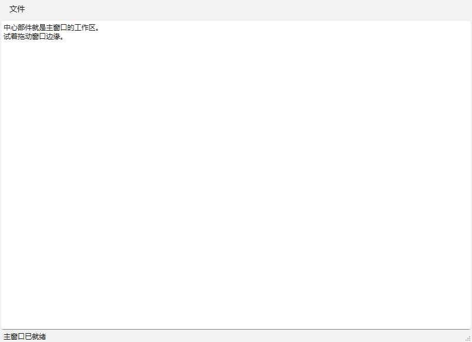

# 第 20 章 主窗口与中心部件

本章项目：[完整源码](../../examples/31_mainwindow)。先运行项目观察行为，再按以下顺序阅读。

## 本章要解决的问题

QMainWindow 自带主窗口区域的组织规则：顶部菜单栏、可停靠工具栏、停靠面板、底部状态栏，以及中间的中心部件。中心部件是工作区，例如记事本的编辑器。它也继承 QWidget，但通常不直接在 QMainWindow 本体上再安装普通布局。

setCentralWidget() 把一个控件交给主窗口作为工作区。主窗口负责这个控件的所有权。若工作区含多个控件，先创建普通 QWidget 容器，把布局安装到容器，再把容器设为中心部件。窗口缩放时，这块区域会自动适应剩余空间。

## 窗口并不只是一个大 QWidget

先建立工作区，再把工作区交给主窗口。主窗口有自己管理菜单、工具栏和停靠区域的内部布局；调用 setCentralWidget 的意思是登记工作区，不是设置任意 child 的坐标。如果同时需要编辑器、查询栏和按钮，应先建一个 QWidget 容器，把 QVBoxLayout 安装到容器，再把整个容器作为中心部件。这样各部分会自然分工。

## 按执行顺序拆解

读 main.cpp 时依次找到 QApplication、QMainWindow、QTextEdit、setCentralWidget 和 app.exec。QTextEdit 没传 parent 也不一定泄漏：setCentralWidget 会接管它。随后找出菜单栏和状态栏，它们由 QMainWindow 管理。退出时先结束事件循环，再销毁 main 中的窗口，窗口的子控件随之释放。

## 参数与行为边界

QWidget 是普通控件与容器的基础；QMainWindow 适合带菜单、工具栏与停靠面板的应用；QDialog 适合短时交互。不要为了“功能更多”让所有小组件都继承 QMainWindow。

## 易错点与排查

menuBar() 和 statusBar() 可以取得或按需创建对应栏，取得后无需再调用 setMenuBar(menuBar())。setCentralWidget 会接管部件；替换时不要把旧部件当成仍可随意使用的对象。

遇到问题时先区分三个层次：编译错误检查声明、头文件与构建配置；界面无反应检查连接、接收对象与生存期；运行结果不对检查输入、返回值和分支是否真正执行。可以先在连接入口记录一条日志，再在结果处理处记录一条，定位中间哪一步没有到达。

## 完整示例与配套文件

以下为本步完整程序。若存在 .ui、qrc 或额外头文件，必须把同一目录中的文件一起下载。构建期生成的 ui_*.h、moc 文件不需要手动维护。

### main.cpp

```cpp
#include <QtWidgets>
#include <QMouseEvent>
#include <QKeyEvent>

#include "verify.h"
int main(int argc, char *argv[])
{
    QApplication app(argc, argv);
    QMainWindow w;
    w.resize(800, 580);
    w.setWindowTitle("31 主窗口与中心部件");
    auto *editor = new QTextEdit;
    editor->setPlainText("中心部件就是主窗口的工作区。\n试着拖动窗口边缘。");
    w.setCentralWidget(editor);
    w.menuBar()->addMenu("文件");
    w.statusBar()->showMessage("主窗口已就绪");
    w.show();
    scheduleVerification(&w);
    return app.exec();
}

```

### 31_mainwindow.pro

```qmake
QT += widgets
CONFIG += c++17
TEMPLATE = app
TARGET = 31_mainwindow
SOURCES += main.cpp
HEADERS += verify.h

```

自动检查用的 verify.h 已在项目目录中提供；普通运行没有 --verify 参数时，不会执行自动操作。

## 运行截图与观察



## 自己动手

把中心编辑器改成一个容器，容器上放标签与编辑器，拖动窗口观察编辑器如何变大。再取消 setCentralWidget，观察界面变化；通过对比理解“对象已经创建”和“被安放到工作区”的区别。

先写下预期行为，再修改代码、重新构建，最后对照实际结果。程序没有报错不等于逻辑已经正确，尤其要测试取消、空输入、重复操作和失败分支。

## 自测与答案

**为什么没给 QTextEdit 传 parent 也能被释放？**

因为主窗口在 setCentralWidget 时取得所有权。不要再给同一个对象叠加另一个独立的所有者。

## 继续阅读

- [Qt 官方文档](https://doc.qt.io/qt-6/qmainwindow.html)
- [项目构建方法](../getting-started.md)
- [自动检查范围](../validation.md)
