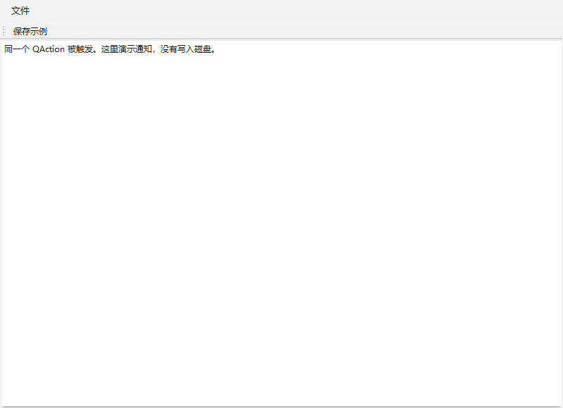

# 第 21 章 菜单 动作与工具栏

本章项目：[完整源码](../../examples/32_menu_toolbar)。先运行项目观察行为，再按以下顺序阅读。

## 本章要解决的问题

菜单栏 QMenuBar 容纳菜单 QMenu，菜单里放 QAction。QAction 表示一项可执行操作，保存操作可以同时出现在菜单和工具栏，它们共享文字、启用状态、勾选状态及 triggered 信号。QAction 不是另一个窗口。

把同一个 QAction 加到 QMenu 和 QToolBar 后，只需连接一次 triggered，用户从任一入口操作都进入同一段业务代码。快捷键也可以设置到动作上。工具栏可设置初始区域、允许区域、能否移动、能否浮动；这些是不同属性。

## 先定义动作 再提供多个入口

动作是“保存”这项命令，菜单项和工具栏按钮只是触发它的入口。若两个入口各自创建一份 QAction，即使文字相同，也不是同一个动作：启用状态、快捷键和勾选状态都要分别同步。把一个 QAction 分别 addAction 到菜单和工具栏，可以直接共享这些状态。

## 按执行顺序拆解

先观察 save 指针只创建一次，再看它被两个容器使用，最后找 triggered 的唯一连接。点击任一入口都执行相同的 Lambda。把 save->setEnabled(false) 加入初始化后，观察两个入口都禁用。快捷键也属于动作；QKeySequence::Save 比手写 Ctrl+S 更能适应平台约定。

## 参数与行为边界

triggered(bool) 通知触发，toggled(bool) 通知勾选状态变化。需要开关操作时先 setCheckable(true)，再决定监听哪个信号。构造动作时把父对象设为主窗口；添加到菜单不应成为你推断所有权的唯一依据。

## 易错点与排查

使用 Qt::LeftToolBarArea | Qt::RightToolBarArea 组合区域标志；这是按位或。setMovable(false) 控制移动把手，setFloatable(false) 控制是否可浮动，两者不应混为一谈。

遇到问题时先区分三个层次：编译错误检查声明、头文件与构建配置；界面无反应检查连接、接收对象与生存期；运行结果不对检查输入、返回值和分支是否真正执行。可以先在连接入口记录一条日志，再在结果处理处记录一条，定位中间哪一步没有到达。

## 完整示例与配套文件

以下为本步完整程序。若存在 .ui、qrc 或额外头文件，必须把同一目录中的文件一起下载。构建期生成的 ui_*.h、moc 文件不需要手动维护。

### main.cpp

```cpp
#include <QtWidgets>
#include <QMouseEvent>
#include <QKeyEvent>

#include "verify.h"
int main(int argc, char *argv[])
{
    QApplication app(argc, argv);
    QMainWindow w;
    w.resize(800, 580);
    w.setWindowTitle("32 菜单 动作与工具栏");
    auto *edit = new QTextEdit;
    w.setCentralWidget(edit);
    auto *menu = w.menuBar()->addMenu("文件");
    auto *save = new QAction("保存示例", &w);
    save->setObjectName("action");
    save->setShortcut(QKeySequence::Save);
    menu->addAction(save);
    auto *tools = w.addToolBar("文件工具");
    tools->addAction(save);
    tools->setAllowedAreas(Qt::LeftToolBarArea | Qt::RightToolBarArea | Qt::TopToolBarArea);
    QObject::connect(save, &QAction::triggered, &w, [edit]()
                     { edit->append("同一个 QAction 被触发。这里演示通知，没有写入磁盘。"); });
    w.show();
    scheduleVerification(&w);
    return app.exec();
}

```

### 32_menu_toolbar.pro

```qmake
QT += widgets
CONFIG += c++17
TEMPLATE = app
TARGET = 32_menu_toolbar
SOURCES += main.cpp
HEADERS += verify.h

```

自动检查用的 verify.h 已在项目目录中提供；普通运行没有 --verify 参数时，不会执行自动操作。

## 运行截图与观察



## 自己动手

增加一个“显示日志”可勾选动作，菜单和工具栏共用它，连接 toggled 控制日志区域显隐。把动作禁用，再分别从鼠标和快捷键尝试触发，比较行为。

先写下预期行为，再修改代码、重新构建，最后对照实际结果。程序没有报错不等于逻辑已经正确，尤其要测试取消、空输入、重复操作和失败分支。

## 自测与答案

**setMovable 和 setFloatable 为什么分开？**

前者控制工具栏在主窗口中的移动，后者控制能否离开主窗口浮动。初始停靠位置和允许停靠的区域又是另外两个设置。

## 继续阅读

- [Qt 官方文档](https://doc.qt.io/qt-6/qaction.html)
- [项目构建方法](../getting-started.md)
- [自动检查范围](../validation.md)
