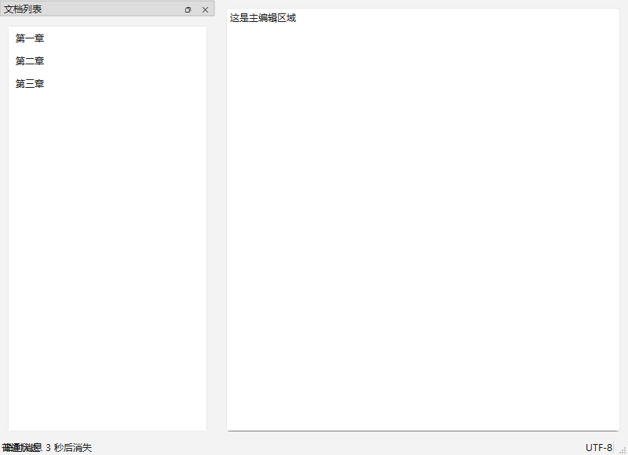

# 第 22 章 状态栏和停靠面板

本章项目：[完整源码](../../examples/33_status_dock)。先运行项目观察行为，再按以下顺序阅读。

## 本章要解决的问题

QStatusBar 的临时消息用 showMessage(text, timeout) 展示，timeout 单位毫秒，0 表示保持到被清除或替换。addWidget 放置普通状态控件，临时消息出现时可能被遮住；addPermanentWidget 放置永久区域控件，不会被临时消息遮盖。永久指显示区域性质，不是对象永不销毁。

QDockWidget 是可停靠面板的外壳，用 setWidget() 设置它内部的控件，用 addDockWidget() 指定初始停靠区域。setAllowedAreas() 决定允许停靠在哪些位置，features 决定是否可关闭、移动和浮动。

## 状态反馈和辅助面板各有职责

状态栏回答“现在发生了什么”，停靠面板提供持续可操作的辅助区。showMessage 的临时文字适合“打开成功”，普通状态控件适合当前工具，永久状态控件适合编码或连接状态。showMessage 的超时单位是毫秒；传 3000 表示约三秒，不是三千秒。

## 按执行顺序拆解

停靠面板 dockWidget、其内容列表 documentList，以及 statusbar 都定义在 mainwindow.ui 中。mainwindow.cpp 在 setupUi 后用 addWidget 和 addPermanentWidget 加入两种状态标签，再显示 3000 毫秒的临时消息。移动停靠面板观察主窗口内部的区域分配。

## 参数与行为边界

关闭停靠面板通常是隐藏，面板不一定被销毁。用 dock->toggleViewAction() 可以把恢复显示的开关放进“视图”菜单。需要保存界面排列时可进一步学习 saveState/restoreState，但恢复时需要稳定 objectName。

## 易错点与排查

标准术语是停靠部件，而不是铆接部件。QDockWidget 与普通非模态 QDialog 不同：前者能参与主窗口的停靠布局。

遇到问题时先区分三个层次：编译错误检查声明、头文件与构建配置；界面无反应检查连接、接收对象与生存期；运行结果不对检查输入、返回值和分支是否真正执行。可以先在连接入口记录一条日志，再在结果处理处记录一条，定位中间哪一步没有到达。

## 完整示例与配套文件

本步按统一模板拆分文件。先打开 .ui 观察界面，再读窗口类；[项目 README](../../examples/33_status_dock/README.md) 提供逐项 Designer 设置。

### main.cpp

```cpp
#include "mainwindow.h"

#include <QApplication>

int main(int argc, char *argv[])
{
    QApplication a(argc, argv);
    MainWindow w;
    w.show();
    return QApplication::exec();
}
```

### mainwindow.h

```cpp
#ifndef MAINWINDOW_H
#define MAINWINDOW_H

#include <QMainWindow>

QT_BEGIN_NAMESPACE
namespace Ui
{
class MainWindow;
}
QT_END_NAMESPACE

class MainWindow : public QMainWindow
{
    Q_OBJECT

public:
    explicit MainWindow(QWidget *parent = nullptr);
    ~MainWindow() override;

private:
    Ui::MainWindow *ui;
};
#endif // MAINWINDOW_H
```

### mainwindow.cpp

```cpp
#include "mainwindow.h"
#include "ui_mainwindow.h"
#include <QLabel>
#include "verify.h"

MainWindow::MainWindow(QWidget *parent)
    : QMainWindow(parent)
    , ui(new Ui::MainWindow)
{
    ui->setupUi(this);
    ui->statusbar->addWidget(new QLabel("普通状态", this));
    ui->statusbar->addPermanentWidget(new QLabel("UTF-8", this));
    ui->statusbar->showMessage("临时消息 3 秒后消失", 3000);

    // 仅带 --verify 参数时安排检查；正常学习时不会执行。
    scheduleVerification(this);
}

MainWindow::~MainWindow()
{
    delete ui;
}
```

### mainwindow.ui

```xml
<?xml version="1.0" encoding="UTF-8"?>
<ui version="4.0">
 <class>MainWindow</class>
 <widget class="QMainWindow" name="MainWindow">
  <property name="geometry">
   <rect>
    <x>0</x>
    <y>0</y>
    <width>800</width>
    <height>580</height>
   </rect>
  </property>
  <property name="windowTitle">
   <string>33 状态栏和停靠面板</string>
  </property>
  <widget class="QWidget" name="centralwidget">
   <layout class="QVBoxLayout" name="verticalLayout">
    <item>
     <widget class="QTextEdit" name="textEdit">
      <property name="plainText">
       <string>这是主编辑区域</string>
      </property>
     </widget>
    </item>
   </layout>
  </widget>
  <widget class="QStatusBar" name="statusbar" />
  <widget class="QDockWidget" name="dockWidget">
   <property name="windowTitle">
    <string>文档列表</string>
   </property>
   <attribute name="dockWidgetArea">
    <number>1</number>
   </attribute>
   <widget class="QWidget" name="dockWidgetContents">
    <layout class="QVBoxLayout" name="dockLayout">
     <item>
      <widget class="QListWidget" name="documentList">
       <item>
        <property name="text">
         <string>第一章</string>
        </property>
       </item>
       <item>
        <property name="text">
         <string>第二章</string>
        </property>
       </item>
       <item>
        <property name="text">
         <string>第三章</string>
        </property>
       </item>
      </widget>
     </item>
    </layout>
   </widget>
  </widget>
 </widget>
 <resources />
 <connections />
</ui>
```

### 33_status_dock.pro

```qmake
QT += widgets

CONFIG += c++17

#DEFINES += QT_DISABLE_DEPRECATED_BEFORE=0x060000

SOURCES += \
    main.cpp \
    mainwindow.cpp

HEADERS += \
    mainwindow.h \
    verify.h

FORMS += \
    mainwindow.ui


# Default rules for deployment.
qnx: target.path = /tmp/$${TARGET}/bin
else: unix:!android: target.path = /opt/$${TARGET}/bin
!isEmpty(target.path): INSTALLS += target
```

[verify.h](../../examples/33_status_dock/verify.h) 是可选运行检查，普通启动不会执行。构建期生成的 ui_*.h 和 moc 文件不手写。

## 运行截图与观察



## 自己动手

给停靠面板设置 objectName，把 toggleViewAction 加入视图菜单。先关闭面板，再从菜单重新显示。给状态栏添加当前字数，并在编辑器内容变化时更新。

先写下预期行为，再修改代码、重新构建，最后对照实际结果。程序没有报错不等于逻辑已经正确，尤其要测试取消、空输入、重复操作和失败分支。

## 自测与答案

**隐藏面板后为何不能再 new 一个作为恢复方式？**

这样会创建不同实例并可能重复占用资源。优先保留原实例并调用 show，或者使用 toggleViewAction。

## 继续阅读

- [Qt 官方文档](https://doc.qt.io/qt-6/qstatusbar.html)
- [项目构建方法](../getting-started.md)
- [自动检查范围](../validation.md)
