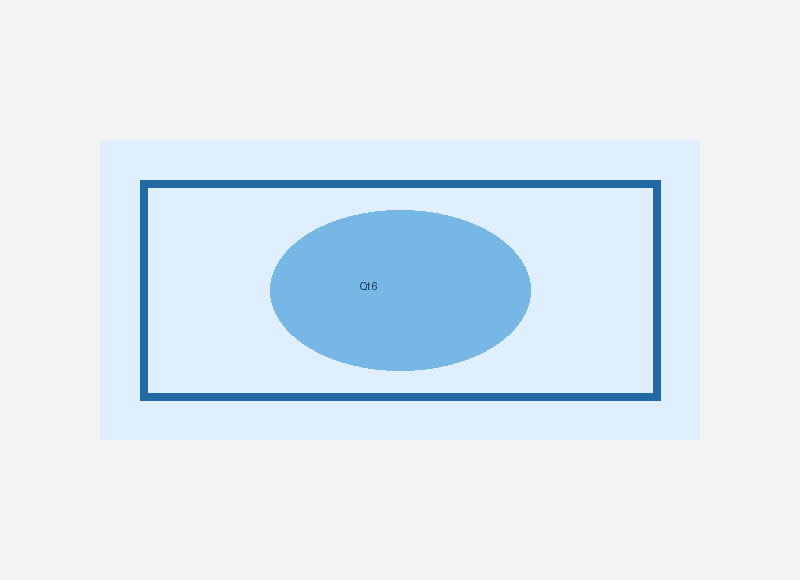

# 第 23 章 资源路径 图片与背景

本章项目：[完整源码](../../examples/34_resources)。先运行项目观察行为，再按以下顺序阅读。

## 本章要解决的问题

qrc 是资源清单，prefix 是资源前缀，alias 是资源在程序里的名字。例如前缀 /images 加别名 demo.png，运行时路径为 :/images/demo.png。这个路径与程序当前工作目录无关。qmake 项目还需要 RESOURCES += assets.qrc，构建时 rcc 才会把资源编入程序。

QPixmap 加载失败时 isNull() 为 true，先检查路径大小写、前缀、别名以及资源是否加入构建。QLabel 显示图片时，按目标区域调用 scaled(..., Qt::KeepAspectRatio, Qt::SmoothTransformation) 可以等比适应。若要做随窗口变化的背景，在 paintEvent 中基于当前 rect 绘制更直接；构造时只缩放一次不会跟随未来窗口变化。

## 磁盘路径 资源路径和显示尺寸

磁盘文件依赖部署位置和文件权限，:/ 开头的资源路径指向 Qt 资源系统。qrc 用 prefix 与 alias 构成运行时名字；XML 中 file 的内容是构建时要读取的源文件位置。因此“源码磁盘文件名”和“程序访问名字”可以不同，改了 alias 后代码也要同步。

## 按执行顺序拆解

先打开 assets.qrc，找到 prefix=/images 和 alias=demo.png，然后核对 main.cpp 的 :/images/demo.png。再打开 .pro，确认 RESOURCES 包含 qrc；使用 CMake 时确认 qrc 加入目标且启用 AUTORCC。构建以后，图片可以从资源中读取，不需要跟着 exe 另外寻找源码目录。

## 参数与行为边界

isNull 用于检查图片是否加载成功。Q_ASSERT 常在 Release 被关闭，不能把生产错误处理只写成断言；要用普通 if 处理并提示。scaled 返回新图片，不会原地修改原对象。KeepAspectRatio 保持比例，KeepAspectRatioByExpanding 会铺满但可能裁剪，IgnoreAspectRatio 可能变形。

## 易错点与排查

Qt 6 中 QPalette::Window 是窗口背景角色。用图片刷填充可能出现平铺；IgnoreAspectRatio 会拉伸变形。资源文件通常打包进程序，但资源系统也支持外部 rcc，并非所有资源都必须内嵌。

遇到问题时先区分三个层次：编译错误检查声明、头文件与构建配置；界面无反应检查连接、接收对象与生存期；运行结果不对检查输入、返回值和分支是否真正执行。可以先在连接入口记录一条日志，再在结果处理处记录一条，定位中间哪一步没有到达。

## 完整示例与配套文件

以下为本步完整程序。若存在 .ui、qrc 或额外头文件，必须把同一目录中的文件一起下载。构建期生成的 ui_*.h、moc 文件不需要手动维护。

### main.cpp

```cpp
#include <QtWidgets>
#include <QMouseEvent>
#include <QKeyEvent>

#include "verify.h"
int main(int argc, char *argv[])
{
    QApplication app(argc, argv);
    QMainWindow w;
    w.resize(800, 580);
    w.setWindowTitle("34 资源路径 图片与背景");
    auto *label = new QLabel;
    QPixmap picture(":/images/demo.png");
    Q_ASSERT(!picture.isNull());
    label->setAlignment(Qt::AlignCenter);
    label->setPixmap(picture.scaled(600, 360, Qt::KeepAspectRatio, Qt::SmoothTransformation));
    w.setCentralWidget(label);
    w.setWindowIcon(QIcon(":/images/demo.png"));
    w.show();
    scheduleVerification(&w);
    return app.exec();
}

```

### 34_resources.pro

```qmake
QT += widgets
CONFIG += c++17
TEMPLATE = app
TARGET = 34_resources
SOURCES += main.cpp
HEADERS += verify.h
RESOURCES += assets.qrc

```

### assets.qrc

```xml
<RCC><qresource prefix="/images"><file alias="demo.png">assets/demo.png</file><file alias="demo.gif">assets/demo.gif</file></qresource></RCC>
```

自动检查用的 verify.h 已在项目目录中提供；普通运行没有 --verify 参数时，不会执行自动操作。

## 运行截图与观察



## 自己动手

把别名故意写错，用 if (picture.isNull()) 显示失败提示。恢复路径后把缩放策略改成 IgnoreAspectRatio，对比图片是否变形。最后试着改变窗口大小，观察构造时只缩放一次的局限。

先写下预期行为，再修改代码、重新构建，最后对照实际结果。程序没有报错不等于逻辑已经正确，尤其要测试取消、空输入、重复操作和失败分支。

## 自测与答案

**背景图为什么不会跟着缩放？**

构造函数只执行一次。若背景依赖当前窗口尺寸，应在 resizeEvent 更新缓存，或在 paintEvent 根据当前 rect 绘制，并避免每次重绘都从磁盘重新加载。

## 继续阅读

- [Qt 官方文档](https://doc.qt.io/qt-6/resources.html)
- [项目构建方法](../getting-started.md)
- [自动检查范围](../validation.md)
