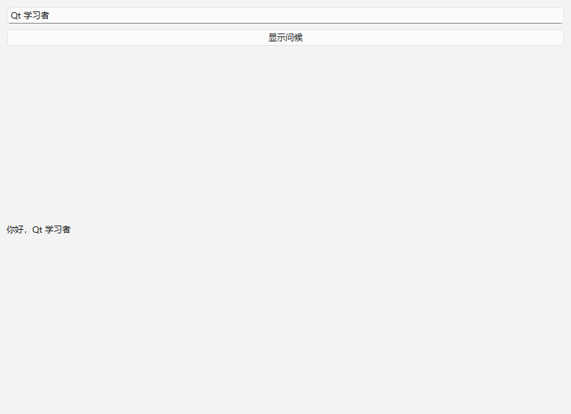

# 第 24 章 Designer 与 setupUi

本章项目：[完整源码](../../examples/35_designer)。先运行项目观察行为，再按以下顺序阅读。

## 本章要解决的问题

Designer 编辑的是 .ui XML 界面描述，uic 在构建时生成 ui_form.h。手写代码调用 ui.setupUi(&w) 后，才能通过 ui.nameEdit 等对象指针访问设计好的控件。这里采用 Ui::Form 栈包装对象，真实控件仍由 QWidget 父子关系管理。原笔记常见的 Ui::MainWindow *ui 写法则还需要析构时 delete ui。

objectName 是代码识别控件的名字，text 是界面显示文字，它们不是同一件事。常见自动槽名 on_对象名_信号名 依赖 setupUi 中的自动连接；本例使用显式 connect，便于看清触发关系，也避免重复连接。

## 设计描述 生成代码和业务代码

form.ui 是界面结构的源文件；uic 把它翻译成生成头文件；自己的 main.cpp 或窗口 .cpp 承担业务行为。setupUi 创建控件、设置属性、建立布局并登记对象名字。这个顺序解释了为什么在 setupUi 之前访问 ui.nameEdit 会得到尚未建立的对象。

## 按执行顺序拆解

在 Qt Creator 中双击 form.ui，修改按钮文字，再构建。接着只修改 nameEdit 的 objectName，观察原来的 ui.nameEdit 代码为什么编译失败。text 只影响显示，objectName 会影响生成成员名以及自动连接。示例直接在栈上保存 Ui::Form 包装器，包装器复制的只是控件指针，不拥有另一套界面。

## 参数与行为边界

Qt Creator 向导常用 Ui::MainWindow *ui；new 出来的包装器需要 delete ui。这个 delete 释放包装器，不是要求你手动逐个 delete 其所有子控件。ui_*.h 每次构建可能重新生成，不应手动修补它来解决错误。

## 易错点与排查

不要手动改 ui_form.h，重新构建会覆盖。应该改 form.ui 或自己的 .cpp。QMainWindow 的布局要放在 centralwidget 上。示例提供真实 .ui，可直接在 Qt Creator 中双击打开。

遇到问题时先区分三个层次：编译错误检查声明、头文件与构建配置；界面无反应检查连接、接收对象与生存期；运行结果不对检查输入、返回值和分支是否真正执行。可以先在连接入口记录一条日志，再在结果处理处记录一条，定位中间哪一步没有到达。

## 完整示例与配套文件

以下为本步完整程序。若存在 .ui、qrc 或额外头文件，必须把同一目录中的文件一起下载。构建期生成的 ui_*.h、moc 文件不需要手动维护。

### main.cpp

```cpp
#include <QtWidgets>
#include <QMouseEvent>
#include <QKeyEvent>
#include "ui_form.h"

#include "verify.h"
int main(int argc, char *argv[])
{
    QApplication app(argc, argv);
    QMainWindow w;
    w.resize(800, 580);
    w.setWindowTitle("35 Designer 与 setupUi");
    Ui::Form ui;
    ui.setupUi(&w);
    QObject::connect(ui.runButton, &QPushButton::clicked, &w,
                     [=]() { ui.resultLabel->setText("你好，" + ui.nameEdit->text()); });
    w.show();
    scheduleVerification(&w);
    return app.exec();
}

```

### 35_designer.pro

```qmake
QT += widgets
CONFIG += c++17
TEMPLATE = app
TARGET = 35_designer
SOURCES += main.cpp
HEADERS += verify.h
FORMS += form.ui

```

### form.ui

```xml
<ui version="4.0"><class>Form</class><widget class="QMainWindow" name="Form"><property name="windowTitle"><string>Designer 示例</string></property><widget class="QWidget" name="centralwidget"><layout class="QVBoxLayout" name="verticalLayout"><item><widget class="QLineEdit" name="nameEdit"><property name="placeholderText"><string>请输入名字</string></property></widget></item><item><widget class="QPushButton" name="runButton"><property name="text"><string>显示问候</string></property></widget></item><item><widget class="QLabel" name="resultLabel"><property name="text"><string>等待输入</string></property></widget></item></layout></widget></widget><resources/><connections/></ui>
```

自动检查用的 verify.h 已在项目目录中提供；普通运行没有 --verify 参数时，不会执行自动操作。

## 运行截图与观察



## 自己动手

给 form.ui 增加一个清空按钮，命名 clearButton。构建后用显式 connect 连接到 nameEdit->clear。再观察 setupUi 生成的结构，确认你改的是源 .ui，生成 .h 只用于理解。

先写下预期行为，再修改代码、重新构建，最后对照实际结果。程序没有报错不等于逻辑已经正确，尤其要测试取消、空输入、重复操作和失败分支。

## 自测与答案

**显式连接和 on_name_signal 能同时用吗？**

可以存在，但容易让同一操作被执行两次。学习阶段先统一使用显式 connect；如果使用自动连接，保持对象名和槽签名准确。

## 继续阅读

- [Qt 官方文档](https://doc.qt.io/qt-6/designer-using-custom-widgets.html)
- [项目构建方法](../getting-started.md)
- [自动检查范围](../validation.md)
