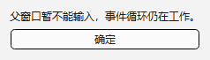
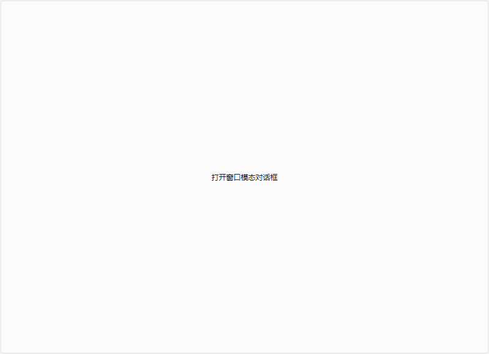

# 第 25 章 模态 非模态与对象生命期

本章项目：[完整源码](../../examples/36_dialog)。先运行项目观察行为，再按以下顺序阅读。

## 本章要解决的问题

模态决定其他窗口能否接受输入；阻塞决定调用处代码是否等待返回。exec() 显示模态对话框并等待返回，它会运行嵌套事件循环，因此对话框本身仍能响应。open() 默认按窗口模态显示并立即返回，通常连接 finished、accepted 或 rejected 处理结果。show() 通常用于非模态显示，但也会受事先设置的 modality 属性影响。

局部栈对象 dialog.show() 一闪而过的根本原因是函数返回后对象立即析构。异步显示应让对象持续存在，例如 new QDialog(&w)，并设置 WA_DeleteOnClose。仅有 parent 能在父窗口销毁时回收，不等于每次关掉对话框立即回收。

## 是否模态和是否等待是两条轴

一个对话框可能限制其他窗口的输入，却不阻塞调用处代码。open 就属于这种情况。exec 等待结果，但内部仍继续处理对话框事件，所以“阻塞代码”不等于整个 GUI 线程停止工作。嵌套事件循环会带来重入，调用之前保存的对象状态可能在对话框打开期间被其他事件改变。

## 按执行顺序拆解

运行第 50 步比较三个入口。show 和 open 的“调用后”会在用户关闭前出现；exec 的“调用后”要等用户确认或取消。show 非模态时可以继续操作主窗口；open 的窗口模态会限制父窗口。accepted、rejected 说明结果类型，finished(int) 同时提供结束通知与结果值。

## 参数与行为边界

栈对象不是永远不能用：局部 QDialog dialog; dialog.exec(); 可以活到 exec 返回。问题出在局部对象配 show/open 后函数马上返回。异步版本应使用能存活的对象，合理设置 parent 和 WA_DeleteOnClose。持有可能被关闭删除的指针时，可用 QPointer 检测对象是否仍存在。

## 易错点与排查

open() 和 show() 后不要让对象立即离开作用域。exec() 的栈对象可活到返回，但新代码通常优先考虑 open() 加结果信号，减少嵌套事件循环。对话框有 parent 仍可作为独立顶层对话框显示，不是普通嵌入控件。

遇到问题时先区分三个层次：编译错误检查声明、头文件与构建配置；界面无反应检查连接、接收对象与生存期；运行结果不对检查输入、返回值和分支是否真正执行。可以先在连接入口记录一条日志，再在结果处理处记录一条，定位中间哪一步没有到达。

## 完整示例与配套文件

以下为本步完整程序。若存在 .ui、qrc 或额外头文件，必须把同一目录中的文件一起下载。构建期生成的 ui_*.h、moc 文件不需要手动维护。

### main.cpp

```cpp
#include <QtWidgets>
#include <QMouseEvent>
#include <QKeyEvent>

#include "verify.h"
int main(int argc, char *argv[])
{
    QApplication app(argc, argv);
    QMainWindow w;
    w.resize(800, 580);
    w.setWindowTitle("36 模态 非模态与对象生命期");
    auto *button = new QPushButton("打开窗口模态对话框");
    button->setObjectName("run");
    w.setCentralWidget(button);
    QObject::connect(button, &QPushButton::clicked, &w,
                     [&w]()
                     {
                         auto *dialog = new QDialog(&w);
                         dialog->setAttribute(Qt::WA_DeleteOnClose);
                         dialog->setWindowTitle("open 立即返回");
                         auto *layout = new QVBoxLayout(dialog);
                         layout->addWidget(new QLabel("父窗口暂不能输入，事件循环仍在工作。"));
                         auto *ok = new QPushButton("确定");
                         layout->addWidget(ok);
                         QObject::connect(ok, &QPushButton::clicked, dialog, &QDialog::accept);
                         dialog->open();
                     });
    w.show();
    scheduleVerification(&w);
    return app.exec();
}

```

### 36_dialog.pro

```qmake
QT += widgets
CONFIG += c++17
TEMPLATE = app
TARGET = 36_dialog
SOURCES += main.cpp
HEADERS += verify.h

```

自动检查用的 verify.h 已在项目目录中提供；普通运行没有 --verify 参数时，不会执行自动操作。

## 运行截图与观察





## 自己动手

打开第 50 步，按 show、open、exec 分别测试确定和取消，观察日志顺序。再把 open 改成 show，比较父窗口是否可操作。不要对设置 DeleteOnClose 的对象关闭后继续调用成员。

先写下预期行为，再修改代码、重新构建，最后对照实际结果。程序没有报错不等于逻辑已经正确，尤其要测试取消、空输入、重复操作和失败分支。

## 自测与答案

**异步对话框必须写完 result=dialog->open() 吗？**

不可以。open 不用返回值传递选择结果，应提前 connect 到结果信号，并在 Lambda 中读取仍然存活的目标状态。

## 继续阅读

- [Qt 官方文档](https://doc.qt.io/qt-6/qdialog.html)
- [项目构建方法](../getting-started.md)
- [自动检查范围](../validation.md)
