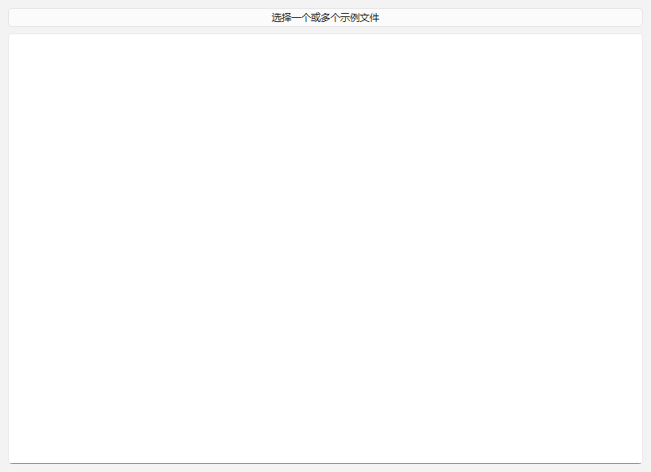

# 第 26 章 单文件 多文件与取消

本章项目：[完整源码](../../examples/37_file_dialog)。先运行项目观察行为，再按以下顺序阅读。

## 本章要解决的问题

getOpenFileName 返回 QString，getOpenFileNames 返回 QStringList；取消时分别得到空字符串或空列表。parent 用于归属，caption 是标题，dir 是起始目录，filter 是过滤规则。Images (*.png *.jpg);;Text (*.txt) 中 ;; 分隔多组过滤器。

文件选择只返回路径，不会把文件内容读到编辑框里。要读取还需 QFile 打开、检查错误、读取内容和处理编码。本项目明确只显示选中的路径。示例使用 QFileDialog 对象加 open() 与 filesSelected 信号，因此能以同样方式展示多个文件，取消时不执行选择后的逻辑。

## 选择路径与文件读写要分成两步

文件选择对话框只解决“用户要哪个路径”，QFile 才负责“这个路径能否打开、读到什么”。过滤器主要帮助用户选择，不是对文件内容的真实性验证。扩展名是 txt 也不保证内容就是 UTF-8 文本。读取后还要决定编码、大小限制和失败时是否保留当前文档。

## 按执行顺序拆解

先运行第 37 步，只选择文件并显示路径；再运行第 49 步，完成打开、编辑、保存。loadPath 先用 QFile::open(ReadOnly) 检查错误，再 readAll，再检查读取状态；成功后才替换编辑器内容。savePath 把 QString 编码为 UTF-8，再写 QSaveFile，最后 commit。写入或提交失败时返回 false，不把未保存状态清除。

## 参数与行为边界

getOpenFileName 取消返回空字符串，getOpenFileNames 返回空列表；getSaveFileName 返回目标路径，不会自动完成写入。读取现有文件用 QFile，整份文档覆盖保存优先考虑 QSaveFile。文本内容从 QString 到字节数组需要明确编码，不要把本地编码和 UTF-8 混用。

## 易错点与排查

./ 依赖当前工作目录，未必是源码所在目录。示例用构建时提供的 QT_LESSON_SOURCE_DIR 定位源码中的 samples；发布应用时应改用用户目录或部署后的资源位置。为了截图可复现，使用 Qt 非原生对话框；实际程序可以根据平台选择原生外观。

遇到问题时先区分三个层次：编译错误检查声明、头文件与构建配置；界面无反应检查连接、接收对象与生存期；运行结果不对检查输入、返回值和分支是否真正执行。可以先在连接入口记录一条日志，再在结果处理处记录一条，定位中间哪一步没有到达。

## 完整示例与配套文件

以下为本步完整程序。若存在 .ui、qrc 或额外头文件，必须把同一目录中的文件一起下载。构建期生成的 ui_*.h、moc 文件不需要手动维护。

### main.cpp

```cpp
#include <QtWidgets>
#include <QMouseEvent>
#include <QKeyEvent>

#include "verify.h"
int main(int argc, char *argv[])
{
    QApplication app(argc, argv);
    QMainWindow w;
    w.resize(800, 580);
    w.setWindowTitle("37 单文件 多文件与取消");
    auto *run = new QPushButton("选择一个或多个示例文件");
    run->setObjectName("run");
    auto *root = new QWidget;
    auto *layout = new QVBoxLayout(root);
    auto *result = new QTextEdit;
    result->setReadOnly(true);
    layout->addWidget(run);
    layout->addWidget(result);
    w.setCentralWidget(root);
    QObject::connect(run, &QPushButton::clicked, &w,
                     [&w, result]()
                     {
                         auto *dialog = new QFileDialog(
                             &w, "选择文件", QStringLiteral(QT_LESSON_SOURCE_DIR "/samples"));
                         dialog->setOption(QFileDialog::DontUseNativeDialog);
                         dialog->setFileMode(QFileDialog::ExistingFiles);
                         dialog->setNameFilter("Text (*.txt);;Images (*.png *.jpg)");
                         dialog->setAttribute(Qt::WA_DeleteOnClose);
                         QObject::connect(dialog, &QFileDialog::filesSelected, result,
                                          [result](const QStringList &files)
                                          { result->setPlainText(files.join('\n')); });
                         dialog->open();
                     });
    w.show();
    scheduleVerification(&w);
    return app.exec();
}

```

### 37_file_dialog.pro

```qmake
QT += widgets
CONFIG += c++17
TEMPLATE = app
TARGET = 37_file_dialog
SOURCES += main.cpp
HEADERS += verify.h

DEFINES += QT_LESSON_SOURCE_DIR=\\\"$$PWD\\\"

```

自动检查用的 verify.h 已在项目目录中提供；普通运行没有 --verify 参数时，不会执行自动操作。

## 运行截图与观察



## 自己动手

用第 49 步创建含中文和换行的文本，另存到自己的测试目录，关闭后重新打开。再选择不可写目录观察错误。对未保存内容发起打开或关闭，分别选择保存、不保存和取消，确认取消不会丢掉当前内容。

先写下预期行为，再修改代码、重新构建，最后对照实际结果。程序没有报错不等于逻辑已经正确，尤其要测试取消、空输入、重复操作和失败分支。

## 自测与答案

**保存后能立即把 modified 设成 false 吗？**

只有写入完整并且 commit 成功后才可以。用户取消路径选择或者磁盘写入失败时，保存未完成，当前文档仍应标记为修改过。

## 继续阅读

- [Qt 官方文档](https://doc.qt.io/qt-6/qfiledialog.html)
- [项目构建方法](../getting-started.md)
- [自动检查范围](../validation.md)
