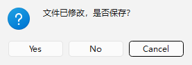
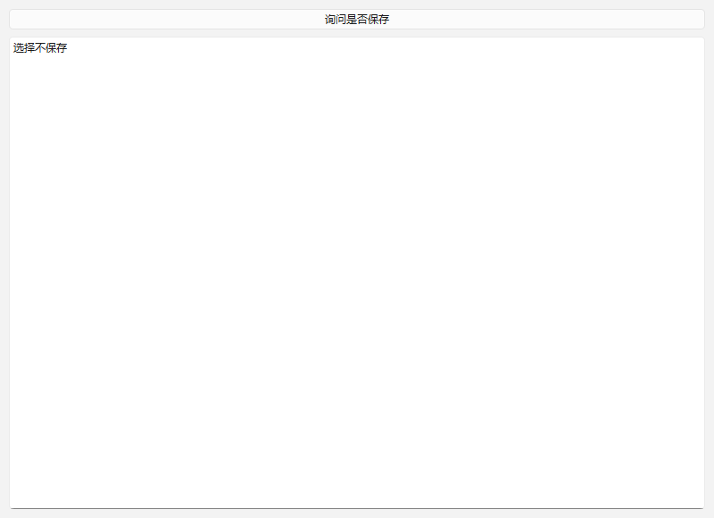

# 第 28 章 消息框与三种选择结果

本章项目：[完整源码](../../examples/39_messagebox)。先运行项目观察行为，再按以下顺序阅读。

## 本章要解决的问题

information、warning、critical 分别用于信息、警告和错误提示；question 用于请求决策。它们返回 QMessageBox::StandardButton，应该与 Yes、No、Cancel 等标准按钮枚举比较，不能把任何非零返回值都当成确认。

文件已修改时，“保存”“不保存”“取消”代表三种不同的控制流程：保存成功后继续，不保存则继续但放弃改动，取消则中止当前关闭或切换。示例只演示分支，把选择结果写到编辑器，不会真正保存或删除文件。defaultButton 应明确指定，本例选择 Cancel，避免随手回车就放弃改动。

## 按钮结果必须落实到控制流程

“是否保存”不是只打印三种文本。保存意味着成功写入后继续；不保存意味着放弃当前修改后继续；取消意味着停止正在进行的关闭或切换。如果保存过程失败，后续关闭仍不能继续。这个分支可以抽成 confirmDiscard()，供打开新文档与关闭窗口共同使用。

## 按执行顺序拆解

先在第 39 步学习 Yes、No、Cancel 与返回结果的对应关系，再在第 49 步查看真实控制流程。closeEvent 根据 confirmDiscard 返回值选择 accept 或 ignore。confirmDiscard 在 Yes 分支继续调用 saveCurrent，saveCurrent 可能因为选择路径被取消或写入失败而返回 false，因此这个 bool 不能只表示“点了 Yes”。

## 参数与行为边界

information、warning、critical 的图标表达不同严重程度，不会自动抛异常、记录日志或者退出程序。question 返回标准按钮枚举，默认按钮应有意识选择。键盘 Enter 触发默认按钮，Esc 的行为还与逃逸按钮和平台约定相关，不能把所有关闭方式当作 Yes。

## 易错点与排查

about 与 aboutQt 是说明信息，不是保存决策。示例问是否保存并不构成已经实现文件保存；真正保存要检查写入是否成功。

遇到问题时先区分三个层次：编译错误检查声明、头文件与构建配置；界面无反应检查连接、接收对象与生存期；运行结果不对检查输入、返回值和分支是否真正执行。可以先在连接入口记录一条日志，再在结果处理处记录一条，定位中间哪一步没有到达。

## 完整示例与配套文件

以下为本步完整程序。若存在 .ui、qrc 或额外头文件，必须把同一目录中的文件一起下载。构建期生成的 ui_*.h、moc 文件不需要手动维护。

### main.cpp

```cpp
#include <QtWidgets>
#include <QMouseEvent>
#include <QKeyEvent>

#include "verify.h"
int main(int argc, char *argv[])
{
    QApplication app(argc, argv);
    QMainWindow w;
    w.resize(800, 580);
    w.setWindowTitle("39 消息框与三种选择结果");
    auto *root = new QWidget;
    auto *layout = new QVBoxLayout(root);
    auto *button = new QPushButton("询问是否保存");
    button->setObjectName("run");
    auto *text = new QTextEdit;
    layout->addWidget(button);
    layout->addWidget(text);
    w.setCentralWidget(root);
    QObject::connect(button, &QPushButton::clicked, &w,
                     [&w, text]()
                     {
                         auto *box = new QMessageBox(
                             QMessageBox::Question, "保存选择", "文件已修改，是否保存？",
                             QMessageBox::Yes | QMessageBox::No | QMessageBox::Cancel, &w);
                         box->setDefaultButton(QMessageBox::Cancel);
                         box->setAttribute(Qt::WA_DeleteOnClose);
                         QObject::connect(box, &QDialog::finished, text,
                                          [text](int result)
                                          {
                                              if (result == QMessageBox::Yes)
                                                  text->append("选择保存（仅演示）");
                                              else if (result == QMessageBox::No)
                                                  text->append("选择不保存");
                                              else
                                                  text->append("取消当前操作");
                                          });
                         box->open();
                     });
    w.show();
    scheduleVerification(&w);
    return app.exec();
}

```

### 39_messagebox.pro

```qmake
QT += widgets
CONFIG += c++17
TEMPLATE = app
TARGET = 39_messagebox
SOURCES += main.cpp
HEADERS += verify.h

```

自动检查用的 verify.h 已在项目目录中提供；普通运行没有 --verify 参数时，不会执行自动操作。

## 运行截图与观察





## 自己动手

修改第 39 步默认按钮，按 Enter 测试哪个分支被触发。再到第 49 步编辑文本后关闭，选择 Yes 后取消保存路径，确认编辑器仍然打开且文本未丢失。

先写下预期行为，再修改代码、重新构建，最后对照实际结果。程序没有报错不等于逻辑已经正确，尤其要测试取消、空输入、重复操作和失败分支。

## 自测与答案

**为什么 if(result) 不够？**

Yes、No、Cancel 都是枚举值，并不把只有 Yes 定义为 true。必须显式与相应 StandardButton 比较，才能保持业务语义。

## 继续阅读

- [Qt 官方文档](https://doc.qt.io/qt-6/qmessagebox.html)
- [项目构建方法](../getting-started.md)
- [自动检查范围](../validation.md)
