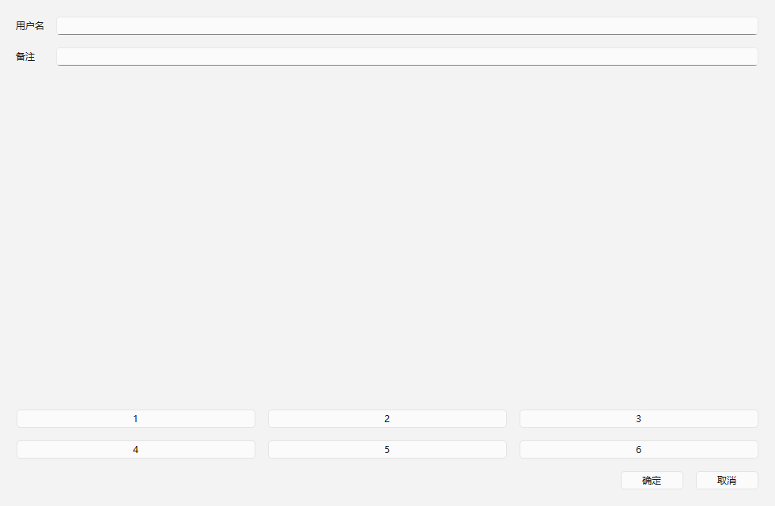

# 第 29 章 水平 垂直 网格与表单布局

本章项目：[完整源码](../../examples/40_layout)。先运行项目观察行为，再按以下顺序阅读。

## 本章要解决的问题

绝对定位要给控件逐个设置坐标和尺寸；布局则描述控件关系，由布局管理器在可用区域改变时重新安排。QHBoxLayout 从左到右，QVBoxLayout 从上到下，QGridLayout 按行列定位，QFormLayout 适合标签与输入框成对排列。

父布局用 addLayout 嵌入子布局，控件用 addWidget 加入。addStretch 放可伸缩空白；setContentsMargins 控制布局与外边界间距；setSpacing 控制相邻项目间距。stretch 是分配额外空间的权重，不是承诺最终宽高严格按比例分配，还会受 sizeHint、最小尺寸和 sizePolicy 约束。

## 布局管理的是空间约束

布局会综合 available space、sizeHint、minimumSize、maximumSize、sizePolicy 和 stretch 来分配空间。它不是简单把窗口按比例切成几个盒子。一个按钮即使 stretch 为 1，也可能由于样式或尺寸策略不愿竖向拉高；多行编辑器通常适合承担更多可伸缩空间。

## 按执行顺序拆解

第 40 步的根 QVBoxLayout 管理三个区域：表单、网格、底部按钮行。表单用 addRow，网格用从零开始的行列下标，底部行先 addStretch 再加按钮，让按钮靠右。new QVBoxLayout(root) 已把布局安装到 root，无需又对 root setLayout 另一份。

## 参数与行为边界

contentsMargins 是容器内缘留白，spacing 是相邻项目间隔，addSpacing 是固定间隔，addStretch 是可伸缩空白。QGridLayout 的 rowSpan 和 columnSpan 允许跨行列。QFormLayout 不等于 QTableWidget：前者安排控件，后者显示可编辑表格数据。

## 易错点与排查

布局不是可见控件。控件加入布局后不要再依赖 move()/resize() 固定摆放。不要给同一 QWidget 安装两个顶层布局；QMainWindow 先设置 centralWidget，再给这个容器安装布局。

遇到问题时先区分三个层次：编译错误检查声明、头文件与构建配置；界面无反应检查连接、接收对象与生存期；运行结果不对检查输入、返回值和分支是否真正执行。可以先在连接入口记录一条日志，再在结果处理处记录一条，定位中间哪一步没有到达。

## 完整示例与配套文件

以下为本步完整程序。若存在 .ui、qrc 或额外头文件，必须把同一目录中的文件一起下载。构建期生成的 ui_*.h、moc 文件不需要手动维护。

### main.cpp

```cpp
#include <QtWidgets>
#include <QMouseEvent>
#include <QKeyEvent>

#include "verify.h"
int main(int argc, char *argv[])
{
    QApplication app(argc, argv);
    QMainWindow w;
    w.resize(800, 580);
    w.setWindowTitle("40 水平 垂直 网格与表单布局");
    auto *root = new QWidget;
    auto *outer = new QVBoxLayout(root);
    auto *form = new QFormLayout;
    form->addRow("用户名", new QLineEdit);
    form->addRow("备注", new QLineEdit);
    outer->addLayout(form);
    auto *grid = new QGridLayout;
    for (int i = 0; i < 6; ++i)
        grid->addWidget(new QPushButton(QString::number(i + 1)), i / 3, i % 3);
    outer->addLayout(grid);
    auto *row = new QHBoxLayout;
    row->addStretch();
    row->addWidget(new QPushButton("确定"));
    row->addWidget(new QPushButton("取消"));
    outer->addLayout(row);
    outer->setContentsMargins(20, 20, 20, 20);
    outer->setSpacing(14);
    w.setCentralWidget(root);
    w.show();
    scheduleVerification(&w);
    return app.exec();
}

```

### 40_layout.pro

```qmake
QT += widgets
CONFIG += c++17
TEMPLATE = app
TARGET = 40_layout
SOURCES += main.cpp
HEADERS += verify.h

```

自动检查用的 verify.h 已在项目目录中提供；普通运行没有 --verify 参数时，不会执行自动操作。

## 运行截图与观察



## 自己动手

把编辑器放到垂直布局中，设置 addWidget(editor,1)，底部按钮行不设置伸展。把窗口拉宽拉高，观察谁吸收额外空间。再把某个按钮 setFixedSize，检查它如何限制布局，理解固定大小不应滥用。

先写下预期行为，再修改代码、重新构建，最后对照实际结果。程序没有报错不等于逻辑已经正确，尤其要测试取消、空输入、重复操作和失败分支。

## 自测与答案

**一个控件可以同时加入两个布局吗？**

同一个控件只有一个实际父层级与几何位置，不能被两个布局当作两个副本使用。需要重复显示时应创建多个控件实例并同步数据。

## 继续阅读

- [Qt 官方文档](https://doc.qt.io/qt-6/layout.html)
- [项目构建方法](../getting-started.md)
- [自动检查范围](../validation.md)
