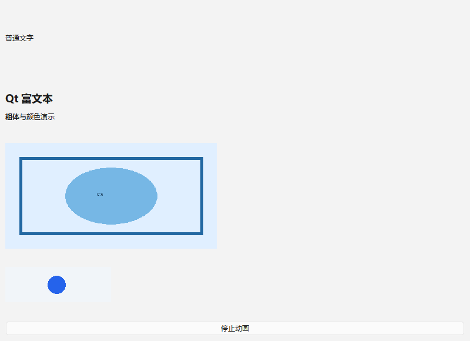

# 第 30 章 QLabel 文本 图片与动画

本章项目：[完整源码](../../examples/41_label_movie)。先运行项目观察行为，再按以下顺序阅读。

## 本章要解决的问题

QLabel 可显示普通文本、受支持的 HTML 富文本、QPixmap 图片和 QMovie 动画。并不意味着完整浏览器；复杂网页不应交给 QLabel。内容来自外部输入时，可显式设 PlainText，避免自动识别为富文本。

setOpenExternalLinks(true) 会在用户点击链接后交给外部程序打开网址；本例只显示本地富文本，不自动跳转。setPixmap 绑定图片；setMovie 绑定动画，但 QLabel 不接管 QMovie 的所有权，应 new QMovie(..., parent) 指定父对象，并调用 start()。stop() 停止播放，setPaused(true) 暂停。

## QLabel 的四种内容走不同接口

setText 接收文本，setPixmap 接收像素图，setMovie 接收动画对象。设置字符串 :/images/demo.png 并不会让 QLabel 读取图片。富文本采用 Qt 支持的子集，不等于浏览器完整 HTML/CSS。对用户输入使用 PlainText，可避免误把尖括号内容当作格式标签。

## 按执行顺序拆解

第 41 步先显示普通文本，再显示富文本，然后分别绑定 QPixmap 和 QMovie。QMovie 需要 start 才播放；停止按钮连接到 movie->stop。QMovie 的 parent 设为 root，避免标签不接管 movie 所有权所导致的泄漏。图片和 GIF 都已随 qrc 提供。

## 参数与行为边界

设置固定目标尺寸并等比缩放，会留下空白；scaledContents(true) 可能直接拉伸。高 DPI 图片还涉及逻辑尺寸与 devicePixelRatio，不应只按物理像素数猜显示大小。需要随容器大小调整图片时，可在尺寸变化时更新缩放结果，避免在无关事件里重复加载。

## 易错点与排查

显示 GIF 的 QMovie 不要漏 parent。标签不会自动把资源路径文本变成图片，必须加载 QPixmap 或 QMovie。原笔记的资源图片若未随项目提供，在其他电脑就会显示空白；本例随附 qrc、PNG 和 GIF。

遇到问题时先区分三个层次：编译错误检查声明、头文件与构建配置；界面无反应检查连接、接收对象与生存期；运行结果不对检查输入、返回值和分支是否真正执行。可以先在连接入口记录一条日志，再在结果处理处记录一条，定位中间哪一步没有到达。

## 完整示例与配套文件

以下为本步完整程序。若存在 .ui、qrc 或额外头文件，必须把同一目录中的文件一起下载。构建期生成的 ui_*.h、moc 文件不需要手动维护。

### main.cpp

```cpp
#include <QtWidgets>
#include <QMouseEvent>
#include <QKeyEvent>

#include "verify.h"
int main(int argc, char *argv[])
{
    QApplication app(argc, argv);
    QMainWindow w;
    w.resize(800, 580);
    w.setWindowTitle("41 QLabel 文本 图片与动画");
    auto *root = new QWidget;
    auto *layout = new QVBoxLayout(root);
    layout->addWidget(new QLabel("普通文字"));
    auto *rich = new QLabel("<h2>Qt 富文本</h2><p><b>粗体</b>与颜色演示</p>");
    layout->addWidget(rich);
    auto *image = new QLabel;
    image->setPixmap(QPixmap(":/images/demo.png").scaledToWidth(360));
    layout->addWidget(image);
    auto *animation = new QLabel;
    auto *movie = new QMovie(":/images/demo.gif", QByteArray(), root);
    animation->setMovie(movie);
    movie->start();
    layout->addWidget(animation);
    auto *stop = new QPushButton("停止动画");
    stop->setObjectName("run");
    layout->addWidget(stop);
    QObject::connect(stop, &QPushButton::clicked, movie, &QMovie::stop);
    w.setCentralWidget(root);
    w.show();
    scheduleVerification(&w);
    return app.exec();
}

```

### 41_label_movie.pro

```qmake
QT += widgets
CONFIG += c++17
TEMPLATE = app
TARGET = 41_label_movie
SOURCES += main.cpp
HEADERS += verify.h
RESOURCES += assets.qrc

```

### assets.qrc

```xml
<RCC><qresource prefix="/images"><file alias="demo.png">assets/demo.png</file><file alias="demo.gif">assets/demo.gif</file></qresource></RCC>
```

自动检查用的 verify.h 已在项目目录中提供；普通运行没有 --verify 参数时，不会执行自动操作。

## 运行截图与观察



## 自己动手

把标签改为纯文本并传入 <b>Qt</b>，观察它是否显示原始标签。分别测试 movie.stop、setPaused(true)、start，比较停止与暂停的区别。把图片目标尺寸改成长条，比较等比与拉伸结果。

先写下预期行为，再修改代码、重新构建，最后对照实际结果。程序没有报错不等于逻辑已经正确，尤其要测试取消、空输入、重复操作和失败分支。

## 自测与答案

**标签析构会自动 delete movie 吗？**

setMovie 不接管动画对象。应通过 QObject parent 或其他明确的生命周期方案管理它，不要仅凭“在标签里显示”判断归属。

## 继续阅读

- [Qt 官方文档](https://doc.qt.io/qt-6/qlabel.html)
- [项目构建方法](../getting-started.md)
- [自动检查范围](../validation.md)
