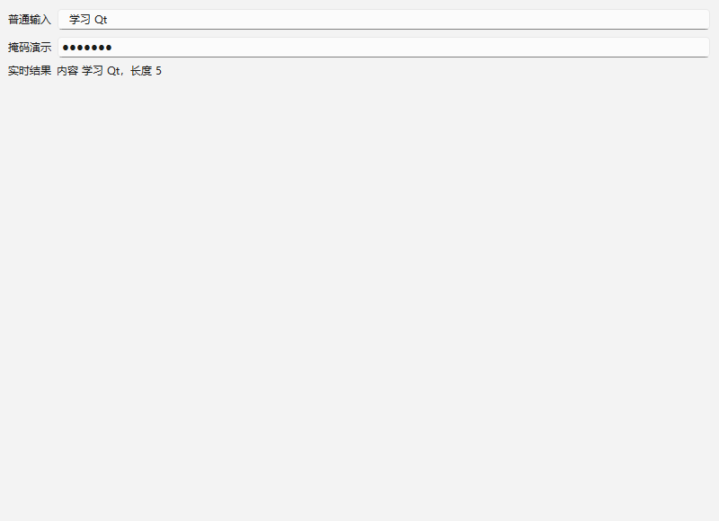

# 第 31 章 QLineEdit 输入与显示模式

本章项目：[完整源码](../../examples/42_lineedit)。先运行项目观察行为，再按以下顺序阅读。

## 本章要解决的问题

QLineEdit 用于单行输入，setText 写入，text() 读取真实内容。placeholderText 是空内容时的提示，不是输入值；设置它不会让 text() 返回提示。textChanged 会响应用户和代码设置的变化，textEdited 主要响应用户编辑，returnPressed 用于回车触发。

四种 EchoMode 为 Normal、NoEcho、Password、PasswordEchoOnEdit。NoEcho 不显示字符；Password 显示掩码；PasswordEchoOnEdit 在编辑时显示、非编辑时掩码。显示模式只改变外观，text() 仍是实际字符串。setTextMargins 控制框内边距，不是移动控件本身。

## 输入值 显示值和编辑动作

QLineEdit::text() 是真实字符串，displayText() 是按 EchoMode 处理后的显示内容。placeholderText 只在空值时提示，它不会成为真实文本。代码 setText 也会触发 textChanged，但通常不属于 textEdited 所描述的用户编辑，这个差别常用于避免把程序回填当成用户输入。

## 按执行顺序拆解

启动第 42 步时普通框为空，掩码演示框已有固定样例值。输入名字后，textChanged 将内容和长度送到结果标签。清空输入后，提示文字出现，但结果中的真实长度应为零。密码框从来不把真实演示值复制到日志。

## 参数与行为边界

setMaxLength 限制长度；QValidator 可以约束可接受输入；inputMask 适合固定形状。验证器可能有 Intermediate 状态，因此输入过程中暂时不完整不一定是 Invalid。returnPressed 与 editingFinished 的触发还可能受验证状态影响，不能只看某一帧文本就提交业务。

## 易错点与排查

密码掩码不是加密，不应把敏感密码打印到日志。本例仅用固定的演示文本，并只显示长度。清空后 text() 是空字符串，不是 placeholder 文本。

遇到问题时先区分三个层次：编译错误检查声明、头文件与构建配置；界面无反应检查连接、接收对象与生存期；运行结果不对检查输入、返回值和分支是否真正执行。可以先在连接入口记录一条日志，再在结果处理处记录一条，定位中间哪一步没有到达。

## 完整示例与配套文件

以下为本步完整程序。若存在 .ui、qrc 或额外头文件，必须把同一目录中的文件一起下载。构建期生成的 ui_*.h、moc 文件不需要手动维护。

### main.cpp

```cpp
#include <QtWidgets>
#include <QMouseEvent>
#include <QKeyEvent>

#include "verify.h"
int main(int argc, char *argv[])
{
    QApplication app(argc, argv);
    QMainWindow w;
    w.resize(800, 580);
    w.setWindowTitle("42 QLineEdit 输入与显示模式");
    auto *root = new QWidget;
    auto *form = new QFormLayout(root);
    auto *name = new QLineEdit;
    name->setObjectName("name");
    name->setPlaceholderText("请输入名字");
    name->setTextMargins(8, 0, 8, 0);
    form->addRow("普通输入", name);
    auto *password = new QLineEdit("demo123");
    password->setEchoMode(QLineEdit::Password);
    form->addRow("掩码演示", password);
    auto *result = new QLabel("尚未输入");
    form->addRow("实时结果", result);
    QObject::connect(name, &QLineEdit::textChanged, result, [result](const QString &text)
                     { result->setText(QString("内容 %1，长度 %2").arg(text).arg(text.size())); });
    w.setCentralWidget(root);
    w.show();
    scheduleVerification(&w);
    return app.exec();
}

```

### 42_lineedit.pro

```qmake
QT += widgets
CONFIG += c++17
TEMPLATE = app
TARGET = 42_lineedit
SOURCES += main.cpp
HEADERS += verify.h

```

自动检查用的 verify.h 已在项目目录中提供；普通运行没有 --verify 参数时，不会执行自动操作。

## 运行截图与观察



## 自己动手

添加读取按钮，同时观察 text() 与 displayText() 的差别，但仅使用固定演示内容。给姓名设置最大长度，再给另一个输入框安装 QIntValidator，尝试空值、部分输入和超范围值。提交前使用 hasAcceptableInput 检查。

先写下预期行为，再修改代码、重新构建，最后对照实际结果。程序没有报错不等于逻辑已经正确，尤其要测试取消、空输入、重复操作和失败分支。

## 自测与答案

**把 echoMode 改成 Password 就能安全保存密码吗？**

它只隐藏显示，不加密内存、日志或磁盘数据。不要把输入展示策略当作数据保护或账号认证方案。

## 继续阅读

- [Qt 官方文档](https://doc.qt.io/qt-6/qlineedit.html)
- [项目构建方法](../getting-started.md)
- [自动检查范围](../validation.md)
