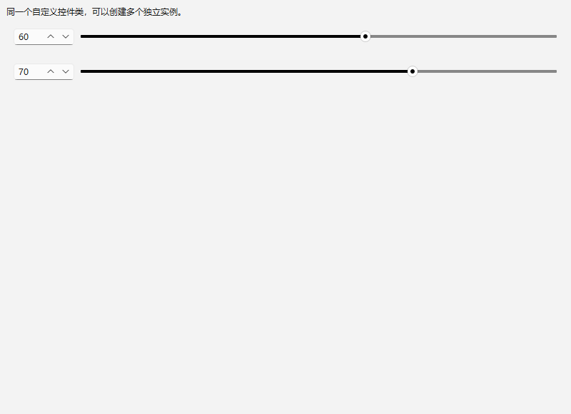

# 第 32 章 组合控件与 Designer 提升

本章项目：[完整源码](../../examples/43_custom_widget)。先运行项目观察行为，再按以下顺序阅读。

## 本章要解决的问题

自定义控件是把重复出现的交互封装成可创建多个实例的类。这里把 QSpinBox 和 QSlider 组合到 SmallWidget，统一数值范围，双向连接数值变化，并提供 setValue()/value()。调用者不需要知道内部布局。

双向连接并不必然无限递归：这里 setValue 只有数值真正改变才发信号，回写相同值不会再次发射。若自定义 setter 每次都发信号，就要先判断是否变化，必要时使用 QSignalBlocker。封装的目标是复用定义和行为，不是让整个应用只创建一个对象。

## 把内部结构藏在稳定接口后面

组合控件把多个标准控件组织成一个可复用组件。外部调用者只知道 setValue 和 value，不需要知道滑块放左边还是右边。复制的是类定义和设计，不是强迫所有页面共享同一个实例。需要多处独立状态时创建多个对象即可。

## 按执行顺序拆解

打开 smallwidget.h，依次找到构造函数、范围设置、布局、双向连接、setValue/value。两端范围必须一致，否则 A 到 B 的截断可能造成显示不一致。setValue 相同值不发 valueChanged，是这里双向连接能稳定结束的原因。若自定义组件公开信号，需要 Q_OBJECT 并让 moc 参与构建。

## 参数与行为边界

Designer 提升分成五步：添加普通 QWidget，占位对象改名；右键提升；基类选 QWidget；填写 SmallWidget 和 smallwidget.h；添加后执行提升。构建器必须能够找到头文件，构造函数应支持 QWidget *parent。提升不自动生成 SmallWidget 的实现。

## 易错点与排查

Designer 中先放 QWidget 占位，提升类名填 SmallWidget，头文件填 smallwidget.h，再提升；类必须可包含且构造函数能接受 QWidget *parent。提升不保证设计器预览能运行自定义代码。示例附 smallwidget.h，可直接用于提升。

遇到问题时先区分三个层次：编译错误检查声明、头文件与构建配置；界面无反应检查连接、接收对象与生存期；运行结果不对检查输入、返回值和分支是否真正执行。可以先在连接入口记录一条日志，再在结果处理处记录一条，定位中间哪一步没有到达。

## 完整示例与配套文件

以下为本步完整程序。若存在 .ui、qrc 或额外头文件，必须把同一目录中的文件一起下载。构建期生成的 ui_*.h、moc 文件不需要手动维护。

### main.cpp

```cpp
#include <QtWidgets>
#include <QMouseEvent>
#include <QKeyEvent>
#include "smallwidget.h"

#include "verify.h"
int main(int argc, char *argv[])
{
    QApplication app(argc, argv);
    QMainWindow w;
    w.resize(800, 580);
    w.setWindowTitle("43 组合控件与 Designer 提升");
    auto *root = new QWidget;
    auto *layout = new QVBoxLayout(root);
    layout->addWidget(new QLabel("同一个自定义控件类，可以创建多个独立实例。"));
    auto *first = new SmallWidget;
    first->setObjectName("first");
    first->setValue(25);
    auto *second = new SmallWidget;
    second->setValue(70);
    layout->addWidget(first);
    layout->addWidget(second);
    layout->addStretch();
    w.setCentralWidget(root);
    w.show();
    scheduleVerification(&w);
    return app.exec();
}

```

### smallwidget.h

```cpp
#pragma once
#include <QtWidgets>
class SmallWidget : public QWidget
{
  public:
    explicit SmallWidget(QWidget *parent = nullptr) : QWidget(parent)
    {
        auto *row = new QHBoxLayout(this);
        spin = new QSpinBox;
        auto *slider = new QSlider(Qt::Horizontal);
        spin->setRange(0, 100);
        slider->setRange(0, 100);
        row->addWidget(spin);
        row->addWidget(slider);
        QObject::connect(spin, &QSpinBox::valueChanged, slider, &QSlider::setValue);
        QObject::connect(slider, &QSlider::valueChanged, spin, &QSpinBox::setValue);
    }
    void setValue(int value)
    {
        spin->setValue(value);
    }
    int value() const
    {
        return spin->value();
    }

  private:
    QSpinBox *spin;
};

```

### 43_custom_widget.pro

```qmake
QT += widgets
CONFIG += c++17
TEMPLATE = app
TARGET = 43_custom_widget
SOURCES += main.cpp
HEADERS += verify.h
HEADERS += smallwidget.h

```

自动检查用的 verify.h 已在项目目录中提供；普通运行没有 --verify 参数时，不会执行自动操作。

## 运行截图与观察



## 自己动手

新建一个 .ui，把 QWidget 提升为 SmallWidget，运行后读取 value。再把两个组件放到不同页面，确认数值独立。若需要对外通知变化，可添加 valueChanged(int) 信号，并只在真正变化时发出。

先写下预期行为，再修改代码、重新构建，最后对照实际结果。程序没有报错不等于逻辑已经正确，尤其要测试取消、空输入、重复操作和失败分支。

## 自测与答案

**如何避免互相 setValue 时无限循环？**

优先让 setter 检查数值是否变化。必要时用 QSignalBlocker 在同步期间暂时阻断回发，不能仅仅假定所有自定义 setter 都和 QSpinBox 一样。

## 继续阅读

- [Qt 官方文档](https://doc.qt.io/qt-6/designer-using-custom-widgets.html)
- [项目构建方法](../getting-started.md)
- [自动检查范围](../validation.md)
