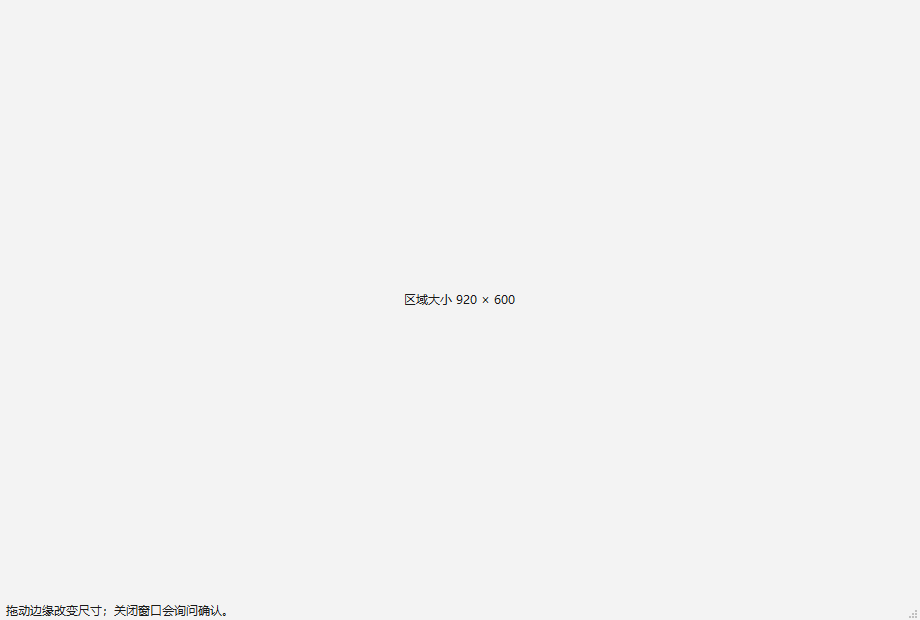

# 第 34 章 关闭事件与尺寸变化

本章项目：[完整源码](../../examples/45_close_resize)。先运行项目观察行为，再按以下顺序阅读。

## 本章要解决的问题

事件是 QEvent 的对象，由事件系统送到目标 QObject。QWidget 的 event() 会根据类型分派到 closeEvent、resizeEvent 等专用处理函数；按钮 clicked 则是较高层的信号通知。二者经常配合，但不是同一个概念。

在头文件 protected 区声明 void closeEvent(QCloseEvent *event) override，源文件实现。accept 允许关闭，ignore 拒绝关闭；不要调用 close() 重新触发自己。resizeEvent 的 size 是新尺寸，oldSize 是旧尺寸，首次事件的旧尺寸可能无效。resizeEvent 中尽量避免无条件再次 resize，以免递归。

## 关闭请求和尺寸通知是不同事件

closeEvent 收到的是关闭请求，ignore 可以让窗口继续存在；resizeEvent 通知的是尺寸已经变化，不是拿来询问是否允许缩放。不要在 closeEvent 里再次调用 close 引发递归，也不要在 resizeEvent 中无条件再次 resize 制造事件循环。

## 按执行顺序拆解

第 45 步用 QMessageBox 的 No/Yes 控制 ignore/accept。对照第 49 步，确认“用户同意保存”和“保存已完成”之间还存在文件错误处理。resizeEvent 中使用 event->size() 与 oldSize()，首次旧尺寸可能无效，因此不要直接按其计算有意义的比例。

## 参数与行为边界

事件参数只在当前调用中有效，不要把 QCloseEvent* 或 QResizeEvent* 保存到异步回调后再使用。若要异步询问关闭，可以先 ignore，本次事件结束后显示异步对话框，确认后设置状态并重新发起关闭请求。

## 易错点与排查

override 用于检查是否真正覆盖了基类虚函数。保留原有处理通常要调用基类对应函数，但关闭拦截中拒绝后不要再调用会重新接受关闭的默认处理。本例自动验证会分别选择 No 与 Yes。

遇到问题时先区分三个层次：编译错误检查声明、头文件与构建配置；界面无反应检查连接、接收对象与生存期；运行结果不对检查输入、返回值和分支是否真正执行。可以先在连接入口记录一条日志，再在结果处理处记录一条，定位中间哪一步没有到达。

## 完整示例与配套文件

以下为本步完整程序。若存在 .ui、qrc 或额外头文件，必须把同一目录中的文件一起下载。构建期生成的 ui_*.h、moc 文件不需要手动维护。

### main.cpp

```cpp
#include <QtWidgets>
#include <QMouseEvent>
#include <QKeyEvent>
class EventArea : public QLabel
{
  public:
    explicit EventArea(QWidget *p = nullptr) : QLabel(p)
    {
        setMouseTracking(true);
        setFocusPolicy(Qt::StrongFocus);
        setAlignment(Qt::AlignCenter);
        setText("移动鼠标，点击后按键盘；拖动主窗口观察大小变化。");
    }

  protected:
    void resizeEvent(QResizeEvent *event) override
    {
        setText(QString("区域大小 %1 × %2").arg(event->size().width()).arg(event->size().height()));
        QLabel::resizeEvent(event);
    }
    void mouseMoveEvent(QMouseEvent *event) override
    {
        setText(QString("鼠标位置 %1，%2").arg(event->position().x()).arg(event->position().y()));
        QLabel::mouseMoveEvent(event);
    }
    void mousePressEvent(QMouseEvent *event) override
    {
        setFocus();
        setText(event->button() == Qt::LeftButton ? "左键按下" : "其他鼠标键按下");
        QLabel::mousePressEvent(event);
    }
    bool event(QEvent *event) override
    {
        if (event->type() == QEvent::KeyPress)
        {
            auto *key = static_cast<QKeyEvent *>(event);
            if (key->key() == Qt::Key_Tab)
            {
                setText("event 已处理 Tab，阻止默认焦点切换");
                return true;
            }
        }
        return QLabel::event(event);
    }
};
class CloseWindow : public QMainWindow
{
  protected:
    void closeEvent(QCloseEvent *event) override
    {
        auto choice = QMessageBox::question(this, "关闭确认", "确定关闭窗口吗？",
                                            QMessageBox::Yes | QMessageBox::No, QMessageBox::No);
        if (choice == QMessageBox::Yes)
            event->accept();
        else
            event->ignore();
    }
};

#include "verify.h"
int main(int argc, char *argv[])
{
    QApplication app(argc, argv);
    CloseWindow w;
    w.resize(800, 580);
    w.setWindowTitle("45 关闭事件与尺寸变化");
    w.setCentralWidget(new EventArea);
    w.statusBar()->showMessage("拖动边缘改变尺寸；关闭窗口会询问确认。");
    w.show();
    scheduleVerification(&w);
    return app.exec();
}

```

### 45_close_resize.pro

```qmake
QT += widgets
CONFIG += c++17
TEMPLATE = app
TARGET = 45_close_resize
SOURCES += main.cpp
HEADERS += verify.h

```

自动检查用的 verify.h 已在项目目录中提供；普通运行没有 --verify 参数时，不会执行自动操作。

## 运行截图与观察



## 自己动手

第一次关闭选 No，确认窗口仍显示；第二次选 Yes，确认窗口退出。改变窗口大小后记录旧新尺寸。再思考怎样让编辑器修改未保存时才询问，而不是每次关闭都询问。

先写下预期行为，再修改代码、重新构建，最后对照实际结果。程序没有报错不等于逻辑已经正确，尤其要测试取消、空输入、重复操作和失败分支。

## 自测与答案

**在拒绝关闭后还调用默认 closeEvent 有何问题？**

默认实现可能接受这次关闭请求，覆盖你的拒绝决策。需要保留的基类行为必须结合事件种类判断，不能机械地在每个函数末尾调用。

## 继续阅读

- [Qt 官方文档](https://doc.qt.io/qt-6/qwidget.html)
- [项目构建方法](../getting-started.md)
- [自动检查范围](../validation.md)
