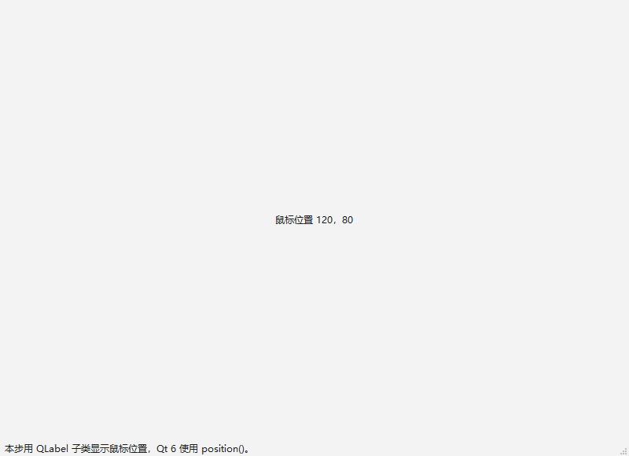

# 第 35 章 鼠标按键 坐标和跟踪

本章项目：[完整源码](../../examples/46_mouse_events)。先运行项目观察行为，再按以下顺序阅读。

## 本章要解决的问题

mousePressEvent 处理按下，mouseReleaseEvent 处理释放，mouseMoveEvent 处理移动。button() 描述本次发生变化的按键；buttons() 是当前仍按下的按键集合，例如移动时判断是否正在拖动要查看 buttons()。

默认不按键移动时不一定收到移动事件，setMouseTracking(true) 允许无按键移动跟踪。Qt 6 推荐 position() 获取相对接收控件的浮点坐标，用 globalPosition() 获取屏幕坐标。坐标属于接收事件的控件，不是任意父窗口。

## 本次变化的按键和当前按下集合

鼠标 button() 表示触发本次按下或释放的按键，buttons() 表示当前仍保持按下的集合。mouseMoveEvent 的 button 常是 NoButton，因此拖拽判断应使用 buttons() & Qt::LeftButton。position 是相对接收控件的坐标，globalPosition 是屏幕坐标，二者不能混用。

## 按执行顺序拆解

本例把事件处理放在 QLabel 子类 EventArea 上，因为鼠标实际上位于这个标签。设置 mouseTracking(true) 后，即使没有按键也收到移动事件。点击时 setFocus，后面的键盘观察才有明确目标。只在主窗口上重写鼠标函数，不保证能看到被子控件处理掉的事件。

## 参数与行为边界

默认把某些事件交给基类处理，有助于保留原控件行为。事件传播不是任意祖先都会收到一份副本；是否处理、是否接受、控件默认行为都会影响链路。需要观察已有子控件而不改继承时，下一节的事件过滤器更合适。

## 易错点与排查

鼠标位于某个子控件上时，事件通常发给那个子控件。若想观察 QLabel 上的事件，应继承 QLabel 重写，而不是只在主窗口上重写后期待捕获所有子控件事件。

遇到问题时先区分三个层次：编译错误检查声明、头文件与构建配置；界面无反应检查连接、接收对象与生存期；运行结果不对检查输入、返回值和分支是否真正执行。可以先在连接入口记录一条日志，再在结果处理处记录一条，定位中间哪一步没有到达。

## 完整示例与配套文件

以下为本步完整程序。若存在 .ui、qrc 或额外头文件，必须把同一目录中的文件一起下载。构建期生成的 ui_*.h、moc 文件不需要手动维护。

### main.cpp

```cpp
#include <QtWidgets>
#include <QMouseEvent>
#include <QKeyEvent>
class EventArea : public QLabel
{
  public:
    explicit EventArea(QWidget *p = nullptr) : QLabel(p)
    {
        setMouseTracking(true);
        setFocusPolicy(Qt::StrongFocus);
        setAlignment(Qt::AlignCenter);
        setText("移动鼠标，点击后按键盘；拖动主窗口观察大小变化。");
    }

  protected:
    void resizeEvent(QResizeEvent *event) override
    {
        setText(QString("区域大小 %1 × %2").arg(event->size().width()).arg(event->size().height()));
        QLabel::resizeEvent(event);
    }
    void mouseMoveEvent(QMouseEvent *event) override
    {
        setText(QString("鼠标位置 %1，%2").arg(event->position().x()).arg(event->position().y()));
        QLabel::mouseMoveEvent(event);
    }
    void mousePressEvent(QMouseEvent *event) override
    {
        setFocus();
        setText(event->button() == Qt::LeftButton ? "左键按下" : "其他鼠标键按下");
        QLabel::mousePressEvent(event);
    }
    bool event(QEvent *event) override
    {
        if (event->type() == QEvent::KeyPress)
        {
            auto *key = static_cast<QKeyEvent *>(event);
            if (key->key() == Qt::Key_Tab)
            {
                setText("event 已处理 Tab，阻止默认焦点切换");
                return true;
            }
        }
        return QLabel::event(event);
    }
};
class CloseWindow : public QMainWindow
{
  protected:
    void closeEvent(QCloseEvent *event) override
    {
        auto choice = QMessageBox::question(this, "关闭确认", "确定关闭窗口吗？",
                                            QMessageBox::Yes | QMessageBox::No, QMessageBox::No);
        if (choice == QMessageBox::Yes)
            event->accept();
        else
            event->ignore();
    }
};

#include "verify.h"
int main(int argc, char *argv[])
{
    QApplication app(argc, argv);
    QMainWindow w;
    w.resize(800, 580);
    w.setWindowTitle("46 鼠标按键 坐标和跟踪");
    w.setCentralWidget(new EventArea);
    w.statusBar()->showMessage("本步用 QLabel 子类显示鼠标位置，Qt 6 使用 position()。");
    w.show();
    scheduleVerification(&w);
    return app.exec();
}

```

### 46_mouse_events.pro

```qmake
QT += widgets
CONFIG += c++17
TEMPLATE = app
TARGET = 46_mouse_events
SOURCES += main.cpp
HEADERS += verify.h

```

自动检查用的 verify.h 已在项目目录中提供；普通运行没有 --verify 参数时，不会执行自动操作。

## 运行截图与观察



## 自己动手

在 mouseMoveEvent 中只有左键拖动时显示“拖动”，无按键时显示“悬停”。用 position 记录相对位置，再把标签放进带边距的布局中，确认坐标原点跟随标签而非主窗口。

先写下预期行为，再修改代码、重新构建，最后对照实际结果。程序没有报错不等于逻辑已经正确，尤其要测试取消、空输入、重复操作和失败分支。

## 自测与答案

**Qt 5 示例中的 x/y 可以照搬吗？**

部分旧接口仍可能存在但不适合新代码。Qt 6 使用 position 的浮点位置更准确，必要时再有意识转换成整数 QPoint。

## 继续阅读

- [Qt 官方文档](https://doc.qt.io/qt-6/qmouseevent.html)
- [项目构建方法](../getting-started.md)
- [自动检查范围](../validation.md)
