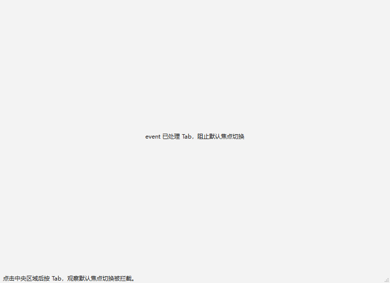

# 第 36 章 重写 event 拦截 Tab

本章项目：[完整源码](../../examples/47_event_tab)。先运行项目观察行为，再按以下顺序阅读。

## 本章要解决的问题

event(QEvent *) 返回 bool，表示是否处理这个事件。先检查 type 再把通用指针转换到对应事件类型；未经类型判断的强制转换可能访问错误的数据。处理感兴趣的事件后返回 true；其余事件必须 return 基类::event(event)，避免破坏默认行为。

Tab 常被控件系统用来切换焦点，因此只在 keyPressEvent 中写代码可能不够。要改变这个行为，可以在目标控件的 event 中拦截 KeyPress，识别 Qt::Key_Tab。键盘事件发给有焦点的对象，先确保目标控件有适当 focusPolicy 并获得焦点。

## 事件分发 事件处理和事件过滤

特定处理函数适合某一类事件；重写 event 适合介入目标对象的分发；eventFilter 适合在不改被观察对象继承关系时提前观察或消费事件。第 51 步在 QLineEdit 上安装过滤器，识别回车并更新标签，不需要创建 QLineEdit 子类。

## 按执行顺序拆解

在 mainwindow.ui 查看 EventArea 提升信息，在 eventarea.h 中找到 event 声明。eventarea.cpp 先判断 KeyPress，再读取 Tab 键并返回 true；其他情况调用 QLabel::event。第 51 步则把过滤器安装在普通 QLineEdit 上，便于对比两种方式。

## 参数与行为边界

键盘事件以焦点为中心。focusPolicy 决定能否通过 Tab 或点击等方式获得焦点，setFocus 才是当前请求。QEvent::accept 与 event 返回值并不是所有事件中都可机械等同的通用开关。sendEvent 同步送达，postEvent 排队稍后送达且由 Qt 接管事件对象。

## 易错点与排查

返回 true 不是“所有事件继续向下传递”。不要在末尾无条件 return true。QEvent::accept() 与 event() 返回值有关但不能在所有事件种类下简单当成同一开关。原例中 Ctrl、Tab 等专用按键应使用 Qt 枚举。

遇到问题时先区分三个层次：编译错误检查声明、头文件与构建配置；界面无反应检查连接、接收对象与生存期；运行结果不对检查输入、返回值和分支是否真正执行。可以先在连接入口记录一条日志，再在结果处理处记录一条，定位中间哪一步没有到达。

## 完整示例与配套文件

本步按统一模板拆分文件。先打开 .ui 观察界面，再读窗口类；[项目 README](../../examples/47_event_tab/README.md) 提供逐项 Designer 设置。

### main.cpp

```cpp
#include "mainwindow.h"

#include <QApplication>

int main(int argc, char *argv[])
{
    QApplication a(argc, argv);
    MainWindow w;
    w.show();
    return QApplication::exec();
}
```

### mainwindow.h

```cpp
#ifndef MAINWINDOW_H
#define MAINWINDOW_H

#include <QMainWindow>

QT_BEGIN_NAMESPACE
namespace Ui
{
class MainWindow;
}
QT_END_NAMESPACE

class MainWindow : public QMainWindow
{
    Q_OBJECT

public:
    explicit MainWindow(QWidget *parent = nullptr);
    ~MainWindow() override;

private:
    Ui::MainWindow *ui;
};
#endif // MAINWINDOW_H
```

### mainwindow.cpp

```cpp
#include "mainwindow.h"
#include "ui_mainwindow.h"

#include "verify.h"

MainWindow::MainWindow(QWidget *parent)
    : QMainWindow(parent)
    , ui(new Ui::MainWindow)
{
    ui->setupUi(this);
    ui->statusbar->showMessage("点击中央区域后按 Tab，观察默认焦点切换被拦截。");
    ui->eventArea->setFocus();

    // 仅带 --verify 参数时安排检查；正常学习时不会执行。
    scheduleVerification(this);
}

MainWindow::~MainWindow()
{
    delete ui;
}
```

### mainwindow.ui

```xml
<?xml version="1.0" encoding="UTF-8"?>
<ui version="4.0">
 <class>MainWindow</class>
 <widget class="QMainWindow" name="MainWindow">
  <property name="geometry">
   <rect>
    <x>0</x>
    <y>0</y>
    <width>800</width>
    <height>580</height>
   </rect>
  </property>
  <property name="windowTitle">
   <string>47 重写 event 拦截 Tab</string>
  </property>
  <widget class="EventArea" name="eventArea" />
  <widget class="QStatusBar" name="statusbar" />
 </widget>
 <customwidgets>
  <customwidget>
   <class>EventArea</class>
   <extends>QLabel</extends>
   <header>eventarea.h</header>
  </customwidget>
 </customwidgets>
 <resources />
 <connections />
</ui>
```

### eventarea.cpp

```cpp
#include "eventarea.h"
#include <QMouseEvent>
#include <QResizeEvent>
#include <QKeyEvent>

EventArea::EventArea(QWidget *parent)
    : QLabel(parent)
{
    setMouseTracking(true);
    setFocusPolicy(Qt::StrongFocus);
    setAlignment(Qt::AlignCenter);
    setText("点击此区域后按 Tab，观察事件被拦截。");
}

bool EventArea::event(QEvent *event)
{
    if (event->type() == QEvent::KeyPress)
    {
        auto *key = static_cast<QKeyEvent *>(event);
        if (key->key() == Qt::Key_Tab)
        {
            setText("event 已处理 Tab，阻止默认焦点切换");
            return true;
        }
    }
    return QLabel::event(event);
}
```

### eventarea.h

```cpp
#ifndef EVENTAREA_H
#define EVENTAREA_H
#include <QLabel>
class EventArea : public QLabel
{
    Q_OBJECT
public:
    explicit EventArea(QWidget *parent = nullptr);

protected:
    bool event(QEvent *event) override;
};
#endif // EVENTAREA_H
```

### 47_event_tab.pro

```qmake
QT += widgets

CONFIG += c++17

#DEFINES += QT_DISABLE_DEPRECATED_BEFORE=0x060000

SOURCES += \
    eventarea.cpp \
    main.cpp \
    mainwindow.cpp

HEADERS += \
    eventarea.h \
    mainwindow.h \
    verify.h

FORMS += \
    mainwindow.ui


# Default rules for deployment.
qnx: target.path = /tmp/$${TARGET}/bin
else: unix:!android: target.path = /opt/$${TARGET}/bin
!isEmpty(target.path): INSTALLS += target
```

[verify.h](../../examples/47_event_tab/verify.h) 是可选运行检查，普通启动不会执行。构建期生成的 ui_*.h 和 moc 文件不手写。

## 运行截图与观察



## 自己动手

给输入框安装第 51 步过滤器，输入中文后回车观察结果。再把 true 改为基类返回，观察输入框自己的 returnPressed 是否仍可触发。不要同时把所有事件无条件吞掉。

先写下预期行为，再修改代码、重新构建，最后对照实际结果。程序没有报错不等于逻辑已经正确，尤其要测试取消、空输入、重复操作和失败分支。

## 自测与答案

**过滤器能保存传入的 event 指针以后再用吗？**

不能假定它仍存活。需要延后处理时先复制所需数据，例如 key、文本或坐标，再通过信号或排队调用传递这些值。

## 继续阅读

- [Qt 官方文档](https://doc.qt.io/qt-6/eventsandfilters.html)
- [项目构建方法](../getting-started.md)
- [自动检查范围](../validation.md)
