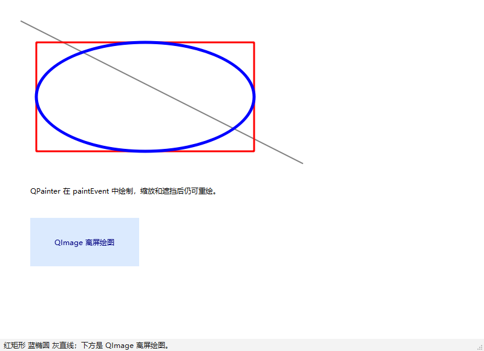

# 第 37 章 QPainter 与绘图设备

本章项目：[完整源码](../../examples/48_painter)。先运行项目观察行为，再按以下顺序阅读。

## 本章要解决的问题

QPainter 执行画线、矩形、椭圆、图片和文本等操作；QPaintDevice 是可被绘制的设备基类；QPaintEngine 提供设备对应的绘制实现，入门通常不用直接操作。原笔记中的 QPainterDevice 应改为 QPaintDevice。

对 QWidget 绘制应在 paintEvent 或其调用链中完成。先创建 QPainter(this)，设置 QPen 控制边线颜色宽度，设置 QBrush 控制填充，再调用 drawLine、drawRect、drawEllipse。要改变图形，更新成员状态后调用 update() 请求重新绘制，而不是把绘图只放进按钮槽临时画一次。

QPixmap 常用于界面显示，QImage 便于像素访问，QBitmap 是一位深度位图，QPicture 记录与重放绘图命令。它们不是全部绘图设备，QWidget 也是 QPaintDevice 的子类。

## 图形应该从持久状态重建

绘制结果是窗口某一时刻的像素，不是可靠的应用状态。遮挡、缩放、主题变化等都可能触发重绘。把“画一个红椭圆”只写在按钮槽里而不保留颜色状态，下一次重绘可能消失。第 52 步将 color_ 放在 DrawingArea 成员中，按钮只更新颜色并 update，paintEvent 每次根据状态重建图形。

## 按执行顺序拆解

QPainter 在 paintEvent 中绑定 this，设置抗锯齿、画笔和画刷，再画椭圆。QPen 控制轮廓，QBrush 控制填充。update 请求未来合适时机重绘，可能合并多次请求；repaint 更直接，日常状态更新通常优先 update。不要从 paintEvent 里无条件再 update，造成持续无效绘制。

## 参数与行为边界

QWidget 是屏幕控件，QImage 便于像素操作，QPixmap 为界面显示优化，QBitmap 是一位位图，QPicture 记录绘制命令。逻辑坐标、像素坐标与设备像素比需要区分。painter.save/restore 可隔离画笔与坐标变换状态，复杂绘制中比反复手动恢复属性更可靠。

## 易错点与排查

QPicture 不是普通像素图片。QImage、QPixmap 上的离屏绘制可以在适当代码位置进行，不要求它们自己的 paintEvent。一个设备同时只应有一个活动画家；使用局部 QPainter 作用域可自动结束绘制。

遇到问题时先区分三个层次：编译错误检查声明、头文件与构建配置；界面无反应检查连接、接收对象与生存期；运行结果不对检查输入、返回值和分支是否真正执行。可以先在连接入口记录一条日志，再在结果处理处记录一条，定位中间哪一步没有到达。

## 完整示例与配套文件

以下为本步完整程序。若存在 .ui、qrc 或额外头文件，必须把同一目录中的文件一起下载。构建期生成的 ui_*.h、moc 文件不需要手动维护。

### main.cpp

```cpp
#include <QtWidgets>
#include <QMouseEvent>
#include <QKeyEvent>
class Canvas : public QWidget
{
  protected:
    void paintEvent(QPaintEvent *) override
    {
        QPainter painter(this);
        painter.setRenderHint(QPainter::Antialiasing);
        painter.fillRect(rect(), Qt::white);
        painter.setPen(QPen(Qt::darkGray, 2));
        painter.drawLine(35, 35, 500, 270);
        painter.setPen(QPen(Qt::red, 3));
        painter.drawRect(60, 70, 360, 180);
        painter.setPen(QPen(Qt::blue, 5));
        painter.drawEllipse(60, 70, 360, 180);
        painter.setPen(Qt::black);
        painter.drawText(50, 320, "QPainter 在 paintEvent 中绘制，缩放和遮挡后仍可重绘。");
        QImage image(180, 80, QImage::Format_ARGB32);
        image.fill(QColor("#dbeafe"));
        {
            QPainter imagePainter(&image);
            imagePainter.setPen(Qt::darkBlue);
            imagePainter.drawText(image.rect(), Qt::AlignCenter, "QImage 离屏绘图");
        }
        painter.drawImage(50, 360, image);
    }
};

#include "verify.h"
int main(int argc, char *argv[])
{
    QApplication app(argc, argv);
    QMainWindow w;
    w.resize(800, 580);
    w.setWindowTitle("48 QPainter 与绘图设备");
    w.setCentralWidget(new Canvas);
    w.statusBar()->showMessage("红矩形 蓝椭圆 灰直线；下方是 QImage 离屏绘图。");
    w.show();
    scheduleVerification(&w);
    return app.exec();
}

```

### 48_painter.pro

```qmake
QT += widgets
CONFIG += c++17
TEMPLATE = app
TARGET = 48_painter
SOURCES += main.cpp
HEADERS += verify.h

```

自动检查用的 verify.h 已在项目目录中提供；普通运行没有 --verify 参数时，不会执行自动操作。

## 运行截图与观察



## 自己动手

运行第 52 步，切换颜色后缩放窗口并遮挡再恢复，确认颜色仍保持。把椭圆位置从固定 QRect 改为基于当前 rect 调整后的区域。再把画刷改为 NoBrush，比较只画轮廓与填充的区别。

先写下预期行为，再修改代码、重新构建，最后对照实际结果。程序没有报错不等于逻辑已经正确，尤其要测试取消、空输入、重复操作和失败分支。

## 自测与答案

**为什么 QImage 上绘制不需要 paintEvent？**

paintEvent 是 QWidget 的屏幕重绘入口。离屏图像本身是绘图设备，可以在适当函数中创建局部 QPainter 绘制；结束后再交给 QLabel 或其他控件显示。

## 继续阅读

- [Qt 官方文档](https://doc.qt.io/qt-6/qpainter.html)
- [项目构建方法](../getting-started.md)
- [自动检查范围](../validation.md)
