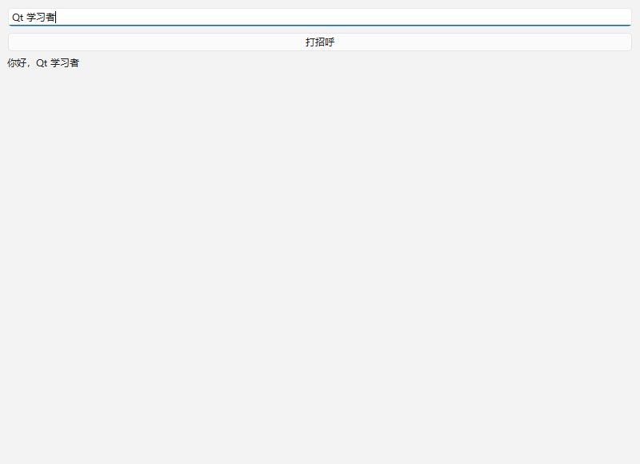

# 创建Qt项目

从新建项目、选择 Kit 开始，弄清默认模板里每个文件的职责，完成第一次构建运行。全部示例采用带 .ui 的统一模板。

本章对应的完整项目：

- [项目 2.1 first_window](../../examples/02_01_first_window/README.md)
- [项目 2.2 designer](../../examples/02_02_designer/README.md)

## 创建Qt Widgets项目

在 Qt Creator 的新建项目向导中选择 Qt Widgets Application，填写名称和位置，构建系统选择 qmake。初学普通窗口时，类名使用 Widget，基类选择 QWidget，并保留生成表单的选项，得到 widget.ui。学习第六章主窗口时，再使用 MainWindow 与 QMainWindow。

向导的页面名称可能随版本变化，重点是选择 Widgets 项目、合适的基类、配套 Kit 和生成 .ui。完成后先构建运行，不要一开始同时修改多处配置。

## Kit与构建配置

Kit 可以理解为一套配好的工具组合，包含 Qt 版本、编译器、调试器及目标设备等。Windows 上 MinGW 版 Qt 配套使用对应 MinGW 工具链，MSVC 版 Qt 配套使用相应 MSVC 工具链。

Debug 便于调试，Release 通常启用更多优化。遇到库格式或链接错误，先检查 Kit 和 Qt 是否匹配，再查源文件是否缺失。

## 默认模板文件的分工

| 文件 | 负责什么 |
|---|---|
| .pro | 列出 Qt 模块、C++ 标准、源文件、头文件、FORMS 和资源 |
| main.cpp | 创建应用与窗口，显示窗口并进入事件循环 |
| widget.h / mainwindow.h | 声明窗口类、成员、槽和事件函数 |
| widget.cpp / mainwindow.cpp | 初始化界面并实现行为 |
| widget.ui / mainwindow.ui | 保存 Designer 中的控件、属性和布局 |

新增 .h/.cpp 要加入 HEADERS/SOURCES，新增 .ui 要加入 FORMS。构建时 uic 生成 ui_*.h，moc 处理 Q_OBJECT 相关内容，生成文件由构建工具维护。

## 程序入口的执行顺序

```cpp
#include "widget.h"

#include <QApplication>

int main(int argc, char *argv[])
{
    QApplication a(argc, argv);
    Widget w;
    w.show();
    return QApplication::exec();
}
```

先创建 QApplication，再创建 Widget，这时执行窗口构造函数。show() 显示窗口，exec() 进入事件循环，程序才能继续响应点击、输入和重绘。若直接 return 0，程序很快结束；不需要自己写 while 循环来轮询按钮。

## setupUi与ui指针

```cpp
Widget::Widget(QWidget *parent)
    : QWidget(parent)
    , ui(new Ui::Widget)
{
    ui->setupUi(this);
}

Widget::~Widget()
{
    delete ui;
}
```

Ui::Widget 是生成的辅助类，不是窗口本身。setupUi(this) 执行后才建立控件和布局，因此访问 ui->控件 要放在它之后。delete ui 释放辅助对象；控件对象主要由 QObject 父子关系管理。

控件的 objectName 决定生成的成员名，text 只是显示文字。修改 .ui 后应保存并重新构建，不要直接修改 ui_widget.h 或 ui_mainwindow.h。[统一模板与 Designer 操作](../project-format.md) 提供完整说明。

## Designer 与 setupUi

对应示例：[完整源码](../../examples/02_02_designer)。先运行项目观察行为，再按以下顺序阅读。

### 本章要解决的问题

Designer 将界面保存在 .ui XML 文件中，构建时 uic 生成 ui_mainwindow.h。mainwindow.h 用前向声明保存 Ui::MainWindow *ui；mainwindow.cpp 包含生成的头文件，在构造函数中创建辅助对象、调用 ui->setupUi(this)，在析构函数中 delete ui。

objectName 是代码成员和自动连接所依赖的对象名，text 是显示文字。按钮名为 runButton，槽名为 on_runButton_clicked，且在 private slots 中声明，因此 setupUi 会自动完成连接。

### 默认模板与自动连接

本步 main.cpp 与 Qt Creator 默认模板一致，只启动 MainWindow。控件和布局都在 mainwindow.ui，行为写在 mainwindow.cpp。不要修改 ui_mainwindow.h，也不要对已自动连接的槽再 connect 一次。Designer 中“转到槽”会帮你生成相应声明和实现。

### 按执行顺序拆解

main.cpp 创建 MainWindow。mainwindow.h 声明 Ui::MainWindow *ui 和 on_runButton_clicked 槽；mainwindow.cpp 在初始化列表创建 Ui 辅助对象，再调用 ui->setupUi(this)。这个调用会建立 .ui 中的控件并自动连接 runButton 的 clicked 信号。点击后只执行对应槽，析构时 delete ui。

### 参数与行为边界

Qt Creator 向导常用 Ui::MainWindow *ui；new 出来的包装器需要 delete ui。这个 delete 释放包装器，不是要求你手动逐个 delete 其所有子控件。ui_*.h 每次构建可能重新生成，不应手动修补它来解决错误。

### 易错点与排查

不要手动改 ui_mainwindow.h，重新构建会覆盖。应该改 mainwindow.ui 或自己的 .cpp。QMainWindow 的布局要放在 centralwidget 上。示例提供真实 .ui，可直接在 Qt Creator 中双击打开。

遇到问题时先区分三个层次：编译错误检查声明、头文件与构建配置；界面无反应检查连接、接收对象与生存期；运行结果不对检查输入、返回值和分支是否真正执行。可以先在连接入口记录一条日志，再在结果处理处记录一条，定位中间哪一步没有到达。

### 完整代码与界面操作

[本节完整源码与深入讲解](../topics/designer.md) · [独立项目与 Designer 步骤](../../examples/02_02_designer/README.md)



### 动手练习

在 mainwindow.ui 添加 clearButton，使用“转到槽”生成 on_clearButton_clicked，在槽中调用 ui->nameEdit->clear。修改按钮的显示文字，确认自动连接仍然有效；再修改 objectName，观察为什么槽名也需要同步修改。

### 自测与答案

**已经有 on_runButton_clicked，还需要再写 connect 吗？**

不需要。setupUi 调用 connectSlotsByName，会按对象名和槽名自动连接。再添加相同的显式连接会让一次点击执行两次。要使用另一种连接方式，应先去掉旧的连接。

## 构建运行与调试

构建负责生成程序；运行负责启动程序；调试是在调试器控制下运行，可以设断点、单步执行和查看变量。运行按钮通常会先检查是否需要构建。Debug 便于调试，Release 通常启用更多优化。
编译错误先看 Issues 与编译输出中的第一条相关错误；qDebug() 的输出通常看 Application Output。不要把程序输出和编译器报错混在一起。

本章练习：先运行项目 2.1；再打开项目 2.2 的 mainwindow.ui，修改按钮显示文字，保存并运行。确认自己能够指出 main.cpp、窗口类和 .ui 各自的作用。


---

[总目录](../README.md) · [上一章](01-overview.md) · [下一章](03-window-properties.md)
