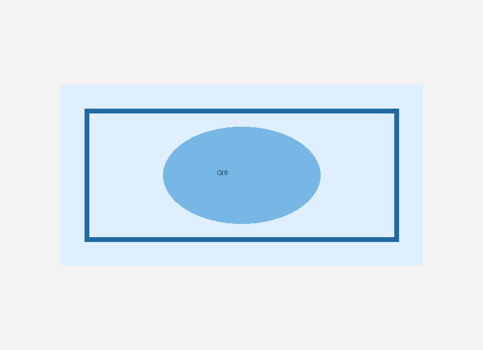

# 设置窗口属性

学习标题、尺寸、位置和图标等窗口属性，并把图片资源与窗口显示联系起来。

本章对应的完整项目：

- [项目 3.1 window_size](../../examples/03_01_window_size/README.md)
- [项目 3.2 resources](../../examples/03_02_resources/README.md)

## 标题与窗口尺寸

在窗口类中，setWindowTitle 设置标题，resize 设置初始尺寸。它们也可通过 Designer 的 windowTitle 和 geometry 等属性配置。固定初始界面放在 .ui，需要随交互变化的属性在 .cpp 中更新。

```cpp
setWindowTitle("窗口属性练习");
resize(720, 540);
```

## 初始尺寸与固定尺寸

resize(w, h) 通常仍允许继续调整尺寸；setFixedSize(w, h) 则把最小、最大尺寸限制为相同数值。项目 3.1 先使用可调整的窗口，再通过按钮固定为 720 × 540，便于对照观察。

move(x, y) 改变位置，setGeometry(x, y, w, h) 同时改变位置和大小。顶层窗口与子控件的坐标参考系不同；子控件相对父控件内容区域的位置在第四章结合按钮理解。

## 资源路径 图片与背景

对应示例：[完整源码](../../examples/03_02_resources)。先运行项目观察行为，再按以下顺序阅读。

### 本章要解决的问题

qrc 是资源清单，prefix 是资源前缀，alias 是资源在程序里的名字。例如前缀 /images 加别名 demo.png，运行时路径为 :/images/demo.png。这个路径与程序当前工作目录无关。qmake 项目还需要 RESOURCES += assets.qrc，构建时 rcc 才会把资源编入程序。

QPixmap 加载失败时 isNull() 为 true，先检查路径大小写、前缀、别名以及资源是否加入构建。QLabel 显示图片时，按目标区域调用 scaled(..., Qt::KeepAspectRatio, Qt::SmoothTransformation) 可以等比适应。若要做随窗口变化的背景，在 paintEvent 中基于当前 rect 绘制更直接；构造时只缩放一次不会跟随未来窗口变化。

### 磁盘路径 资源路径和显示尺寸

磁盘文件依赖部署位置和文件权限，:/ 开头的资源路径指向 Qt 资源系统。qrc 用 prefix 与 alias 构成运行时名字；XML 中 file 的内容是构建时要读取的源文件位置。因此“源码磁盘文件名”和“程序访问名字”可以不同，改了 alias 后代码也要同步。

### 按执行顺序拆解

先打开 assets.qrc 确认 prefix、alias 与素材，再打开 mainwindow.ui 查看 imageLabel。mainwindow.cpp 用资源路径读取 QPixmap，失败时显示提示，成功时设置缩放后的图像，并用同一资源设置窗口图标。资源由构建系统打包，不依赖运行工作目录。

### 参数与行为边界

isNull 用于检查图片是否加载成功。Q_ASSERT 常在 Release 被关闭，不能把生产错误处理只写成断言；要用普通 if 处理并提示。scaled 返回新图片，不会原地修改原对象。KeepAspectRatio 保持比例，KeepAspectRatioByExpanding 会铺满但可能裁剪，IgnoreAspectRatio 可能变形。

### 易错点与排查

Qt 6 中 QPalette::Window 是窗口背景角色。用图片刷填充可能出现平铺；IgnoreAspectRatio 会拉伸变形。资源文件通常打包进程序，但资源系统也支持外部 rcc，并非所有资源都必须内嵌。

遇到问题时先区分三个层次：编译错误检查声明、头文件与构建配置；界面无反应检查连接、接收对象与生存期；运行结果不对检查输入、返回值和分支是否真正执行。可以先在连接入口记录一条日志，再在结果处理处记录一条，定位中间哪一步没有到达。

### 完整代码与界面操作

[本节完整源码与深入讲解](../topics/resources.md) · [独立项目与 Designer 步骤](../../examples/03_02_resources/README.md)



### 动手练习

把别名故意写错，用 if (picture.isNull()) 显示失败提示。恢复路径后把缩放策略改成 IgnoreAspectRatio，对比图片是否变形。最后试着改变窗口大小，观察构造时只缩放一次的局限。

先写下预期行为，再修改代码、重新构建，最后对照实际结果。程序没有报错不等于逻辑已经正确，尤其要测试取消、空输入、重复操作和失败分支。

### 自测与答案

**背景图为什么不会跟着缩放？**

构造函数只执行一次。若背景依赖当前窗口尺寸，应在 resizeEvent 更新缓存，或在 paintEvent 根据当前 rect 绘制，并避免每次重绘都从磁盘重新加载。

## 本章回顾

能区分初始尺寸和固定尺寸，能找到窗口属性配置的位置，并能解释为什么 :/ 开头的资源路径不依赖当前工作目录。不要只凭界面是否显示来判断资源是否正确加载，要检查加载结果并提供失败提示。


---

[总目录](../README.md) · [上一章](02-create-project.md) · [下一章](04-buttons.md)
