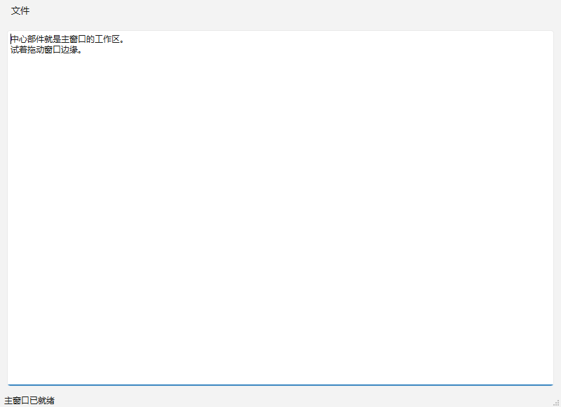
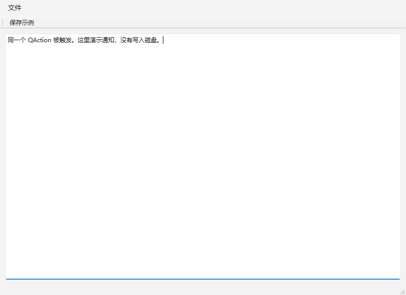
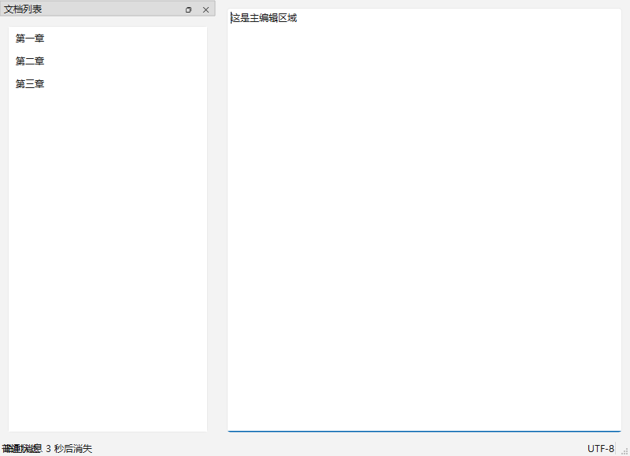

# QMainWindow

在普通窗口基础上学习主窗口的工作区、菜单、动作、工具栏、状态栏和停靠面板，把它们放到同一个主窗口结构中理解。

本章对应的完整项目：

- [项目 6.1 mainwindow](../../examples/06_01_mainwindow/README.md)
- [项目 6.2 menu_toolbar](../../examples/06_02_menu_toolbar/README.md)
- [项目 6.3 status_dock](../../examples/06_03_status_dock/README.md)

## 主窗口与中心部件

对应示例：[完整源码](../../examples/06_01_mainwindow)。先运行项目观察行为，再按以下顺序阅读。

### 本章要解决的问题

QMainWindow 自带主窗口区域的组织规则：顶部菜单栏、可停靠工具栏、停靠面板、底部状态栏，以及中间的中心部件。中心部件是工作区，例如记事本的编辑器。它也继承 QWidget，但通常不直接在 QMainWindow 本体上再安装普通布局。

setCentralWidget() 把一个控件交给主窗口作为工作区。主窗口负责这个控件的所有权。若工作区含多个控件，先创建普通 QWidget 容器，把布局安装到容器，再把容器设为中心部件。窗口缩放时，这块区域会自动适应剩余空间。

### 窗口并不只是一个大 QWidget

先建立工作区，再把工作区交给主窗口。主窗口有自己管理菜单、工具栏和停靠区域的内部布局；调用 setCentralWidget 的意思是登记工作区，不是设置任意 child 的坐标。如果同时需要编辑器、查询栏和按钮，应先建一个 QWidget 容器，把 QVBoxLayout 安装到容器，再把整个容器作为中心部件。这样各部分会自然分工。

### 按执行顺序拆解

main.cpp 创建 MainWindow 并显示。构造函数先调用 ui->setupUi(this)，uic 生成的代码根据 mainwindow.ui 建立 centralwidget、布局和 textEdit，并登记主窗口的中心部件。正文的 C++ 代码只设置状态消息。先在 Designer 的对象查看器中确认层级，再看 mainwindow.cpp 的初始化。

### 参数与行为边界

QWidget 是普通控件与容器的基础；QMainWindow 适合带菜单、工具栏与停靠面板的应用；QDialog 适合短时交互。不要为了“功能更多”让所有小组件都继承 QMainWindow。

### 易错点与排查

menuBar() 和 statusBar() 可以取得或按需创建对应栏，取得后无需再调用 setMenuBar(menuBar())。setCentralWidget 会接管部件；替换时不要把旧部件当成仍可随意使用的对象。

遇到问题时先区分三个层次：编译错误检查声明、头文件与构建配置；界面无反应检查连接、接收对象与生存期；运行结果不对检查输入、返回值和分支是否真正执行。可以先在连接入口记录一条日志，再在结果处理处记录一条，定位中间哪一步没有到达。

### 完整代码与界面操作

[本节完整源码与深入讲解](../topics/mainwindow.md) · [独立项目与 Designer 步骤](../../examples/06_01_mainwindow/README.md)

### 动手练习

在 mainwindow.ui 的 centralwidget 布局中增加一个 QLabel，再拖动窗口观察标签与编辑器如何分配空间。对比保留布局与取消布局时的表现，理解中心工作区与内部布局的分工。

先写下预期行为，再修改代码、重新构建，最后对照实际结果。程序没有报错不等于逻辑已经正确，尤其要测试取消、空输入、重复操作和失败分支。

### 自测与答案

**为什么没给 QTextEdit 传 parent 也能被释放？**

因为主窗口在 setCentralWidget 时取得所有权。不要再给同一个对象叠加另一个独立的所有者。

## 菜单 动作与工具栏

对应示例：[完整源码](../../examples/06_02_menu_toolbar)。先运行项目观察行为，再按以下顺序阅读。

### 本章要解决的问题

菜单栏 QMenuBar 容纳菜单 QMenu，菜单里放 QAction。QAction 表示一项可执行操作，保存操作可以同时出现在菜单和工具栏，它们共享文字、启用状态、勾选状态及 triggered 信号。QAction 不是另一个窗口。

把同一个 QAction 加到 QMenu 和 QToolBar 后，只需连接一次 triggered，用户从任一入口操作都进入同一段业务代码。快捷键也可以设置到动作上。工具栏可设置初始区域、允许区域、能否移动、能否浮动；这些是不同属性。

### 先定义动作 再提供多个入口

动作是“保存”这项命令，菜单项和工具栏按钮只是触发它的入口。若两个入口各自创建一份 QAction，即使文字相同，也不是同一个动作：启用状态、快捷键和勾选状态都要分别同步。把一个 QAction 分别 addAction 到菜单和工具栏，可以直接共享这些状态。

### 按执行顺序拆解

在 mainwindow.ui 中找到名为 action 的 QAction：菜单 menuFile 和 toolBar 的 addaction 均引用它。mainwindow.cpp 只有一次 triggered 连接，两个入口都会向 ui->textEdit 追加同一条消息。尝试 ui->action->setEnabled(false)，观察菜单与工具栏一起禁用。

### 参数与行为边界

triggered(bool) 通知触发，toggled(bool) 通知勾选状态变化。需要开关操作时先 setCheckable(true)，再决定监听哪个信号。构造动作时把父对象设为主窗口；添加到菜单不应成为你推断所有权的唯一依据。

### 易错点与排查

使用 Qt::LeftToolBarArea | Qt::RightToolBarArea 组合区域标志；这是按位或。setMovable(false) 控制移动把手，setFloatable(false) 控制是否可浮动，两者不应混为一谈。

遇到问题时先区分三个层次：编译错误检查声明、头文件与构建配置；界面无反应检查连接、接收对象与生存期；运行结果不对检查输入、返回值和分支是否真正执行。可以先在连接入口记录一条日志，再在结果处理处记录一条，定位中间哪一步没有到达。

### 完整代码与界面操作

[本节完整源码与深入讲解](../topics/menu-toolbar.md) · [独立项目与 Designer 步骤](../../examples/06_02_menu_toolbar/README.md)

### 动手练习

增加一个“显示日志”可勾选动作，菜单和工具栏共用它，连接 toggled 控制日志区域显隐。把动作禁用，再分别从鼠标和快捷键尝试触发，比较行为。

先写下预期行为，再修改代码、重新构建，最后对照实际结果。程序没有报错不等于逻辑已经正确，尤其要测试取消、空输入、重复操作和失败分支。

### 自测与答案

**setMovable 和 setFloatable 为什么分开？**

前者控制工具栏在主窗口中的移动，后者控制能否离开主窗口浮动。初始停靠位置和允许停靠的区域又是另外两个设置。

## 状态栏和停靠面板

对应示例：[完整源码](../../examples/06_03_status_dock)。先运行项目观察行为，再按以下顺序阅读。

### 本章要解决的问题

QStatusBar 的临时消息用 showMessage(text, timeout) 展示，timeout 单位毫秒，0 表示保持到被清除或替换。addWidget 放置普通状态控件，临时消息出现时可能被遮住；addPermanentWidget 放置永久区域控件，不会被临时消息遮盖。永久指显示区域性质，不是对象永不销毁。

QDockWidget 是可停靠面板的外壳，用 setWidget() 设置它内部的控件，用 addDockWidget() 指定初始停靠区域。setAllowedAreas() 决定允许停靠在哪些位置，features 决定是否可关闭、移动和浮动。

### 状态反馈和辅助面板各有职责

状态栏回答“现在发生了什么”，停靠面板提供持续可操作的辅助区。showMessage 的临时文字适合“打开成功”，普通状态控件适合当前工具，永久状态控件适合编码或连接状态。showMessage 的超时单位是毫秒；传 3000 表示约三秒，不是三千秒。

### 按执行顺序拆解

停靠面板 dockWidget、其内容列表 documentList，以及 statusbar 都定义在 mainwindow.ui 中。mainwindow.cpp 在 setupUi 后用 addWidget 和 addPermanentWidget 加入两种状态标签，再显示 3000 毫秒的临时消息。移动停靠面板观察主窗口内部的区域分配。

### 参数与行为边界

关闭停靠面板通常是隐藏，面板不一定被销毁。用 dock->toggleViewAction() 可以把恢复显示的开关放进“视图”菜单。需要保存界面排列时可进一步学习 saveState/restoreState，但恢复时需要稳定 objectName。

### 易错点与排查

标准术语是停靠部件，而不是铆接部件。QDockWidget 与普通非模态 QDialog 不同：前者能参与主窗口的停靠布局。

遇到问题时先区分三个层次：编译错误检查声明、头文件与构建配置；界面无反应检查连接、接收对象与生存期；运行结果不对检查输入、返回值和分支是否真正执行。可以先在连接入口记录一条日志，再在结果处理处记录一条，定位中间哪一步没有到达。

### 完整代码与界面操作

[本节完整源码与深入讲解](../topics/status-dock.md) · [独立项目与 Designer 步骤](../../examples/06_03_status_dock/README.md)

### 动手练习

给停靠面板设置 objectName，把 toggleViewAction 加入视图菜单。先关闭面板，再从菜单重新显示。给状态栏添加当前字数，并在编辑器内容变化时更新。

先写下预期行为，再修改代码、重新构建，最后对照实际结果。程序没有报错不等于逻辑已经正确，尤其要测试取消、空输入、重复操作和失败分支。

### 自测与答案

**隐藏面板后为何不能再 new 一个作为恢复方式？**

这样会创建不同实例并可能重复占用资源。优先保留原实例并调用 show，或者使用 toggleViewAction。

---

[总目录](../README.md) · [上一章](05-signals-slots-lambda.md) · [下一章](07-dialogs.md)
