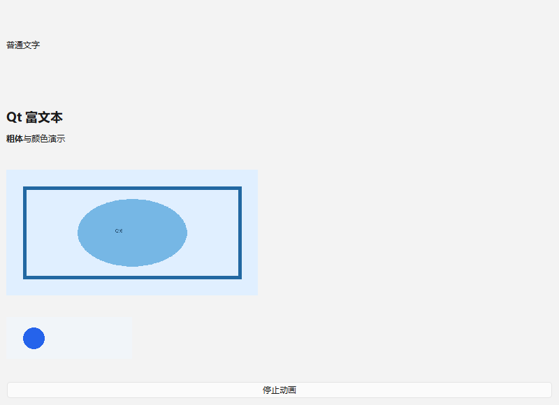
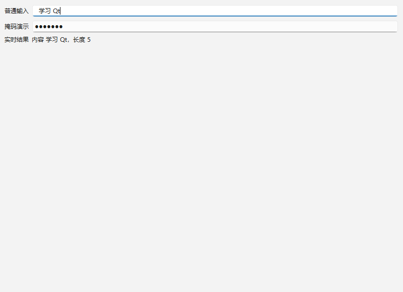
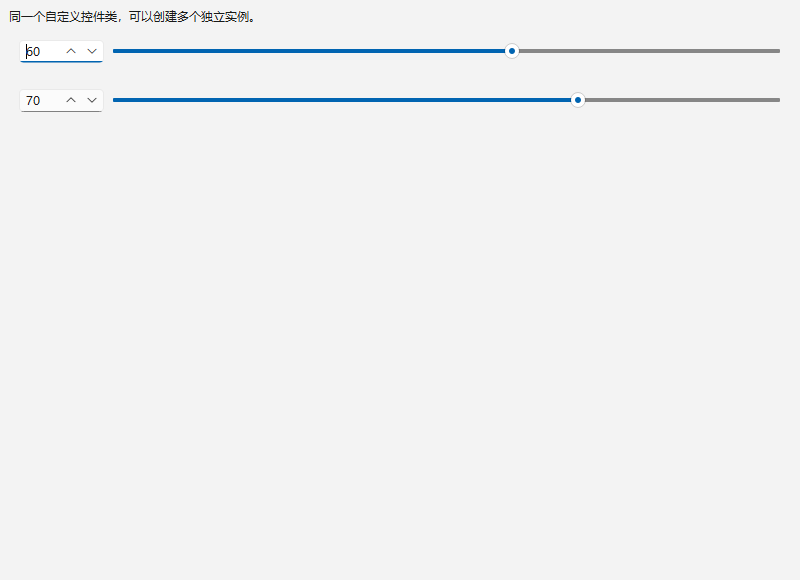
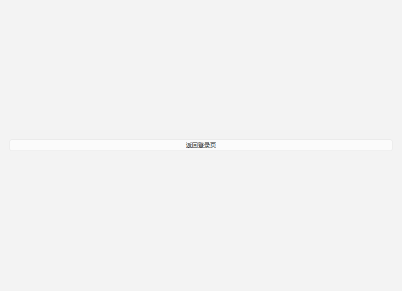

# 常用控件

按照显示、输入、组合和页面切换学习常用控件，重点理解数据、属性、信号和对象生命周期。

本章对应的完整项目：

- [项目 9.1 label_movie](../../examples/09_01_label_movie/README.md)
- [项目 9.2 lineedit](../../examples/09_02_lineedit/README.md)
- [项目 9.3 custom_widget](../../examples/09_03_custom_widget/README.md)
- [项目 9.4 stacked_pages](../../examples/09_04_stacked_pages/README.md)

## QLabel 文本 图片与动画

对应示例：[完整源码](../../examples/09_01_label_movie)。先运行项目观察行为，再按以下顺序阅读。

### 本章要解决的问题

QLabel 可显示普通文本、受支持的 HTML 富文本、QPixmap 图片和 QMovie 动画。并不意味着完整浏览器；复杂网页不应交给 QLabel。内容来自外部输入时，可显式设 PlainText，避免自动识别为富文本。

setOpenExternalLinks(true) 会在用户点击链接后交给外部程序打开网址；本例只显示本地富文本，不自动跳转。setPixmap 绑定图片；setMovie 绑定动画，但 QLabel 不接管 QMovie 的所有权，应 new QMovie(..., parent) 指定父对象，并调用 start()。stop() 停止播放，setPaused(true) 暂停。

### QLabel 的四种内容走不同接口

setText 接收文本，setPixmap 接收像素图，setMovie 接收动画对象。设置字符串 :/images/demo.png 并不会让 QLabel 读取图片。富文本采用 Qt 支持的子集，不等于浏览器完整 HTML/CSS。对用户输入使用 PlainText，可避免误把尖括号内容当作格式标签。

### 按执行顺序拆解

普通文字、富文本、图片标签、动画标签和停止按钮均在 mainwindow.ui。mainwindow.cpp 只负责装载图片和 QMovie，将动画交给标签显示并调用 start。QMovie 的 parent 是当前主窗口；停止按钮显式连接 QMovie::stop。

### 参数与行为边界

设置固定目标尺寸并等比缩放，会留下空白；scaledContents(true) 可能直接拉伸。高 DPI 图片还涉及逻辑尺寸与 devicePixelRatio，不应只按物理像素数猜显示大小。需要随容器大小调整图片时，可在尺寸变化时更新缩放结果，避免在无关事件里重复加载。

### 易错点与排查

显示 GIF 的 QMovie 不要漏 parent。标签不会自动把资源路径文本变成图片，必须加载 QPixmap 或 QMovie。原笔记的资源图片若未随项目提供，在其他电脑就会显示空白；本例随附 qrc、PNG 和 GIF。

遇到问题时先区分三个层次：编译错误检查声明、头文件与构建配置；界面无反应检查连接、接收对象与生存期；运行结果不对检查输入、返回值和分支是否真正执行。可以先在连接入口记录一条日志，再在结果处理处记录一条，定位中间哪一步没有到达。

### 完整代码与界面操作

[本节完整源码与深入讲解](../topics/label-movie.md) · [独立项目与 Designer 步骤](../../examples/09_01_label_movie/README.md)

### 动手练习

把标签改为纯文本并传入 <b>Qt</b>，观察它是否显示原始标签。分别测试 movie.stop、setPaused(true)、start，比较停止与暂停的区别。把图片目标尺寸改成长条，比较等比与拉伸结果。

先写下预期行为，再修改代码、重新构建，最后对照实际结果。程序没有报错不等于逻辑已经正确，尤其要测试取消、空输入、重复操作和失败分支。

### 自测与答案

**标签析构会自动 delete movie 吗？**

setMovie 不接管动画对象。应通过 QObject parent 或其他明确的生命周期方案管理它，不要仅凭“在标签里显示”判断归属。

## QLineEdit 输入与显示模式

对应示例：[完整源码](../../examples/09_02_lineedit)。先运行项目观察行为，再按以下顺序阅读。

### 本章要解决的问题

QLineEdit 用于单行输入，setText 写入，text() 读取真实内容。placeholderText 是空内容时的提示，不是输入值；设置它不会让 text() 返回提示。textChanged 会响应用户和代码设置的变化，textEdited 主要响应用户编辑，returnPressed 用于回车触发。

四种 EchoMode 为 Normal、NoEcho、Password、PasswordEchoOnEdit。NoEcho 不显示字符；Password 显示掩码；PasswordEchoOnEdit 在编辑时显示、非编辑时掩码。显示模式只改变外观，text() 仍是实际字符串。setTextMargins 控制框内边距，不是移动控件本身。

### 输入值 显示值和编辑动作

QLineEdit::text() 是真实字符串，displayText() 是按 EchoMode 处理后的显示内容。placeholderText 只在空值时提示，它不会成为真实文本。代码 setText 也会触发 textChanged，但通常不属于 textEdited 所描述的用户编辑，这个差别常用于避免把程序回填当成用户输入。

### 按执行顺序拆解

在 mainwindow.ui 中查看 name 的 placeholderText、passwordEdit 的 Password 显示模式和三行表单。mainwindow.cpp 设置文本边距并连接 textChanged。输入后 resultLabel 同时显示内容和长度；清空后 placeholderText 只作提示，不属于 text()。

### 参数与行为边界

setMaxLength 限制长度；QValidator 可以约束可接受输入；inputMask 适合固定形状。验证器可能有 Intermediate 状态，因此输入过程中暂时不完整不一定是 Invalid。returnPressed 与 editingFinished 的触发还可能受验证状态影响，不能只看某一帧文本就提交业务。

### 易错点与排查

密码掩码不是加密，不应把敏感密码打印到日志。本例仅用固定的演示文本，并只显示长度。清空后 text() 是空字符串，不是 placeholder 文本。

遇到问题时先区分三个层次：编译错误检查声明、头文件与构建配置；界面无反应检查连接、接收对象与生存期；运行结果不对检查输入、返回值和分支是否真正执行。可以先在连接入口记录一条日志，再在结果处理处记录一条，定位中间哪一步没有到达。

### 完整代码与界面操作

[本节完整源码与深入讲解](../topics/line-edit.md) · [独立项目与 Designer 步骤](../../examples/09_02_lineedit/README.md)

### 动手练习

添加读取按钮，同时观察 text() 与 displayText() 的差别，但仅使用固定演示内容。给姓名设置最大长度，再给另一个输入框安装 QIntValidator，尝试空值、部分输入和超范围值。提交前使用 hasAcceptableInput 检查。

先写下预期行为，再修改代码、重新构建，最后对照实际结果。程序没有报错不等于逻辑已经正确，尤其要测试取消、空输入、重复操作和失败分支。

### 自测与答案

**把 echoMode 改成 Password 就能安全保存密码吗？**

它只隐藏显示，不加密内存、日志或磁盘数据。不要把输入展示策略当作数据保护或账号认证方案。

## 组合控件与 Designer 提升

对应示例：[完整源码](../../examples/09_03_custom_widget)。先运行项目观察行为，再按以下顺序阅读。

### 本章要解决的问题

自定义控件是把重复出现的交互封装成可创建多个实例的类。这里把 QSpinBox 和 QSlider 组合到 SmallWidget，统一数值范围，双向连接数值变化，并提供 setValue()/value()。调用者不需要知道内部布局。

双向连接并不必然无限递归：这里 setValue 只有数值真正改变才发信号，回写相同值不会再次发射。若自定义 setter 每次都发信号，就要先判断是否变化，必要时使用 QSignalBlocker。封装的目标是复用定义和行为，不是让整个应用只创建一个对象。

### 把内部结构藏在稳定接口后面

组合控件把多个标准控件组织成一个可复用组件。外部调用者只知道 setValue 和 value，不需要知道滑块放左边还是右边。复制的是类定义和设计，不是强迫所有页面共享同一个实例。需要多处独立状态时创建多个对象即可。

### 按执行顺序拆解

mainwindow.ui 中 first 和 second 已提升为 SmallWidget。分别打开 smallwidget.h、smallwidget.cpp 和 smallwidget.ui：SpinBox 与 Slider 由 .ui 创建，C++ 连接双向数值同步，并提供 setValue/value 接口。主窗口将两个实例分别初始化为 25 与 70。

### 参数与行为边界

Designer 提升分成五步：添加普通 QWidget，占位对象改名；右键提升；基类选 QWidget；填写 SmallWidget 和 smallwidget.h；添加后执行提升。构建器必须能够找到头文件，构造函数应支持 QWidget *parent。提升不自动生成 SmallWidget 的实现。

### 易错点与排查

Designer 中先放 QWidget 占位，提升类名填 SmallWidget，头文件填 smallwidget.h，再提升；类必须可包含且构造函数能接受 QWidget *parent。提升不保证设计器预览能运行自定义代码。示例附 smallwidget.h，可直接用于提升。

遇到问题时先区分三个层次：编译错误检查声明、头文件与构建配置；界面无反应检查连接、接收对象与生存期；运行结果不对检查输入、返回值和分支是否真正执行。可以先在连接入口记录一条日志，再在结果处理处记录一条，定位中间哪一步没有到达。

### 完整代码与界面操作

[本节完整源码与深入讲解](../topics/custom-widget.md) · [独立项目与 Designer 步骤](../../examples/09_03_custom_widget/README.md)

### 动手练习

新建一个 .ui，把 QWidget 提升为 SmallWidget，运行后读取 value。再把两个组件放到不同页面，确认数值独立。若需要对外通知变化，可添加 valueChanged(int) 信号，并只在真正变化时发出。

先写下预期行为，再修改代码、重新构建，最后对照实际结果。程序没有报错不等于逻辑已经正确，尤其要测试取消、空输入、重复操作和失败分支。

### 自测与答案

**如何避免互相 setValue 时无限循环？**

优先让 setter 检查数值是否变化。必要时用 QSignalBlocker 在同步期间暂时阻断回发，不能仅仅假定所有自定义 setter 都和 QSpinBox 一样。

## 堆叠页面与窗口切换

对应示例：[完整源码](../../examples/09_04_stacked_pages)。先运行项目观察行为，再按以下顺序阅读。

### 本章要解决的问题

QStackedWidget 在同一容器里管理多个页面，一次显示其中一页。addWidget 返回该页索引；setCurrentIndex(0) 切到第一页，索引从 0 开始，也可用 setCurrentWidget 按指针切换。切换不会删除其他页面，输入状态通常仍保留。

这与 hide 一个顶层窗口、show 另一个顶层窗口不同。用堆叠控件实现“登录页面—主页”能够共享同一个顶层窗口，方便统一管理退出和生命期。多窗口方案也可用，但要管理返回路径、对象所有权，以及隐藏主窗口后子窗口关闭导致程序无可见窗口的情况。

### 页面属于一个窗口 生命周期仍然存在

QStackedWidget 在视觉上一次显示一页，但其他页面的对象通常仍存在，因此输入状态也可保留。这适合向导、设置页和简单导航。切换页面不会自动执行登录验证，也不会自动清除敏感信息或刷新数据；这些都需要明确的进入与退出逻辑。

### 按执行顺序拆解

mainwindow.ui 的 pages 包含 loginPage 与 homePage，两个按钮分别位于各自页面。mainwindow.cpp 只连接导航按钮与 setCurrentIndex。页面对象保持存活，切换时不会自动清除控件状态。

### 参数与行为边界

currentIndex 从零开始，空容器可能没有有效当前页。setCurrentWidget 比硬编码数字更能表达意图，但仍要求页面已经加入。removeWidget 不等于 delete：移除后对象是否继续使用、重新设 parent 还是释放，需要自己决定。

### 易错点与排查

改变当前页不等于验证了身份。此例只演示页面导航，没有账号认证。每页有自己的布局，页面必须先 addWidget 再切换到相应索引。

遇到问题时先区分三个层次：编译错误检查声明、头文件与构建配置；界面无反应检查连接、接收对象与生存期；运行结果不对检查输入、返回值和分支是否真正执行。可以先在连接入口记录一条日志，再在结果处理处记录一条，定位中间哪一步没有到达。

### 完整代码与界面操作

[本节完整源码与深入讲解](../topics/stacked-pages.md) · [独立项目与 Designer 步骤](../../examples/09_04_stacked_pages/README.md)

### 动手练习

增加第三页“关于”，提供返回按钮。让第一页有一个 QLineEdit，切走再回来观察内容是否保持。再为切换后“清空输入”写一段明确代码，理解状态变化与显示切换并非自动绑定。

先写下预期行为，再修改代码、重新构建，最后对照实际结果。程序没有报错不等于逻辑已经正确，尤其要测试取消、空输入、重复操作和失败分支。

### 自测与答案

**什么时候应该使用多个顶层窗口？**

当任务确实需要独立并行工作区时可以选择多窗口；同时要设计返回与退出路径，避免主窗口隐藏后只剩已经关闭的子窗口。简单内部导航通常先用堆叠页面。

## 文本编辑控件的综合使用

QLabel 用于显示；QLineEdit 用于单行输入；QTextEdit 和 QPlainTextEdit 用于多行编辑。本教程的 UTF-8 文本编辑器使用 QPlainTextEdit，界面在 mainwindow.ui，打开、保存和修改标记在 mainwindow.cpp。

[返回第七章的文本编辑器练习](07-dialogs.md) · [打开项目 7.6](../../examples/07_06_text_editor/README.md)。控件负责编辑文本，文件对话框负责选择路径，QFile/QSaveFile 负责读写，分清这些职责后再追踪状态变化。

---

[总目录](../README.md) · [上一章](08-layouts.md) · [下一章](10-events.md)
