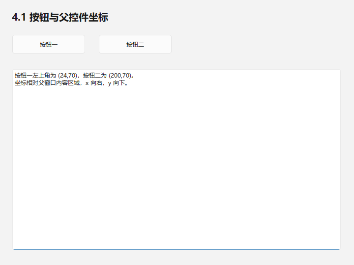

# 4.1 按钮坐标与父控件

[所属章节](../chapters/04-buttons.md) · [完整项目](../../examples/04_01_buttons_coordinates/README.md)

### 本项目要掌握什么

按钮坐标与父控件。这一节只围绕这个核心问题阅读和修改程序。

### 关键代码在哪里

关键片段 1：[ widget.ui 第 48 行起](../../examples/04_01_buttons_coordinates/widget.ui#L48)。以下是相关界面 XML 节选，完整表单保留在项目中。

```xml
  <widget class="QPushButton" name="firstButton">
   <property name="geometry">
    <rect>
     <x>24</x>
     <y>70</y>
     <width>150</width>
     <height>40</height>
    </rect>
   </property>
   <property name="text">
    <string>按钮一</string>
   </property>
  </widget>
```

### 逐段讲解

firstButton、secondButton 由 .ui 创建，geometry 的 x/y 是相对父控件内容区域的位置，width/height 是按钮尺寸。

代码只输出两组坐标用于对照，按钮并非在 writeLine 时生成。先看 .ui 中的 geometry，再看界面与日志。

### 按执行顺序阅读

先从 main.cpp 创建应用和窗口进入构造函数，再由 setupUi 根据 .ui 建立对象、属性与布局。对照上面的片段定位本节设置；show 后进入事件循环，界面才会持续响应操作。

### 容易出错的地方与动手验证

把一个按钮移入新容器，再比较相同坐标的位置；设置布局后应由布局控制位置。

先写下预测，再修改一个条件重新构建。记录实际结果，并用本节代码中的变量、对象和调用顺序解释原因；仅仅没有报错不代表已经验证了所有分支。

### 运行结果



### 完整项目与界面文件

- [04_01_buttons_coordinates.pro](../../examples/04_01_buttons_coordinates/04_01_buttons_coordinates.pro)
- [main.cpp](../../examples/04_01_buttons_coordinates/main.cpp)
- [verify.h](../../examples/04_01_buttons_coordinates/verify.h)
- [widget.cpp](../../examples/04_01_buttons_coordinates/widget.cpp)
- [widget.h](../../examples/04_01_buttons_coordinates/widget.h)
- [widget.ui](../../examples/04_01_buttons_coordinates/widget.ui)

打开本项目 .pro，选择匹配的 Kit，构建运行；修改界面请打开 .ui，保存后重新构建。verify.h 只在传入 --verify 时执行检查。
