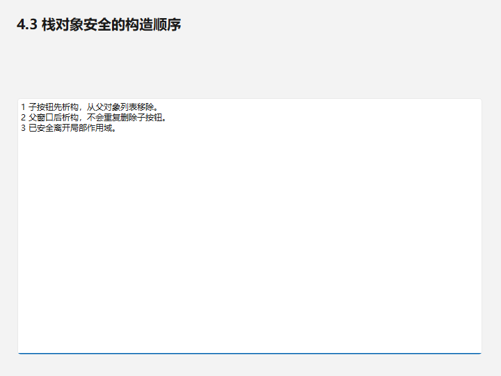

# 4.3 栈对象的构造与析构顺序

[所属章节](../chapters/04-buttons.md) · [完整项目](../../examples/04_03_stack_lifetime/README.md)

### 本项目要掌握什么

栈对象的构造与析构顺序。这一节只围绕这个核心问题阅读和修改程序。

### 关键代码在哪里

关键片段 1：[ widget.cpp 第 12 行起](../../examples/04_03_stack_lifetime/widget.cpp#L12)。以下代码从本项目源文件提取，完整上下文见源文件。

```cpp
{
    QWidget parent;
    QPushButton child("栈按钮", &parent);
    connect(&child, &QObject::destroyed, this,
            [this]() { writeLine("1 子按钮先析构，从父对象列表移除。"); });
    connect(&parent, &QObject::destroyed, this,
            [this]() { writeLine("2 父窗口后析构，不会重复删除子按钮。"); });
}
writeLine("3 已安全离开局部作用域。");
```

### 逐段讲解

先创建 parent，再创建以它为父控件的 child；离开花括号时逆序析构，child 先销毁并从父对象列表移除。

连接上下文是仍存活的主窗口，所以两个析构日志都能输出；Qt 对象树并不改变 C++ 自动对象的存储期。

### 按执行顺序阅读

本项目的主要实验在构造函数里立即执行：变量初始化 → 定义或连接 → 显式调用 → 显示结果。先在代码中圈出实际调用位置，再区分哪些语句只是定义或登记行为。

### 容易出错的地方与动手验证

画出两个对象的构造、析构时间线；不要把先构造的栈对象交给后构造且先析构的父对象管理。

先写下预测，再修改一个条件重新构建。记录实际结果，并用本节代码中的变量、对象和调用顺序解释原因；仅仅没有报错不代表已经验证了所有分支。

### 运行结果



### 完整项目与界面文件

- [04_03_stack_lifetime.pro](../../examples/04_03_stack_lifetime/04_03_stack_lifetime.pro)
- [main.cpp](../../examples/04_03_stack_lifetime/main.cpp)
- [verify.h](../../examples/04_03_stack_lifetime/verify.h)
- [widget.cpp](../../examples/04_03_stack_lifetime/widget.cpp)
- [widget.h](../../examples/04_03_stack_lifetime/widget.h)
- [widget.ui](../../examples/04_03_stack_lifetime/widget.ui)

打开本项目 .pro，选择匹配的 Kit，构建运行；修改界面请打开 .ui，保存后重新构建。verify.h 只在传入 --verify 时执行检查。
