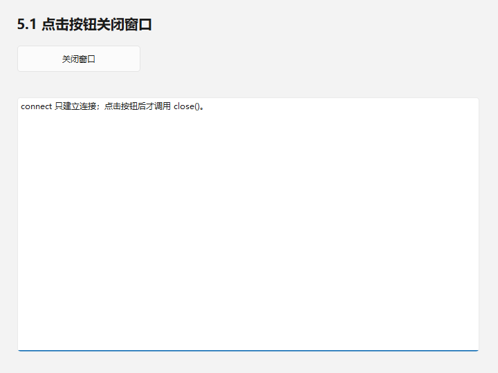

# 5.1 连接按钮与成员函数

[所属章节](../chapters/05-signals-slots-lambda.md) · [完整项目](../../examples/05_01_close_connection/README.md)

### 本项目要掌握什么

连接按钮与成员函数。这一节只围绕这个核心问题阅读和修改程序。

### 关键代码在哪里

关键片段 1：[ widget.cpp 第 11 行起](../../examples/05_01_close_connection/widget.cpp#L11)。以下代码从本项目源文件提取，完整上下文见源文件。

```cpp
connect(ui->runButton, &QPushButton::clicked, this, &QWidget::close);
writeLine("connect 只建立连接；点击按钮后才调用 close()。");
```

### 逐段讲解

connect 四个位置依次表示发送对象、信号、接收对象、处理函数。&QPushButton::clicked 是函数指针，后面不能加调用括号。

clicked 带 bool 参数，close 不需要它，可以忽略末尾参数。connect 时窗口不会关闭，按钮触发后才执行 close。

### 按执行顺序阅读

构造函数先准备界面与连接；交互发生后才进入回调。阅读时按“发送对象 → 信号或调用 → 回调里的数据 → 被修改对象 → 显示结果”追踪，不要把建立连接当成已经执行操作。

### 容易出错的地方与动手验证

在连接前后打印日志，再点击按钮比较时间；close 与对象立即析构也不是同一个概念。

先写下预测，再修改一个条件重新构建。记录实际结果，并用本节代码中的变量、对象和调用顺序解释原因；仅仅没有报错不代表已经验证了所有分支。

### 运行结果



### 完整项目与界面文件

- [05_01_close_connection.pro](../../examples/05_01_close_connection/05_01_close_connection.pro)
- [main.cpp](../../examples/05_01_close_connection/main.cpp)
- [verify.h](../../examples/05_01_close_connection/verify.h)
- [widget.cpp](../../examples/05_01_close_connection/widget.cpp)
- [widget.h](../../examples/05_01_close_connection/widget.h)
- [widget.ui](../../examples/05_01_close_connection/widget.ui)

打开本项目 .pro，选择匹配的 Kit，构建运行；修改界面请打开 .ui，保存后重新构建。verify.h 只在传入 --verify 时执行检查。
