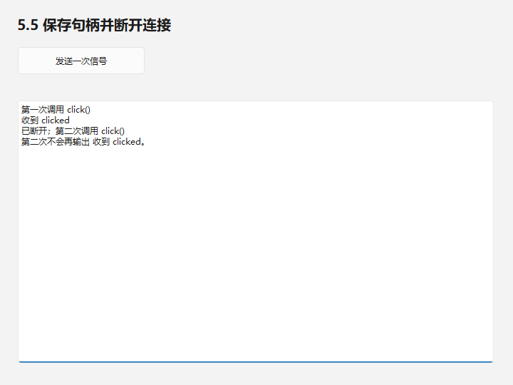

# 5.5 保存连接句柄并断开

[所属章节](../chapters/05-signals-slots-lambda.md) · [完整项目](../../examples/05_05_disconnect/README.md)

### 本项目要掌握什么

保存连接句柄并断开。这一节只围绕这个核心问题阅读和修改程序。

### 关键代码在哪里

关键片段 1：[ widget.cpp 第 11 行起](../../examples/05_05_disconnect/widget.cpp#L11)。以下代码从本项目源文件提取，完整上下文见源文件。

```cpp
auto connection = connect(ui->sourceButton, &QPushButton::clicked, this,
                          [this]() { writeLine("收到 clicked"); });
writeLine("第一次调用 click()");
ui->sourceButton->click();
QObject::disconnect(connection);
writeLine("已断开；第二次调用 click()");
ui->sourceButton->click();
writeLine("第二次不会再输出 收到 clicked。");
```

### 逐段讲解

connect 返回 QMetaObject::Connection，保存的 connection 标识这一条连接。第一次 click 主动发出按钮通知，所以能打印接收日志。

disconnect(connection) 移除指定连接，再次 click 不再调用这条回调；函数返回并不会因为局部句柄消失就自动断开连接。

### 按执行顺序阅读

本项目的主要实验在构造函数里立即执行：变量初始化 → 定义或连接 → 显式调用 → 显示结果。先在代码中圈出实际调用位置，再区分哪些语句只是定义或登记行为。

### 容易出错的地方与动手验证

增加第二条连接，只断开第一条，观察另一条仍有效；disconnect 是函数，不是 C++ 关键字。

先写下预测，再修改一个条件重新构建。记录实际结果，并用本节代码中的变量、对象和调用顺序解释原因；仅仅没有报错不代表已经验证了所有分支。

### 运行结果



### 完整项目与界面文件

- [05_05_disconnect.pro](../../examples/05_05_disconnect/05_05_disconnect.pro)
- [main.cpp](../../examples/05_05_disconnect/main.cpp)
- [verify.h](../../examples/05_05_disconnect/verify.h)
- [widget.cpp](../../examples/05_05_disconnect/widget.cpp)
- [widget.h](../../examples/05_05_disconnect/widget.h)
- [widget.ui](../../examples/05_05_disconnect/widget.ui)

打开本项目 .pro，选择匹配的 Kit，构建运行；修改界面请打开 .ui，保存后重新构建。verify.h 只在传入 --verify 时执行检查。
