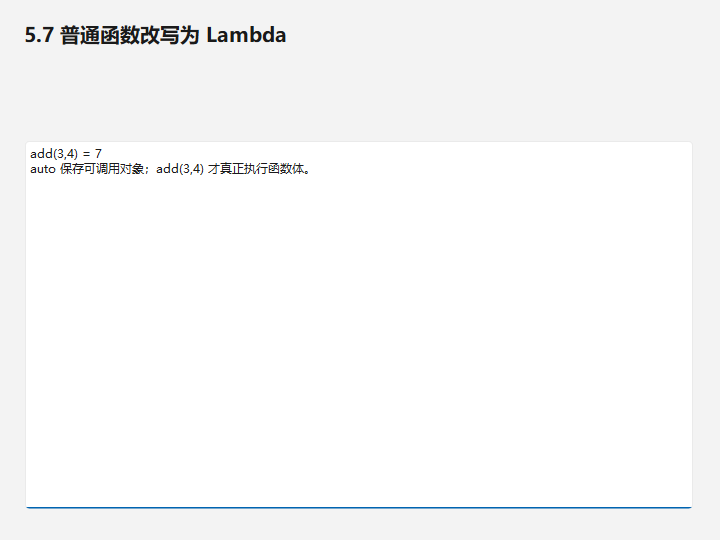

# 5.7 Lambda的定义与调用

[所属章节](../chapters/05-signals-slots-lambda.md) · [完整项目](../../examples/05_07_function_to_lambda/README.md)

### 本项目要掌握什么

Lambda的定义与调用。这一节只围绕这个核心问题阅读和修改程序。

### 关键代码在哪里

关键片段 1：[ widget.cpp 第 11 行起](../../examples/05_07_function_to_lambda/widget.cpp#L11)。以下代码从本项目源文件提取，完整上下文见源文件。

```cpp
auto add = [](int a, int b) -> int { return a + b; };
int result = add(3, 4);
writeLine("add(3,4) = " + QString::number(result));
writeLine("auto 保存可调用对象；add(3,4) 才真正执行函数体。");
```

### 逐段讲解

[] 是捕获列表，(int a, int b) 是调用参数，-> int 明确返回类型，花括号是函数体；auto add 保存可调用对象。

定义 add 不会计算 3+4，add(3,4) 才传入参数并执行 return。result 接收返回值，随后 writeLine 显示 7。

### 按执行顺序阅读

本项目的主要实验在构造函数里立即执行：变量初始化 → 定义或连接 → 显式调用 → 显示结果。先在代码中圈出实际调用位置，再区分哪些语句只是定义或登记行为。

### 容易出错的地方与动手验证

把参数换为负数预测结果，再用普通函数实现同一计算；auto 不是把函数体提前执行的指令。

先写下预测，再修改一个条件重新构建。记录实际结果，并用本节代码中的变量、对象和调用顺序解释原因；仅仅没有报错不代表已经验证了所有分支。

### 运行结果



### 完整项目与界面文件

- [05_07_function_to_lambda.pro](../../examples/05_07_function_to_lambda/05_07_function_to_lambda.pro)
- [main.cpp](../../examples/05_07_function_to_lambda/main.cpp)
- [verify.h](../../examples/05_07_function_to_lambda/verify.h)
- [widget.cpp](../../examples/05_07_function_to_lambda/widget.cpp)
- [widget.h](../../examples/05_07_function_to_lambda/widget.h)
- [widget.ui](../../examples/05_07_function_to_lambda/widget.ui)

打开本项目 .pro，选择匹配的 Kit，构建运行；修改界面请打开 .ui，保存后重新构建。verify.h 只在传入 --verify 时执行检查。
