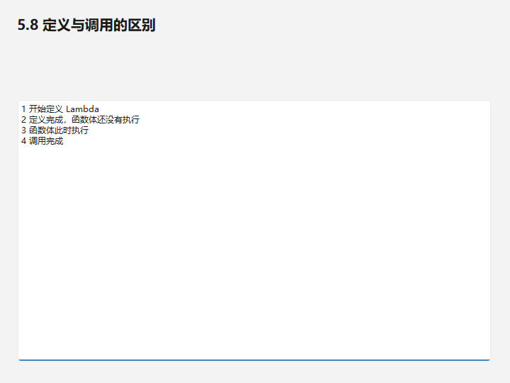

# 5.8 定义阶段与执行阶段

[所属章节](../chapters/05-signals-slots-lambda.md) · [完整项目](../../examples/05_08_define_and_call/README.md)

### 本项目要掌握什么

定义阶段与执行阶段。这一节只围绕这个核心问题阅读和修改程序。

### 关键代码在哪里

关键片段 1：[ widget.cpp 第 11 行起](../../examples/05_08_define_and_call/widget.cpp#L11)。以下代码从本项目源文件提取，完整上下文见源文件。

```cpp
writeLine("1 开始定义 Lambda");
auto say = [this]() { writeLine("3 函数体此时执行"); };
writeLine("2 定义完成，函数体还没有执行");
say();
writeLine("4 调用完成");
```

### 逐段讲解

say 的函数体包含编号 3 的输出，创建 Lambda 时只是保存这段行为，因此编号 2 会先显示。

调用 say() 后进入函数体，返回后再打印编号 4。[this] 允许内部调用窗口的 writeLine。

### 按执行顺序阅读

本项目的主要实验在构造函数里立即执行：变量初始化 → 定义或连接 → 显式调用 → 显示结果。先在代码中圈出实际调用位置，再区分哪些语句只是定义或登记行为。

### 容易出错的地方与动手验证

注释掉 say() 预测哪些输出消失，再恢复；把函数体交给 connect 时也要区分保存回调和真正触发。

先写下预测，再修改一个条件重新构建。记录实际结果，并用本节代码中的变量、对象和调用顺序解释原因；仅仅没有报错不代表已经验证了所有分支。

### 运行结果



### 完整项目与界面文件

- [05_08_define_and_call.pro](../../examples/05_08_define_and_call/05_08_define_and_call.pro)
- [main.cpp](../../examples/05_08_define_and_call/main.cpp)
- [verify.h](../../examples/05_08_define_and_call/verify.h)
- [widget.cpp](../../examples/05_08_define_and_call/widget.cpp)
- [widget.h](../../examples/05_08_define_and_call/widget.h)
- [widget.ui](../../examples/05_08_define_and_call/widget.ui)

打开本项目 .pro，选择匹配的 Kit，构建运行；修改界面请打开 .ui，保存后重新构建。verify.h 只在传入 --verify 时执行检查。
