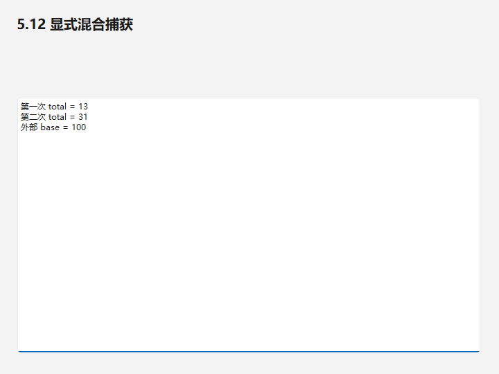

# 5.12 显式混合捕获

[所属章节](../chapters/05-signals-slots-lambda.md) · [完整项目](../../examples/05_12_mixed_capture/README.md)

### 本项目要掌握什么

显式混合捕获。这一节只围绕这个核心问题阅读和修改程序。

### 关键代码在哪里

关键片段 1：[ widget.cpp 第 11 行起](../../examples/05_12_mixed_capture/widget.cpp#L11)。以下代码从本项目源文件提取，完整上下文见源文件。

```cpp
int base = 10;
int total = 0;
auto accumulate = [base, &total](int x) { total += base + x; };
base = 100;
accumulate(3);
writeLine("第一次 total = " + QString::number(total));
accumulate(8);
writeLine("第二次 total = " + QString::number(total));
writeLine("外部 base = " + QString::number(base));
```

### 逐段讲解

[base, &total] 明确表示 base 用副本、total 用引用。外部 base=100 不改变副本，累加仍以 10 为基础。

accumulate(3) 把 total 改为 13，第二次加上 18，结果为 31；两次操作都发生在局部 total 仍存活时。

### 按执行顺序阅读

本项目的主要实验在构造函数里立即执行：变量初始化 → 定义或连接 → 显式调用 → 显示结果。先在代码中圈出实际调用位置，再区分哪些语句只是定义或登记行为。

### 容易出错的地方与动手验证

改用 [&base, &total] 重新预测结果；不同捕获依赖必须分别判断，不能笼统地说 Lambda 都是复制。

先写下预测，再修改一个条件重新构建。记录实际结果，并用本节代码中的变量、对象和调用顺序解释原因；仅仅没有报错不代表已经验证了所有分支。

### 运行结果



### 完整项目与界面文件

- [05_12_mixed_capture.pro](../../examples/05_12_mixed_capture/05_12_mixed_capture.pro)
- [main.cpp](../../examples/05_12_mixed_capture/main.cpp)
- [verify.h](../../examples/05_12_mixed_capture/verify.h)
- [widget.cpp](../../examples/05_12_mixed_capture/widget.cpp)
- [widget.h](../../examples/05_12_mixed_capture/widget.h)
- [widget.ui](../../examples/05_12_mixed_capture/widget.ui)

打开本项目 .pro，选择匹配的 Kit，构建运行；修改界面请打开 .ui，保存后重新构建。verify.h 只在传入 --verify 时执行检查。
