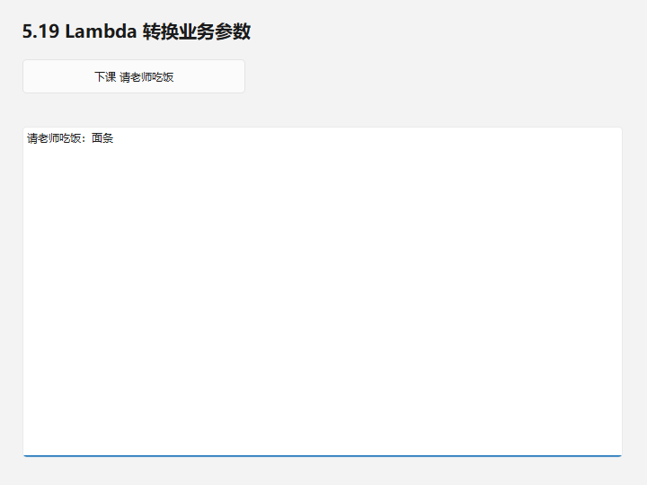

# 5.19 Lambda适配业务参数

[所属章节](../chapters/05-signals-slots-lambda.md) · [完整项目](../../examples/05_19_lambda_adapter/README.md)

### 本项目要掌握什么

Lambda适配业务参数。这一节只围绕这个核心问题阅读和修改程序。

### 关键代码在哪里

关键片段 1：[ widget.cpp 第 13 行起](../../examples/05_19_lambda_adapter/widget.cpp#L13)。以下代码从本项目源文件提取，完整上下文见源文件。

```cpp
auto *teacher = new Teacher(this);
auto *student = new Student(this);
connect(student, &Student::message, this, &Widget::writeLine);
connect(teacher, qOverload<const QString &>(&Teacher::hungry), student,
        qOverload<const QString &>(&Student::treat));
connect(ui->runButton, &QPushButton::clicked, this,
        [teacher]() { teacher->requestFood(QStringLiteral("面条")); });
```

### 逐段讲解

clicked 的 bool 不是老师想要的菜名。Lambda 不声明 bool 参数，因此忽略它，改为显式调用 requestFood("面条")。

teacher 按值捕获仅复制地址，Student 的处理仍由 hungry(food) 触发。窗口 context 管理本连接，teacher 也作为窗口子对象管理。

### 按执行顺序阅读

构造函数先准备界面与连接；交互发生后才进入回调。阅读时按“发送对象 → 信号或调用 → 回调里的数据 → 被修改对象 → 显示结果”追踪，不要把建立连接当成已经执行操作。

### 容易出错的地方与动手验证

让按钮选择两种菜名再调用同一接口；若允许提前删除 teacher，需要另外检查其存活状态。

先写下预测，再修改一个条件重新构建。记录实际结果，并用本节代码中的变量、对象和调用顺序解释原因；仅仅没有报错不代表已经验证了所有分支。

### 运行结果



### 完整项目与界面文件

- [05_19_lambda_adapter.pro](../../examples/05_19_lambda_adapter/05_19_lambda_adapter.pro)
- [main.cpp](../../examples/05_19_lambda_adapter/main.cpp)
- [student.h](../../examples/05_19_lambda_adapter/student.h)
- [teacher.h](../../examples/05_19_lambda_adapter/teacher.h)
- [verify.h](../../examples/05_19_lambda_adapter/verify.h)
- [widget.cpp](../../examples/05_19_lambda_adapter/widget.cpp)
- [widget.h](../../examples/05_19_lambda_adapter/widget.h)
- [widget.ui](../../examples/05_19_lambda_adapter/widget.ui)

打开本项目 .pro，选择匹配的 Kit，构建运行；修改界面请打开 .ui，保存后重新构建。verify.h 只在传入 --verify 时执行检查。
