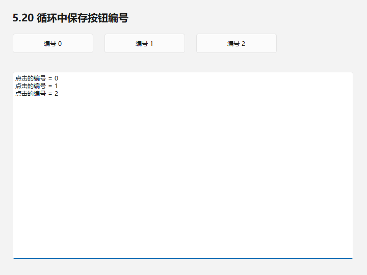

# 5.20 循环回调保存各自编号

[所属章节](../chapters/05-signals-slots-lambda.md) · [完整项目](../../examples/05_20_loop_capture/README.md)

### 本项目要掌握什么

循环回调保存各自编号。这一节只围绕这个核心问题阅读和修改程序。

### 关键代码在哪里

关键片段 1：[ widget.cpp 第 12 行起](../../examples/05_20_loop_capture/widget.cpp#L12)。以下代码从本项目源文件提取，完整上下文见源文件。

```cpp
const QList<QPushButton *> buttons = {ui->number0, ui->number1, ui->number2};
for (int i = 0; i < buttons.size(); ++i)
{
    auto *button = buttons.at(i);
    connect(button, &QPushButton::clicked, this,
            [this, i]() { writeLine("点击的编号 = " + QString::number(i)); });
}
```

### 逐段讲解

buttons 是三个 .ui 按钮的指针集合，循环每次取出一个按钮。[this,i] 在每次建立连接时保存当次 i 的数值。

循环结束后用户才点击，但每个回调都有自己的 0、1、2 副本，因此不会读取构造函数里已经消失的循环变量。

### 按执行顺序阅读

构造函数先准备界面与连接；交互发生后才进入回调。阅读时按“发送对象 → 信号或调用 → 回调里的数据 → 被修改对象 → 显示结果”追踪，不要把建立连接当成已经执行操作。

### 容易出错的地方与动手验证

把循环改为更大的按钮集合；不要用 [&i] 试图让每个按钮保留编号，循环结束后这个引用会失效。

先写下预测，再修改一个条件重新构建。记录实际结果，并用本节代码中的变量、对象和调用顺序解释原因；仅仅没有报错不代表已经验证了所有分支。

### 运行结果



### 完整项目与界面文件

- [05_20_loop_capture.pro](../../examples/05_20_loop_capture/05_20_loop_capture.pro)
- [main.cpp](../../examples/05_20_loop_capture/main.cpp)
- [verify.h](../../examples/05_20_loop_capture/verify.h)
- [widget.cpp](../../examples/05_20_loop_capture/widget.cpp)
- [widget.h](../../examples/05_20_loop_capture/widget.h)
- [widget.ui](../../examples/05_20_loop_capture/widget.ui)

打开本项目 .pro，选择匹配的 Kit，构建运行；修改界面请打开 .ui，保存后重新构建。verify.h 只在传入 --verify 时执行检查。
