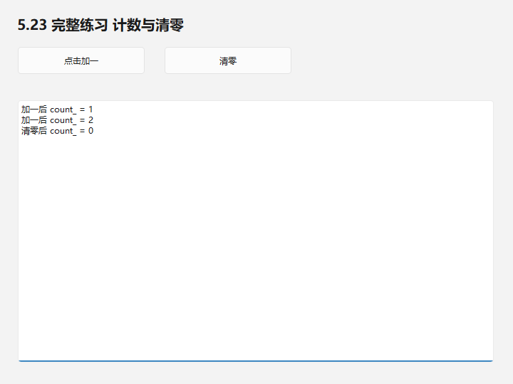

# 5.23 成员状态与界面统一刷新

[所属章节](../chapters/05-signals-slots-lambda.md) · [完整项目](../../examples/05_23_complete_counter/README.md)

### 本项目要掌握什么

成员状态与界面统一刷新。这一节只围绕这个核心问题阅读和修改程序。

### 关键代码在哪里

关键片段 1：[ widget.cpp 第 11 行起](../../examples/05_23_complete_counter/widget.cpp#L11)。以下代码从本项目源文件提取，完整上下文见源文件。

```cpp
connect(ui->runButton, &QPushButton::clicked, this,
        [this]()
        {
            ++count_;
            refreshTitle();
            writeLine("加一后 count_ = " + QString::number(count_));
        });
connect(ui->resetButton, &QPushButton::clicked, this,
        [this]()
        {
            count_ = 0;
            refreshTitle();
            writeLine("清零后 count_ = 0");
        });
refreshTitle();
```

关键片段 2：[ widget.cpp 第 42 行起](../../examples/05_23_complete_counter/widget.cpp#L42)。以下代码从本项目源文件提取，完整上下文见源文件。

```cpp
void Widget::refreshTitle()
{
    setWindowTitle(QString("已点击 %1 次").arg(count_));
}
```

### 逐段讲解

count_ 属于窗口，加一和清零都先修改同一份状态，再调用 refreshTitle，避免两个分支各自拼出不同格式。

setupUi 创建按钮，connect 登记行为，初始 refreshTitle 显示 0；用户操作时才更新成员。writeLine 用于观察过程。

### 按执行顺序阅读

构造函数先准备界面与连接；交互发生后才进入回调。阅读时按“发送对象 → 信号或调用 → 回调里的数据 → 被修改对象 → 显示结果”追踪，不要把建立连接当成已经执行操作。

### 容易出错的地方与动手验证

按加一两次、清零、再加一的顺序预测标题；不要另建一个同名局部 count_ 遮蔽成员。

先写下预测，再修改一个条件重新构建。记录实际结果，并用本节代码中的变量、对象和调用顺序解释原因；仅仅没有报错不代表已经验证了所有分支。

### 运行结果



### 完整项目与界面文件

- [05_23_complete_counter.pro](../../examples/05_23_complete_counter/05_23_complete_counter.pro)
- [main.cpp](../../examples/05_23_complete_counter/main.cpp)
- [verify.h](../../examples/05_23_complete_counter/verify.h)
- [widget.cpp](../../examples/05_23_complete_counter/widget.cpp)
- [widget.h](../../examples/05_23_complete_counter/widget.h)
- [widget.ui](../../examples/05_23_complete_counter/widget.ui)

打开本项目 .pro，选择匹配的 Kit，构建运行；修改界面请打开 .ui，保存后重新构建。verify.h 只在传入 --verify 时执行检查。
