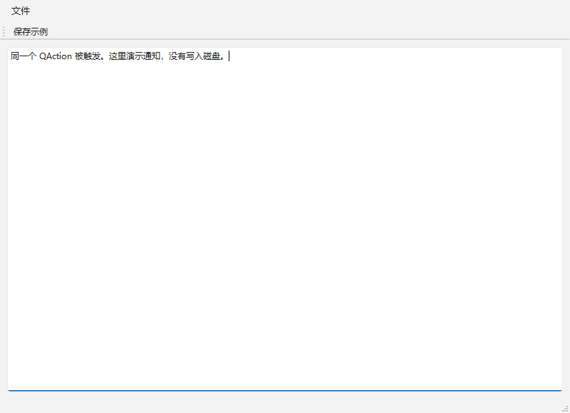

# 6.2 QAction共享命令入口

[所属章节](../chapters/06-mainwindow.md) · [完整项目](../../examples/06_02_menu_toolbar/README.md)

### 本项目要掌握什么

QAction共享命令入口。这一节只围绕这个核心问题阅读和修改程序。

### 关键代码在哪里

关键片段 1：[ mainwindow.cpp 第 11 行起](../../examples/06_02_menu_toolbar/mainwindow.cpp#L11)。以下代码从本项目源文件提取，完整上下文见源文件。

```cpp
connect(ui->action, &QAction::triggered, this, [this]()
        { ui->textEdit->append("同一个 QAction 被触发。这里演示通知，没有写入磁盘。"); });
```

### 逐段讲解

菜单与工具栏在 .ui 中引用同一个 action；只有一次 triggered 连接，因此任一入口触发同一段追加文字的行为。

动作保存快捷键、启用和勾选等命令状态，菜单项与工具按钮是入口。本例演示通知，没有真正保存文件。

### 按执行顺序阅读

构造函数先准备界面与连接；交互发生后才进入回调。阅读时按“发送对象 → 信号或调用 → 回调里的数据 → 被修改对象 → 显示结果”追踪，不要把建立连接当成已经执行操作。

### 容易出错的地方与动手验证

禁用 ui->action 后比较两个入口；两个同名 QAction 是两个对象，不会自动共享状态。

先写下预测，再修改一个条件重新构建。记录实际结果，并用本节代码中的变量、对象和调用顺序解释原因；仅仅没有报错不代表已经验证了所有分支。

### 运行结果



### 完整项目与界面文件

- [06_02_menu_toolbar.pro](../../examples/06_02_menu_toolbar/06_02_menu_toolbar.pro)
- [main.cpp](../../examples/06_02_menu_toolbar/main.cpp)
- [mainwindow.cpp](../../examples/06_02_menu_toolbar/mainwindow.cpp)
- [mainwindow.h](../../examples/06_02_menu_toolbar/mainwindow.h)
- [mainwindow.ui](../../examples/06_02_menu_toolbar/mainwindow.ui)
- [verify.h](../../examples/06_02_menu_toolbar/verify.h)

打开本项目 .pro，选择匹配的 Kit，构建运行；修改界面请打开 .ui，保存后重新构建。verify.h 只在传入 --verify 时执行检查。
