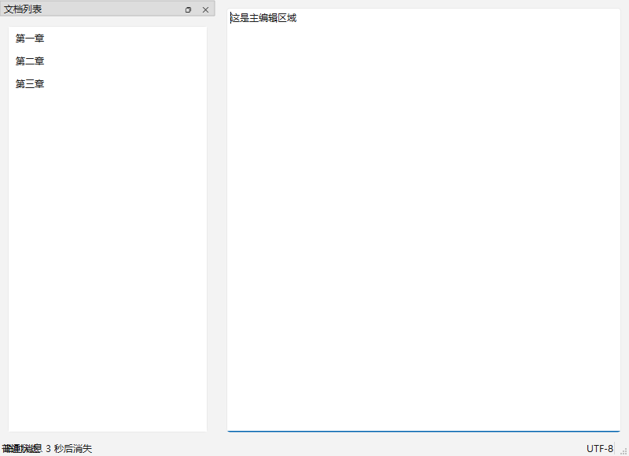

# 6.3 临时状态与停靠区域

[所属章节](../chapters/06-mainwindow.md) · [完整项目](../../examples/06_03_status_dock/README.md)

### 本项目要掌握什么

临时状态与停靠区域。这一节只围绕这个核心问题阅读和修改程序。

### 关键代码在哪里

关键片段 1：[ mainwindow.cpp 第 11 行起](../../examples/06_03_status_dock/mainwindow.cpp#L11)。以下代码从本项目源文件提取，完整上下文见源文件。

```cpp
ui->statusbar->addWidget(new QLabel("普通状态", this));
ui->statusbar->addPermanentWidget(new QLabel("UTF-8", this));
ui->statusbar->showMessage("临时消息 3 秒后消失", 3000);
```

### 逐段讲解

dockWidget 和文档列表在 .ui 配置，状态栏通过 addWidget 与 addPermanentWidget 加入两种状态控件。

showMessage 的 3000 单位为毫秒，临时消息会覆盖普通状态区域；永久区域用来保留编码等信息。DockWidget 管理工作区旁的可停靠内容。

### 按执行顺序阅读

构造函数先准备界面与连接；交互发生后才进入回调。阅读时按“发送对象 → 信号或调用 → 回调里的数据 → 被修改对象 → 显示结果”追踪，不要把建立连接当成已经执行操作。

### 容易出错的地方与动手验证

等待临时消息消失并拖动停靠面板；隐藏面板后应重新显示已有实例，不要反复 new 相同面板。

先写下预测，再修改一个条件重新构建。记录实际结果，并用本节代码中的变量、对象和调用顺序解释原因；仅仅没有报错不代表已经验证了所有分支。

### 运行结果



### 完整项目与界面文件

- [06_03_status_dock.pro](../../examples/06_03_status_dock/06_03_status_dock.pro)
- [main.cpp](../../examples/06_03_status_dock/main.cpp)
- [mainwindow.cpp](../../examples/06_03_status_dock/mainwindow.cpp)
- [mainwindow.h](../../examples/06_03_status_dock/mainwindow.h)
- [mainwindow.ui](../../examples/06_03_status_dock/mainwindow.ui)
- [verify.h](../../examples/06_03_status_dock/verify.h)

打开本项目 .pro，选择匹配的 Kit，构建运行；修改界面请打开 .ui，保存后重新构建。verify.h 只在传入 --verify 时执行检查。
