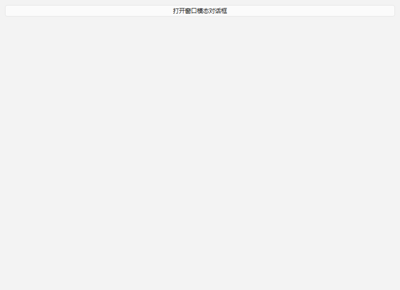

# 7.1 异步对话框的生命周期

[所属章节](../chapters/07-dialogs.md) · [完整项目](../../examples/07_01_dialog/README.md)

### 本项目要掌握什么

异步对话框的生命周期。这一节只围绕这个核心问题阅读和修改程序。

### 关键代码在哪里

关键片段 1：[ mainwindow.cpp 第 11 行起](../../examples/07_01_dialog/mainwindow.cpp#L11)。以下代码从本项目源文件提取，完整上下文见源文件。

```cpp
connect(ui->run, &QPushButton::clicked, this,
        [this]()
        {
            auto *dialog = new Dialog(this);
            dialog->setAttribute(Qt::WA_DeleteOnClose);
            dialog->setWindowTitle("open 立即返回");
            dialog->open();
        });
```

### 逐段讲解

new Dialog(this) 建立有父对象的对话框，Dialog 自己加载 dialog.ui。WA_DeleteOnClose 使它关闭后回收，open 显示窗口模态对话框并立即返回。

父窗口暂时不能输入，不等于代码停在 open 等待；标准按钮在 .ui 中连接 accept/reject，结束后再处理结果。

### 按执行顺序阅读

构造函数先准备界面与连接；交互发生后才进入回调。阅读时按“发送对象 → 信号或调用 → 回调里的数据 → 被修改对象 → 显示结果”追踪，不要把建立连接当成已经执行操作。

### 容易出错的地方与动手验证

打开后比较父窗口输入状态；不要用构造函数中的局部栈对象 show/open 后立刻离开作用域。

先写下预测，再修改一个条件重新构建。记录实际结果，并用本节代码中的变量、对象和调用顺序解释原因；仅仅没有报错不代表已经验证了所有分支。

### 运行结果



### 完整项目与界面文件

- [07_01_dialog.pro](../../examples/07_01_dialog/07_01_dialog.pro)
- [dialog.cpp](../../examples/07_01_dialog/dialog.cpp)
- [dialog.h](../../examples/07_01_dialog/dialog.h)
- [dialog.ui](../../examples/07_01_dialog/dialog.ui)
- [main.cpp](../../examples/07_01_dialog/main.cpp)
- [mainwindow.cpp](../../examples/07_01_dialog/mainwindow.cpp)
- [mainwindow.h](../../examples/07_01_dialog/mainwindow.h)
- [mainwindow.ui](../../examples/07_01_dialog/mainwindow.ui)
- [verify.h](../../examples/07_01_dialog/verify.h)

打开本项目 .pro，选择匹配的 Kit，构建运行；修改界面请打开 .ui，保存后重新构建。verify.h 只在传入 --verify 时执行检查。
