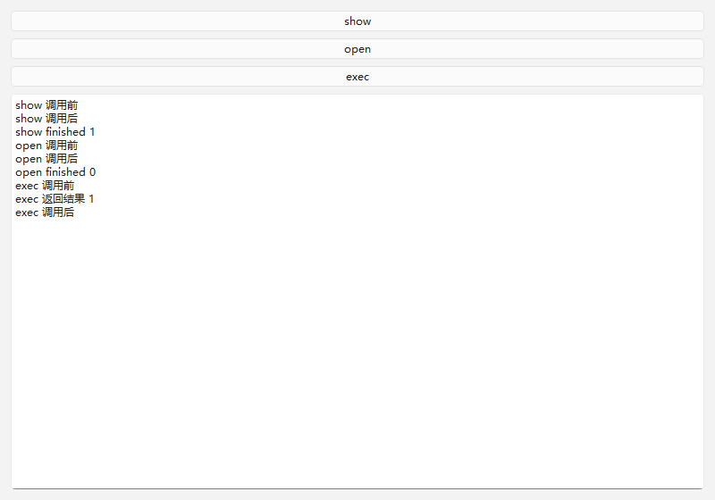

# 7.2 show open exec的返回时机

[所属章节](../chapters/07-dialogs.md) · [完整项目](../../examples/07_02_dialog_modes/README.md)

### 本项目要掌握什么

show open exec的返回时机。这一节只围绕这个核心问题阅读和修改程序。

### 关键代码在哪里

关键片段 1：[ widget.cpp 第 29 行起](../../examples/07_02_dialog_modes/widget.cpp#L29)。以下代码从本项目源文件提取，完整上下文见源文件。

```cpp
void Widget::openMode(const QString &mode)
{
    ui->logEdit->appendPlainText(mode + " 调用前");
    if (mode == "exec")
    {
        Dialog dialog(this); // exec 返回之前，局部对象一直存在。
        dialog.setObjectName("demoDialog");
        dialog.setWindowTitle(mode + " 对话框");
        const int result = dialog.exec();
        ui->logEdit->appendPlainText("exec 返回结果 " + QString::number(result));
    }
    else
    {
        auto *dialog = new Dialog(this);
        dialog->setObjectName("demoDialog");
        dialog->setWindowTitle(mode + " 对话框");
        dialog->setAttribute(Qt::WA_DeleteOnClose);
        connect(dialog, &QDialog::finished, this, [this, mode](int result)
                { ui->logEdit->appendPlainText(mode + " finished " + QString::number(result)); });
        if (mode == "open")
            dialog->open();
        else
            dialog->show();
    }
    ui->logEdit->appendPlainText(mode + " 调用后");
}
```

### 逐段讲解

三个按钮调用同一 openMode，以 mode 区分行为。show/open 使用堆对话框和结束通知；exec 示例用栈对象并取得返回结果。

show/open 的调用后日志先出现，exec 的调用后日志要等关闭；exec 内仍处理事件，不能把它理解为整个 GUI 停止。

### 关键分支再拆一步

exec 分支的局部 Dialog 在 exec 返回前一直存在，关闭后才读 result。异步分支的对象在函数返回后仍要存在，所以用 new 和 parent，并在 finished 中记录结果，WA_DeleteOnClose 负责关闭后回收。日志中的“调用后”位置是判断是否等待的证据，窗口模态则要另看父窗口能否输入。

### 按执行顺序阅读

构造函数先准备界面与连接；交互发生后才进入回调。阅读时按“发送对象 → 信号或调用 → 回调里的数据 → 被修改对象 → 显示结果”追踪，不要把建立连接当成已经执行操作。

### 容易出错的地方与动手验证

逐个确认与取消，并比较父窗口能否操作；不要让异步栈对象先析构，也不要给栈对话框设置自动删除。

先写下预测，再修改一个条件重新构建。记录实际结果，并用本节代码中的变量、对象和调用顺序解释原因；仅仅没有报错不代表已经验证了所有分支。

### 运行结果



### 完整项目与界面文件

- [07_02_dialog_modes.pro](../../examples/07_02_dialog_modes/07_02_dialog_modes.pro)
- [dialog.cpp](../../examples/07_02_dialog_modes/dialog.cpp)
- [dialog.h](../../examples/07_02_dialog_modes/dialog.h)
- [dialog.ui](../../examples/07_02_dialog_modes/dialog.ui)
- [main.cpp](../../examples/07_02_dialog_modes/main.cpp)
- [verify.h](../../examples/07_02_dialog_modes/verify.h)
- [widget.cpp](../../examples/07_02_dialog_modes/widget.cpp)
- [widget.h](../../examples/07_02_dialog_modes/widget.h)
- [widget.ui](../../examples/07_02_dialog_modes/widget.ui)

打开本项目 .pro，选择匹配的 Kit，构建运行；修改界面请打开 .ui，保存后重新构建。verify.h 只在传入 --verify 时执行检查。
