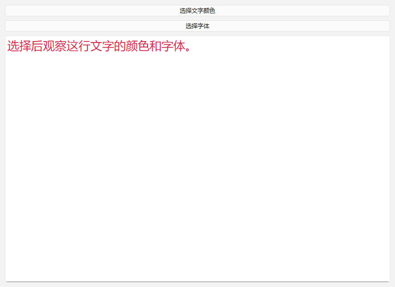

# 7.4 确认颜色或字体后再应用

[所属章节](../chapters/07-dialogs.md) · [完整项目](../../examples/07_04_color_font/README.md)

### 本项目要掌握什么

确认颜色或字体后再应用。这一节只围绕这个核心问题阅读和修改程序。

### 关键代码在哪里

关键片段 1：[ mainwindow.cpp 第 12 行起](../../examples/07_04_color_font/mainwindow.cpp#L12)。以下代码从本项目源文件提取，完整上下文见源文件。

```cpp
connect(ui->run, &QPushButton::clicked, this,
        [this]()
        {
            auto *dialog =
                new QColorDialog(ui->plainTextEdit->palette().color(QPalette::Text), this);
            dialog->setOption(QColorDialog::DontUseNativeDialog);
            dialog->setAttribute(Qt::WA_DeleteOnClose);
            connect(dialog, &QColorDialog::colorSelected, ui->plainTextEdit,
                    [this](const QColor &value)
                    {
                        auto pal = ui->plainTextEdit->palette();
                        pal.setColor(QPalette::Text, value);
                        ui->plainTextEdit->setPalette(pal);
                    });
            dialog->open();
        });
connect(ui->fontButton, &QPushButton::clicked, this,
        [this]()
        {
            auto *dialog = new QFontDialog(ui->plainTextEdit->font(), this);
            dialog->setOption(QFontDialog::DontUseNativeDialog);
            dialog->setAttribute(Qt::WA_DeleteOnClose);
            connect(dialog, &QFontDialog::fontSelected, ui->plainTextEdit, &QWidget::setFont);
            dialog->open();
        });
```

### 逐段讲解

颜色框从编辑器当前 palette 的 Text 角色取得初始值，colorSelected 发生后修改该角色并重新设置 palette。

字体框使用当前 font，并把 fontSelected 连接 setFont。选择过程与最终确认要区分，取消应保留原设置。

### 按执行顺序阅读

构造函数先准备界面与连接；交互发生后才进入回调。阅读时按“发送对象 → 信号或调用 → 回调里的数据 → 被修改对象 → 显示结果”追踪，不要把建立连接当成已经执行操作。

### 容易出错的地方与动手验证

分别取消和确认两个对话框；不能把静态 getFont 返回的某个字体当作用户一定确认，要检查确认标记。

先写下预测，再修改一个条件重新构建。记录实际结果，并用本节代码中的变量、对象和调用顺序解释原因；仅仅没有报错不代表已经验证了所有分支。

### 运行结果



### 完整项目与界面文件

- [07_04_color_font.pro](../../examples/07_04_color_font/07_04_color_font.pro)
- [main.cpp](../../examples/07_04_color_font/main.cpp)
- [mainwindow.cpp](../../examples/07_04_color_font/mainwindow.cpp)
- [mainwindow.h](../../examples/07_04_color_font/mainwindow.h)
- [mainwindow.ui](../../examples/07_04_color_font/mainwindow.ui)
- [verify.h](../../examples/07_04_color_font/verify.h)

打开本项目 .pro，选择匹配的 Kit，构建运行；修改界面请打开 .ui，保存后重新构建。verify.h 只在传入 --verify 时执行检查。
