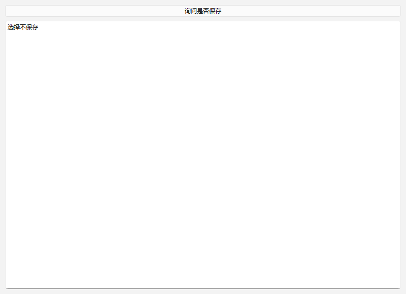

# 7.5 消息框返回值与控制分支

[所属章节](../chapters/07-dialogs.md) · [完整项目](../../examples/07_05_messagebox/README.md)

### 本项目要掌握什么

消息框返回值与控制分支。这一节只围绕这个核心问题阅读和修改程序。

### 关键代码在哪里

关键片段 1：[ mainwindow.cpp 第 11 行起](../../examples/07_05_messagebox/mainwindow.cpp#L11)。以下代码从本项目源文件提取，完整上下文见源文件。

```cpp
connect(ui->run, &QPushButton::clicked, this,
        [this]()
        {
            auto *box =
                new QMessageBox(QMessageBox::Question, "保存选择", "文件已修改，是否保存？",
                                QMessageBox::Yes | QMessageBox::No | QMessageBox::Cancel, this);
            box->setDefaultButton(QMessageBox::Cancel);
            box->setAttribute(Qt::WA_DeleteOnClose);
            connect(box, &QDialog::finished, ui->resultEdit,
                    [this](int result)
                    {
                        if (result == QMessageBox::Yes)
                            ui->resultEdit->append("选择保存（仅演示）");
                        else if (result == QMessageBox::No)
                            ui->resultEdit->append("选择不保存");
                        else
                            ui->resultEdit->append("取消当前操作");
                    });
            box->open();
        });
```

### 逐段讲解

消息框提供 Yes、No、Cancel，并把默认按钮设为 Cancel；finished 给出的结果必须与具体 StandardButton 值比较。

三个枚举值并不等同于 true/false 的业务含义。本例显示选择结果，真实保存应在成功写入后才允许继续关闭或切换。

### 按执行顺序阅读

构造函数先准备界面与连接；交互发生后才进入回调。阅读时按“发送对象 → 信号或调用 → 回调里的数据 → 被修改对象 → 显示结果”追踪，不要把建立连接当成已经执行操作。

### 容易出错的地方与动手验证

测试按钮、Enter 与取消路径；不能只写 if(result) 就把全部非零返回值解释成保存。

先写下预测，再修改一个条件重新构建。记录实际结果，并用本节代码中的变量、对象和调用顺序解释原因；仅仅没有报错不代表已经验证了所有分支。

### 运行结果



### 完整项目与界面文件

- [07_05_messagebox.pro](../../examples/07_05_messagebox/07_05_messagebox.pro)
- [main.cpp](../../examples/07_05_messagebox/main.cpp)
- [mainwindow.cpp](../../examples/07_05_messagebox/mainwindow.cpp)
- [mainwindow.h](../../examples/07_05_messagebox/mainwindow.h)
- [mainwindow.ui](../../examples/07_05_messagebox/mainwindow.ui)
- [verify.h](../../examples/07_05_messagebox/verify.h)

打开本项目 .pro，选择匹配的 Kit，构建运行；修改界面请打开 .ui，保存后重新构建。verify.h 只在传入 --verify 时执行检查。
