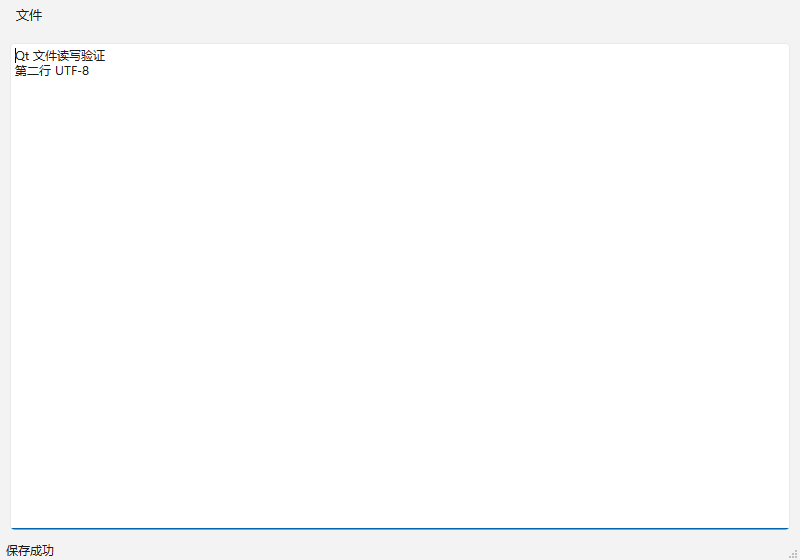

# 7.6 打开编辑保存的完整流程

[所属章节](../chapters/07-dialogs.md) · [完整项目](../../examples/07_06_text_editor/README.md)

### 本项目要掌握什么

打开编辑保存的完整流程。这一节只围绕这个核心问题阅读和修改程序。

### 关键代码在哪里

关键片段 1：[ mainwindow.cpp 第 38 行起](../../examples/07_06_text_editor/mainwindow.cpp#L38)。以下代码从本项目源文件提取，完整上下文见源文件。

```cpp
bool MainWindow::loadPath(const QString &path)
{
    QFile file(path);
    if (!file.open(QIODevice::ReadOnly))
    {
        statusBar()->showMessage("打开失败：" + file.errorString());
        return false;
    }
    const QByteArray bytes = file.readAll();
    if (file.error() != QFileDevice::NoError)
    {
        statusBar()->showMessage("读取失败：" + file.errorString());
        return false;
    }
    // 这个练习约定 UTF-8。其他编码应先识别或明确指定后再解码。
    ui->plainTextEdit->setPlainText(QString::fromUtf8(bytes));
    path_ = path;
    ui->plainTextEdit->document()->setModified(false);
    updateTitle();
    return true;
}
```

关键片段 2：[ mainwindow.cpp 第 60 行起](../../examples/07_06_text_editor/mainwindow.cpp#L60)。以下代码从本项目源文件提取，完整上下文见源文件。

```cpp
bool MainWindow::savePath(const QString &path)
{
    QSaveFile file(path);
    if (!file.open(QIODevice::WriteOnly))
    {
        statusBar()->showMessage("无法保存：" + file.errorString());
        return false;
    }
    const auto bytes = ui->plainTextEdit->toPlainText().toUtf8();
    const bool written = file.write(bytes) == bytes.size();
    if (!written || !file.commit())
    {
        statusBar()->showMessage("保存失败：" + file.errorString());
        return false;
    }
    path_ = path;
    ui->plainTextEdit->document()->setModified(false);
    updateTitle();
    statusBar()->showMessage("保存成功", 2000);
    return true;
}
```

关键片段 3：[ mainwindow.cpp 第 103 行起](../../examples/07_06_text_editor/mainwindow.cpp#L103)。以下代码从本项目源文件提取，完整上下文见源文件。

```cpp
bool MainWindow::confirmDiscard()
{
    if (!ui->plainTextEdit->document()->isModified())
        return true;
    const auto choice = QMessageBox::question(
        this, "未保存的修改", "是否保存后继续？",
        QMessageBox::Yes | QMessageBox::No | QMessageBox::Cancel, QMessageBox::Cancel);
    if (choice == QMessageBox::Cancel)
        return false;
    if (choice == QMessageBox::No)
        return true;
    return saveCurrent(); // 保存取消或失败时，继续保留当前窗口与文档。
}
```

### 逐段讲解

loadPath 先检查打开和读取错误，成功后再替换文本；savePath 用 QSaveFile 写 UTF-8 字节，检查写入长度及 commit。

确认保存成功才清除 modified；confirmDiscard 将保存、不保存、取消接入打开和 closeEvent。取消路径或写入失败应保留当前修改。

### 关键分支再拆一步

保存函数要逐个检查四个关口：open(WriteOnly) 失败立即返回；write 的返回长度要等于完整 UTF-8 字节数；commit 成功才真正确认写入；完成后再更新 path_ 和 modified。confirmDiscard 中 Cancel 返回 false，No 返回 true，Yes 则把决定交给 saveCurrent 的实际结果。这样保存对话框取消或磁盘错误都不会继续丢弃修改。

### 按执行顺序阅读

构造函数先准备界面与连接；交互发生后才进入回调。阅读时按“发送对象 → 信号或调用 → 回调里的数据 → 被修改对象 → 显示结果”追踪，不要把建立连接当成已经执行操作。

### 容易出错的地方与动手验证

输入中文与换行，保存后读回，再测试未保存关闭与取消；文件选择框选出路径不代表已写入。

先写下预测，再修改一个条件重新构建。记录实际结果，并用本节代码中的变量、对象和调用顺序解释原因；仅仅没有报错不代表已经验证了所有分支。

### 运行结果



### 完整项目与界面文件

- [07_06_text_editor.pro](../../examples/07_06_text_editor/07_06_text_editor.pro)
- [main.cpp](../../examples/07_06_text_editor/main.cpp)
- [mainwindow.cpp](../../examples/07_06_text_editor/mainwindow.cpp)
- [mainwindow.h](../../examples/07_06_text_editor/mainwindow.h)
- [mainwindow.ui](../../examples/07_06_text_editor/mainwindow.ui)
- [verify.h](../../examples/07_06_text_editor/verify.h)

打开本项目 .pro，选择匹配的 Kit，构建运行；修改界面请打开 .ui，保存后重新构建。verify.h 只在传入 --verify 时执行检查。
