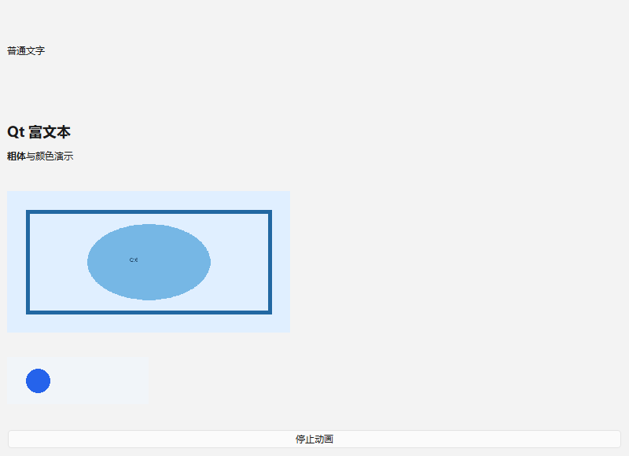

# 9.1 标签的文本图像与动画接口

[所属章节](../chapters/09-widgets.md) · [完整项目](../../examples/09_01_label_movie/README.md)

### 本项目要掌握什么

标签的文本图像与动画接口。这一节只围绕这个核心问题阅读和修改程序。

### 关键代码在哪里

关键片段 1：[ mainwindow.cpp 第 11 行起](../../examples/09_01_label_movie/mainwindow.cpp#L11)。以下代码从本项目源文件提取，完整上下文见源文件。

```cpp
ui->imageLabel->setPixmap(QPixmap(":/images/demo.png").scaledToWidth(360));
auto *movie = new QMovie(":/images/demo.gif", QByteArray(), this);
ui->animationLabel->setMovie(movie);
movie->start();
connect(ui->run, &QPushButton::clicked, movie, &QMovie::stop);
```

### 逐段讲解

setPixmap 显示静态图片，setMovie 绑定动画对象，movie->start 才开始播放；停止按钮连接 QMovie::stop。

QMovie 的 parent 是窗口，QLabel 不接管动画所有权。富文本内容属于 Qt 支持的子集，不是完整浏览器。

### 按执行顺序阅读

构造函数先准备界面与连接；交互发生后才进入回调。阅读时按“发送对象 → 信号或调用 → 回调里的数据 → 被修改对象 → 显示结果”追踪，不要把建立连接当成已经执行操作。

### 容易出错的地方与动手验证

比较 stop 与 setPaused，检查 qrc 和 GIF 插件；setText(":/images/demo.png") 只会显示路径文字。

先写下预测，再修改一个条件重新构建。记录实际结果，并用本节代码中的变量、对象和调用顺序解释原因；仅仅没有报错不代表已经验证了所有分支。

### 运行结果



### 完整项目与界面文件

- [09_01_label_movie.pro](../../examples/09_01_label_movie/09_01_label_movie.pro)
- [assets.qrc](../../examples/09_01_label_movie/assets.qrc)
- [main.cpp](../../examples/09_01_label_movie/main.cpp)
- [mainwindow.cpp](../../examples/09_01_label_movie/mainwindow.cpp)
- [mainwindow.h](../../examples/09_01_label_movie/mainwindow.h)
- [mainwindow.ui](../../examples/09_01_label_movie/mainwindow.ui)
- [verify.h](../../examples/09_01_label_movie/verify.h)

打开本项目 .pro，选择匹配的 Kit，构建运行；修改界面请打开 .ui，保存后重新构建。verify.h 只在传入 --verify 时执行检查。
