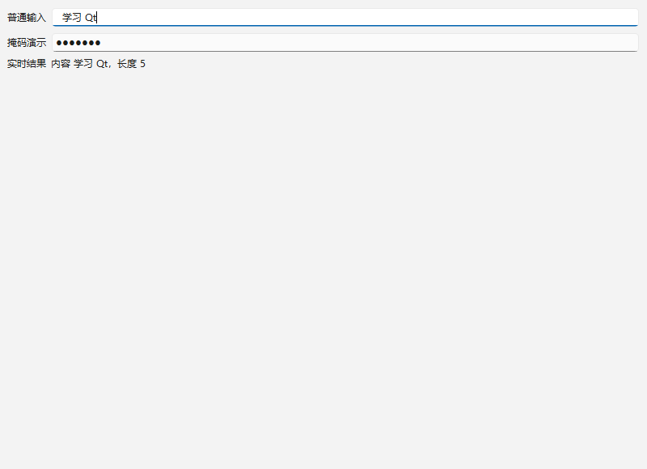

# 9.2 输入内容与显示模式

[所属章节](../chapters/09-widgets.md) · [完整项目](../../examples/09_02_lineedit/README.md)

### 本项目要掌握什么

输入内容与显示模式。这一节只围绕这个核心问题阅读和修改程序。

### 关键代码在哪里

关键片段 1：[ mainwindow.cpp 第 11 行起](../../examples/09_02_lineedit/mainwindow.cpp#L11)。以下代码从本项目源文件提取，完整上下文见源文件。

```cpp
ui->name->setTextMargins(8, 0, 8, 0);
connect(ui->name, &QLineEdit::textChanged, this, [this](const QString &text)
        { ui->resultLabel->setText(QString("内容 %1，长度 %2").arg(text).arg(text.size())); });
```

### 逐段讲解

name 的 textChanged 提供真实文本，Lambda 同时更新内容和长度；placeholderText 在空输入时作提示，不是 text 的一部分。

Password 改变显示方式，不负责加密。textChanged 也可能由代码 setText 触发，与只关注用户编辑的信号要区分。

### 按执行顺序阅读

构造函数先准备界面与连接；交互发生后才进入回调。阅读时按“发送对象 → 信号或调用 → 回调里的数据 → 被修改对象 → 显示结果”追踪，不要把建立连接当成已经执行操作。

### 容易出错的地方与动手验证

清空再输入，比较 text 与 displayText；给密码框设置掩码不等于可以安全记录或存储密码。

先写下预测，再修改一个条件重新构建。记录实际结果，并用本节代码中的变量、对象和调用顺序解释原因；仅仅没有报错不代表已经验证了所有分支。

### 运行结果



### 完整项目与界面文件

- [09_02_lineedit.pro](../../examples/09_02_lineedit/09_02_lineedit.pro)
- [main.cpp](../../examples/09_02_lineedit/main.cpp)
- [mainwindow.cpp](../../examples/09_02_lineedit/mainwindow.cpp)
- [mainwindow.h](../../examples/09_02_lineedit/mainwindow.h)
- [mainwindow.ui](../../examples/09_02_lineedit/mainwindow.ui)
- [verify.h](../../examples/09_02_lineedit/verify.h)

打开本项目 .pro，选择匹配的 Kit，构建运行；修改界面请打开 .ui，保存后重新构建。verify.h 只在传入 --verify 时执行检查。
