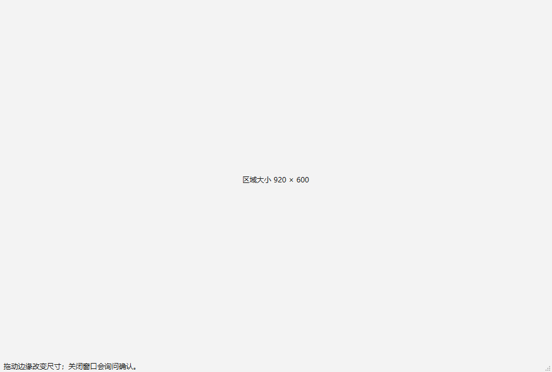

# 10.1 关闭请求与尺寸通知

[所属章节](../chapters/10-events.md) · [完整项目](../../examples/10_01_close_resize/README.md)

### 本项目要掌握什么

关闭请求与尺寸通知。这一节只围绕这个核心问题阅读和修改程序。

### 关键代码在哪里

关键片段 1：[ mainwindow.cpp 第 23 行起](../../examples/10_01_close_resize/mainwindow.cpp#L23)。以下代码从本项目源文件提取，完整上下文见源文件。

```cpp
void MainWindow::closeEvent(QCloseEvent *event)
{
    auto choice = QMessageBox::question(this, "关闭确认", "确定关闭窗口吗？",
                                        QMessageBox::Yes | QMessageBox::No, QMessageBox::No);
    if (choice == QMessageBox::Yes)
        event->accept();
    else
        event->ignore();
}
```

关键片段 2：[ eventarea.cpp 第 15 行起](../../examples/10_01_close_resize/eventarea.cpp#L15)。以下代码从本项目源文件提取，完整上下文见源文件。

```cpp
void EventArea::resizeEvent(QResizeEvent *event)
{
    setText(QString("区域大小 %1 × %2").arg(event->size().width()).arg(event->size().height()));
    QLabel::resizeEvent(event);
}
```

### 逐段讲解

MainWindow::closeEvent 通过消息框决定 accept 或 ignore，ignore 允许窗口继续存在；EventArea::resizeEvent 接收区域已改变的尺寸。

两个处理函数属于不同对象：关闭决策在主窗口，尺寸显示在中央区域。事件指针仅在本次处理时使用。

### 按执行顺序阅读

窗口初始化先准备对象和连接；用户输入、尺寸变化或重绘请求到达后，才进入上述处理函数。依次追踪事件或信号的目标、类型判断、状态变化和结果更新，再观察是否把剩余处理交回基类。

### 容易出错的地方与动手验证

先拒绝关闭再确认关闭；不要在 closeEvent 内再调用 close，也不要在 resizeEvent 无条件调用 resize 造成递归。

先写下预测，再修改一个条件重新构建。记录实际结果，并用本节代码中的变量、对象和调用顺序解释原因；仅仅没有报错不代表已经验证了所有分支。

### 运行结果



### 完整项目与界面文件

- [10_01_close_resize.pro](../../examples/10_01_close_resize/10_01_close_resize.pro)
- [eventarea.cpp](../../examples/10_01_close_resize/eventarea.cpp)
- [eventarea.h](../../examples/10_01_close_resize/eventarea.h)
- [main.cpp](../../examples/10_01_close_resize/main.cpp)
- [mainwindow.cpp](../../examples/10_01_close_resize/mainwindow.cpp)
- [mainwindow.h](../../examples/10_01_close_resize/mainwindow.h)
- [mainwindow.ui](../../examples/10_01_close_resize/mainwindow.ui)
- [verify.h](../../examples/10_01_close_resize/verify.h)

打开本项目 .pro，选择匹配的 Kit，构建运行；修改界面请打开 .ui，保存后重新构建。verify.h 只在传入 --verify 时执行检查。
